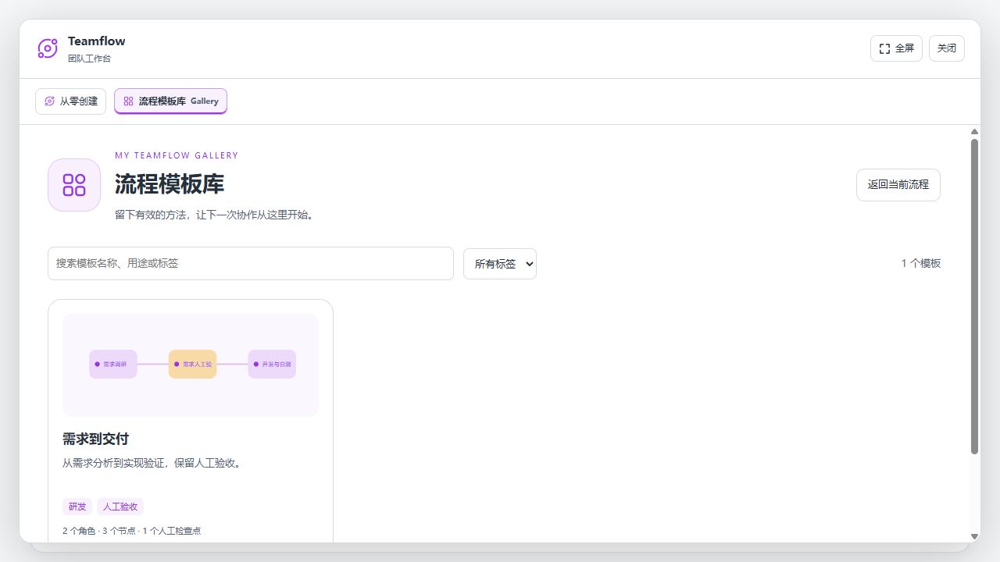
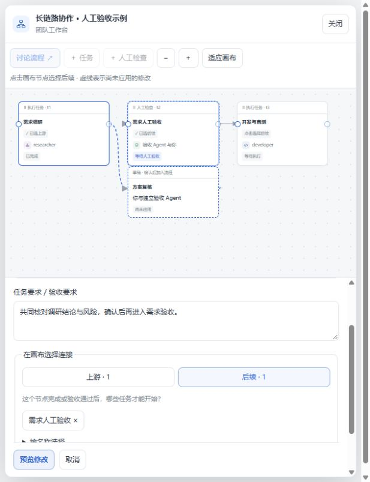

English · [简体中文](./README_ZH.md)

# DSH TeamFlow

**Turn a goal into an editable workflow, with AI agents doing the work and people deciding at key checkpoints.**

TeamFlow is a [DeepSeek Harness](https://github.com/deepseek-ai/deepseek-harness) plugin for work that needs several roles, explicit handoffs, and review. Start from a reusable template or describe a goal, review the proposed tasks, then follow execution on a canvas. Discuss changes, inspect results, and rerun affected work in the same place.

Built on [AgentTeams](https://github.com/NanmiCoder/dsh-agent-teams), TeamFlow now centers on the full workflow: planning, execution, human review, rework, and reuse.

- **Plan before running.** Review responsibilities, task requirements, dependencies, and acceptance criteria before execution.
- **Make handoffs visible.** See who owns each task, what it waits for, and which branches can run in parallel.
- **Keep people in control.** Discuss evidence with AI, then approve or return work at human checkpoints.
- **Reuse a process.** Save a workflow as a template and adapt it to a new goal without carrying over old results or approvals.



*Development UI preview with simulated data; labels and layout may differ by version.*

## Start here

**Continue and rerun**: Start all resumes unfinished, paused, or interrupted work and preserves completed results. Run through a node resumes its required ancestors and pauses later descendants; human checkpoints still require approval. Continuing needs no new input. An explicit rerun requires a reason in the card editor. Reconnection reads current state without replaying mutations. Blockers and recovery explains configuration, dependencies, review, and execution issues with next actions.

This README describes development version **`0.2.11-dev.3`** on `dev`. See the [release notes](./release-notes/v0.2.11-dev.3.md); `main` retains the original non-loop workflow, with general fixes backported separately. The package is `@yogurtss/dsh-teamflow`; install it from this repository or a local build.

| Channel | Git source | Purpose |
| --- | --- | --- |
| Stable | `github:yogurtss/dsh-teamflow#main` | Original non-loop workflow; excludes the development features described here |
| Development | `github:yogurtss/dsh-teamflow#dev` | Upcoming changes under development |
| Classic | `github:yogurtss/dsh-teamflow#classic` | Historical version without Gallery |

This release accepts DSH `0.2.1-rc.5`; the repository's development dependencies remain on `0.2.1-rc.2`. See the [compatibility record](./docs/harness-0.2.1-rc.5/README.md) and [compatibility matrix](./compatibility.json) for exact targets and validation scope. Stable and development releases have separate schedules.

## Your first workflow

### 1. Choose a starting point

**Use a template:** open **Workflow** in the sidebar, browse the Gallery, and enter what you want to accomplish. You can browse before choosing a project. When applying the template, select an existing workspace or use **Add workspace** to choose or create a folder. From a chat, you can also open **Teamflow → Gallery**.

The starter library includes **Feature development**, **Bug investigation and repair**, and **Operator development and optimization**. For work that needs repeated improvement, choose **Iterative operator optimization** (5 rounds) or **Fix and regression loop** (3 rounds): independent AI gates return feedback to the same tasks, and exhausted budgets pause for user action. Setup and delivery remain one-off tasks. Built-in templates are read-only; save a personal copy to customize one.

**Start from a goal:** send a request in a project conversation:

```text
/teamflow Add CSV export to the order list. Review the requirements before implementation, test the result, and leave final acceptance to me.
```

TeamFlow first proposes roles, dependencies, and reusable task requirements, then generates complete tasks for this goal. You review the final proposal once. A template already supplies the structure, so it goes straight to task adaptation.

### 2. Review the plan

Open the canvas and select tasks to check their **requirements, deliverables, and acceptance criteria**. Check each member's role, instructions, model, and thinking level. A member can own more than one task.

Tasks distinguish **general requirements** (the reusable process) from **current requirements** (the complete task for this run). Execution agents receive the current task text, so it must include all applicable constraints—not just additions to the template. Resolve any adaptation issues before starting.

Edit fields directly or discuss a task, member, or the whole workflow with AI. AI proposals show changes for review; you can edit or skip individual operations before applying them. Confirm the plan to start execution.

### 3. Follow execution and review results

Click the conversation's compact status capsule to return to the canvas. Select a node to read its requirements, status, results, and available verification records. **Needs attention** takes you to pending proposals, configuration, reviews, or rerun decisions.

An edge `A → B` means B waits for A. Independent branches can run in parallel when their assigned members are available. Paused or unconfigured tasks do not start; enabling a task does not bypass its prerequisites.

At a human checkpoint, open the evidence and use **Approve** or **Return**. The review discussion helps you inspect results and gaps; the decision is yours. A chat message saying “approved” does not record approval. A returned checkpoint blocks dependent work while unrelated branches can continue.

The **Review workbench** opens from the checkpoint's details, Needs attention, or the chat's review reminder. Inspect requirements, submitted checks, command records, and file digests beside the canvas; expand the panel for more space. Compare saved rounds or discuss the checkpoint with AI. Approval requires confirmation; returning work requires a reason. New decisions retain their evidence snapshot; older records without snapshots are labeled explicitly. Evidence links use exact criterion names, and agent reports are never treated as human approval.

Open **Deliverables** at the top of Workflow to browse submissions, reported checks, and files grouped by source task. Markdown, text/code, CSV, and raster images preview directly from the current workspace; no model is called to collect, organize, or display them. Files come only from declared deliverables and reported changes. Current files are not historical snapshots, and agent reports are not human approval. Use **View source task** or a downstream checkpoint to continue reviewing.

After a return, **Review current results again** starts a fresh review round while retaining the returned decision. To repair the work, select an upstream task under **Arrange rework**, confirm its instructions, and rerun it. Then use **Run through this node** to resume the path to the checkpoint; the current round’s evidence loads when ready, so you can review the new result. Other affected branches stay paused.

**Start all** also confirms pending reruns across the workflow. Enabled nodes run in dependency order, wait at human checkpoints, and continue automatically after approval. **Pause all** stops current work and prevents queued downstream work from starting. Unconfigured nodes, rejected reviews, and failed tasks still need attention.

The compact status capsule shows completed-node progress and an attention count. Pure configuration issues show “Setup needed”; mixed issues show “Attention”. Hover for a breakdown, or click to open Workflow. Running cards breathe gently; reduced-motion settings disable animation.

### 4. Revise and reuse

For a finished, failed, or cancelled task, review the previous result, fill in the required rerun instructions, and choose **Save and rerun task**. Review the affected downstream nodes: they reset and pause for individual confirmation, including renewed human reviews. Earlier results remain in execution history. Stop active affected tasks before rerunning.

Completed workflows remain readable and editable. Archive only when work is complete; **Restore and edit workflow** reopens an archive for review with fresh member sessions and unfinished tasks paused. It does not overwrite an existing live team.

Use **Save as template** to have AI extract reusable requirements, review the draft, and save it to your personal library. Templates retain roles, tasks, dependencies, and checkpoints, but exclude execution sessions, model routes, outputs, and approvals. Saved versions and applied workflows remain independent.

## Working in the canvas



*Development UI preview with simulated data.*

| What you want to do | Where to do it |
| --- | --- |
| Add a task, agent, or checkpoint | Use the canvas toolbar; complete the new node's configuration before execution. |
| Change execution order | Drag connection handles. To insert a review between A and B, replace `A → B` with `A → review → B`. |
| Navigate a larger workflow | Pan, zoom, fit, or arrange by dependencies; expand the inspector when needed. |
| Refine one task | Select its node and open the task discussion. Use the flow discussion for changes across nodes. |
| Change a member's instructions or model | Select the member card; their tasks are highlighted on the canvas. |
| Inspect team activity or older records | Open **Team activity and history** from the canvas. |

Flow, task, member, and review discussions stay inside Workflow. The main conversation remains in the Session list. Discussions retain their history and show streaming replies when the host supports them. **Enter** sends; **Shift+Enter** inserts a line break.

Manual property edits save directly; AI proposals require confirmation. **Save all properties** saves drafts without starting tasks or confirming reruns. Unsaved property and discussion drafts are backed up in the current browser tab; they are not a cross-device backup.

## Installation and updates

### Desktop

Use DSH Desktop's plugin manager to add this repository:

```text
https://github.com/yogurtss/dsh-teamflow
```

The default branch is stable `main`. For the development build, use `github:yogurtss/dsh-teamflow#dev`. Enable the plugin and restart Desktop.

When replacing AgentTeams, first remove `@nanmicoder/dsh-agent-teams` in the same profile. When updating TeamFlow, remove its existing package before adding it again. Stop active work and back up important records first; keep the workspace's `.agent-teams/` directory. Do not enable both plugins together.

Desktop has its own embedded core and profile. Installing into a standalone CLI profile or upgrading the global CLI does not update Desktop.

### CLI / Web

Check `dsh --version`, stop the target Harness process, and replace `web` below with your actual profile. Skip removal for a first installation; when migrating, remove `@nanmicoder/dsh-agent-teams` first.

```sh
dsh plugin --profile web remove @yogurtss/dsh-teamflow
dsh plugin --profile web add github:yogurtss/dsh-teamflow#main
dsh --profile web
```

Use `#dev` instead of `#main` for this development version. Git installs include built artifacts. Restart Harness and refresh the browser after installation or updates.

Verify the installed package:

```sh
dsh plugin --profile web list @yogurtss/dsh-teamflow --depth 0
```

If needed, inspect the target profile's `package.json` to confirm the Git branch or local package source. Pin a full commit SHA for a reproducible installation.

<details>
<summary>Build and install a local package (Windows PowerShell)</summary>

Run in your checkout, replacing the directory with its actual path:

```powershell
cd G:\dsh_agents
pnpm install --frozen-lockfile
pnpm build
pnpm pack --out "$env:TEMP\teamflow-local.tgz"

# Stop the target profile first; skip remove on first installation.
dsh plugin --profile web remove @yogurtss/dsh-teamflow
dsh plugin --profile web add --save-exact "$env:TEMP\teamflow-local.tgz"
dsh --profile web
```

A source ZIP must be extracted and built; it is not an installable plugin tarball. For local development, you can install the built directory with `dsh plugin --profile web add "G:\dsh_agents"`. Keep that directory in place, rebuild after changes, and restart Harness. For tarballs, repack and reinstall; use a new filename if a same-version package is cached.

</details>

## Configuration and storage

Defaults work without extra configuration. Set these options under the `teamflow` plugin's `config` in your DSH configuration:

| Option | Default | Purpose |
| --- | --- | --- |
| `stateDir` | `.agent-teams` | Team records within the workspace |
| `templateDirectory` | `~/.dsh-teamflow/templates` | Personal template library shared across projects |
| `maxMembers` | `8` | Maximum members per team |
| `memberMaxDepth` | `0` | Nested subagents disabled; `1` permits one descendant level |
| `memberProvider` | `spawn` | Subagent runtime backend, not the LLM provider |
| `slashCommand` | `true` | Enable `/teamflow` command activation |

For a configured team profile, use `/teamflow --profile <name> <goal>`. Profiles can supply fixed tasks or let the captain plan tasks for the goal. Model routing, reasoning effort, owner-defined tool policies, and profile examples are covered in the [usage reference](./docs/usage.md).

The old `/agent-teams` command has been removed. Internal `agent_teams_*` tools and `.agent-teams/` records keep their names for continuity. Historical reports retain the original branding.

## Scope and limitations

- **Review is evidence-based, not an independent test run.** Review agents read submitted results and host-computed file digests. Add explicit testing tasks when execution-based verification is required.
- **One captain has one active team.** State is file-backed within one DSH process; avoid editing the same team from multiple processes.
- **Model reports can be incomplete.** If a task's visible status does not match its output, check team status and saved evidence before treating it as complete.
- **Rework can need several decisions.** Downstream nodes and human checkpoints require renewed confirmation; handle rework crossing checkpoints in stages.
- **Compatibility is version-specific.** A declared host target does not imply every feature was tested on every platform. Use the records below; migration of TeamFlow-specific state back to upstream has not been verified.

## Validation and further reading

Recorded validation includes rc5 runtime and browser checks with a deterministic local model, plus an earlier Desktop walkthrough with a real DeepSeek model. The Desktop sample ended with a reviewer requesting revisions; it was not an all-pass content result. These are documented test runs, not a claim that every host/model combination is covered.

| Guide | Contents |
| --- | --- |
| [rc5 compatibility and validation](./docs/harness-0.2.1-rc.5/README.md) | Exact host artifacts, runtime checks, browser coverage, and exclusions |
| [Desktop walkthrough](./docs/desktop-live-test-2026-10-27/README.md) | Real-model creation, review, rejection, rework, and recovery (Chinese) |
| [Usage reference](./docs/usage.md) | Tools, configuration, profiles, state, and runtime details |
| [Verification guide](./docs/verification-guide.md) | Local checks and host validation procedures |
| [Release notes](./release-notes/) | Changes and evidence by version |
| [Contributing](./CONTRIBUTING.md) · [Project skills](./skills/README.md) | Development workflow and vendored maintenance guidance |

For development, run `pnpm install --frozen-lockfile`, `pnpm build`, and `pnpm verify`. Changes go to `dev`; promotion to stable `main` is a separate release decision.

## License

[MIT](./LICENSE). Based on AgentTeams by [NanmiCoder](https://github.com/NanmiCoder/dsh-agent-teams).
