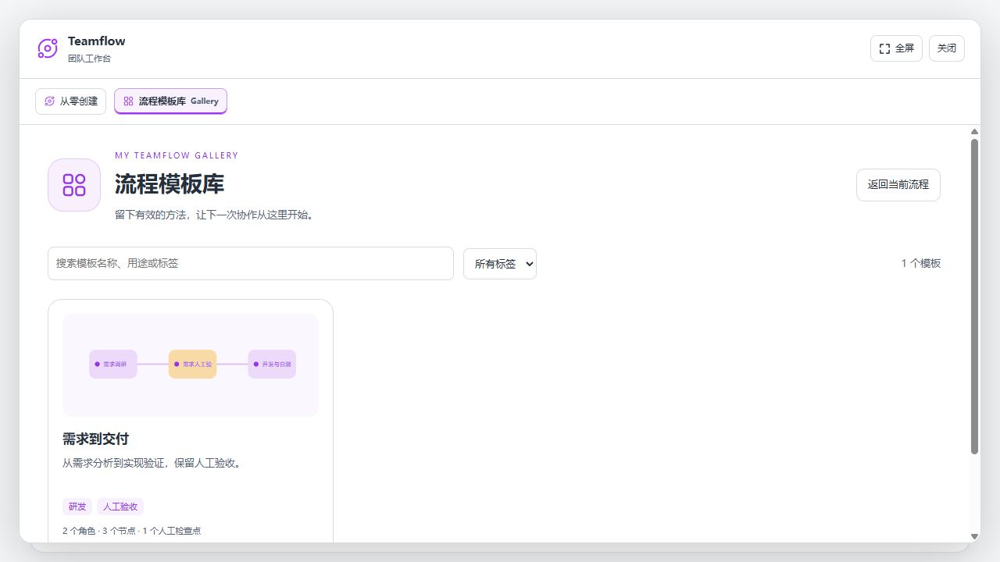
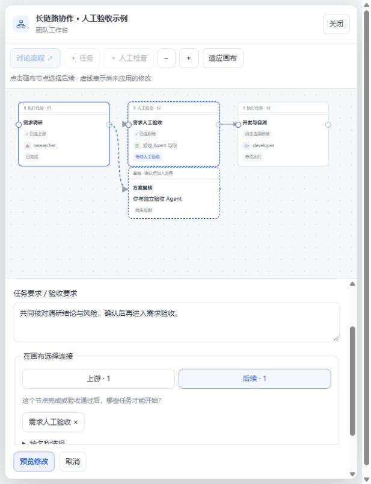
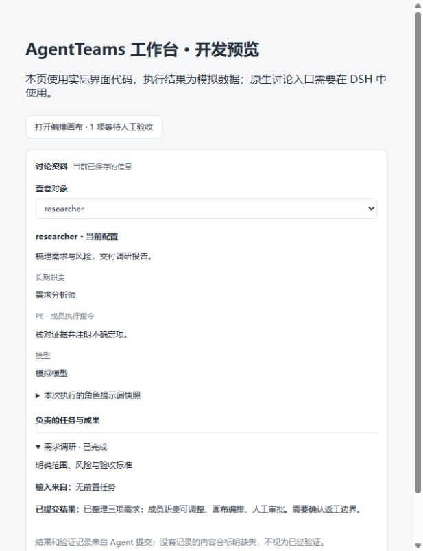

简体中文 · [English](./README.md)

# DSH TeamFlow · 人机协作编排

这是 [yogurtss/dsh-teamflow](https://github.com/yogurtss/dsh-teamflow) 开发分支，基于 [NanmiCoder/dsh-agent-teams](https://github.com/NanmiCoder/dsh-agent-teams) 扩展。让模型先讨论并建立团队，再由你调整成员职责、任务交接和人工验收节点。

**安装本分支请使用本仓库 GitHub 地址或本地构建包。** 新包名为 `@yogurtss/dsh-teamflow`，本次大更新版本为 `0.2.0`；尚未发布到 npm。原版包 `@nanmicoder/dsh-agent-teams` 与本项目不同。

新对话可直接点击 **Teamflow → 流程模板库 Gallery**，不需要输入命令。也可使用 `/teamflow` 开始讨论；仅注册 `/teamflow` 和 `/teamflow-<profile>`，旧 `/agent-teams` 及其 profile 命令已移除。选择预设团队角色也可使用 `/teamflow --profile <名称> <目标>`。为读取原团队记录，`.agent-teams/` 数据目录、内部 `agent_teams_*` 工具和会话事件协议保持不变。历史报告中的旧名称及截图是当时的实测记录。


## 0.2.0 · 个人流程模板库

打开对话即可从 Teamflow 入口进入醒目的卡片式 Gallery，搜索、按标签筛选、查看流程缩略图与通用要求，再填写本次需求并应用。不会先生成一次团队再覆盖。已有流程可通过「保存为模板」让 AI 提炼通用任务，检查后保存；支持编辑、复制、删除及独立版本。

任务采用轻量双层结构：**通用任务**保留方法与质量约束，**本次任务**描述当前项目；每层由任务要求、交付物、验收要求三个文本字段组成。应用模板保留成员、节点、连线和人工检查点，由独立 Captain 配置会话统一生成本次任务，用户确认后才可启动。不适用的节点保留并标记问题，处理后再执行。

模板默认保存在用户主目录的 `.dsh-teamflow/templates`，跨项目复用；可通过 `templateDirectory` 配置。不会保存旧会话、模型路由、执行结果或审批状态。修改实例不会改动模板；保存新版本也不会改变已应用的实例。现有单层任务仍可使用，保存模板时应提炼通用要求。



*真实界面代码的开发预览，使用模拟数据。*

详见 [0.2.0 发布说明](./release-notes/v0.2.0.md)。

## 本分支新增功能

| 功能 | 使用方式 |
| --- | --- |
| 成员 Summary、职责与 PE | 查看功能概述，直接编辑长期职责和执行指令，或通过独立配置对话讨论调整。 |
| 统一任务流程画布 | 先讨论得到初步团队，再手动调整；不区分自动／手动模式，同一个 Agent 可以承担多个任务。 |
| 拖拽连接与插入节点 | 拖动节点本体移动；拖右侧中心连接柄建立关系，点击线查看两端，Delete 删除。点击节点或成员卡片直接编辑属性，列表与画布保持可见。 |
| 原生 DSH 讨论 | 团队、成员及验收讨论在「团队与流程」窗口内进行；底层使用独立 DSH 会话，与队长和执行会话隔离。成员讨论开场列出当前职责、PE 和任务。 |
| 讨论资料 | 侧栏展示职责、PE、已保存的角色提示词快照、任务要求、提交结果与验证记录；缺失信息明确标注。 |
| 人工验收与返工 | 与独立验收 Agent 讨论材料，由你通过或退回；共同决定重跑对象，下游挂起等待手动确认。 |
| 简洁身份头像 | 同身份默认共用头像，沿用原面板的主题与控件风格。 |

连接表示任务交接：A 完成后 B 才能开始。手动在 A 与 B 之间插入人工检查时，添加检查节点，删除原 A → B 连线，再拖线建立 A → 检查 → B；其他连线保持不变。被退回检查点的下游等待，其他分支继续执行。



*实际界面的开发预览截图，使用模拟数据；窄窗口上下排列，宽窗口并排显示。*

<details><summary>查看讨论资料面板</summary>



</details>

## 验证范围

新增流程此前已在隔离的 **Harness `0.2.1-rc.2`** 中通过使用确定性模型数据的运行时检查和完整 `pnpm verify`。2026-10-27 又在本机 **DSH 桌面 `0.2.1-rc.3` + 真实 DeepSeek 模型** 中验证建队、职责修改、插入检查点、退回返工、第二轮通过、下游执行及重启恢复，并修复两处实测问题。当前 24 项流程测试和核心检查通过。

完整步骤和 15 张真实截图见 **[本机 DSH 实测与操作图解](./docs/desktop-live-test-2026-10-27/README.md)**。示例下游审校返回 `needs_revision`，因此流程已验证，示例内容并非全部验收通过；报告说明了未覆盖范围。

另见 **[真实 DSH Web 截图与操作说明](./docs/web-live-test-2026-10-27/README.md)**：已验证 Web 启动、真实模型建队、画布显示与拖拽连线；按用户要求在界面成功显示后停止，未重复完成 Web 验收流程。

[兼容清单](./compatibility.json)和[上游发布说明](./release-notes/v0.1.27.md)保留上游基线信息，不代表本分支新增流程已在所有列出的宿主上逐一验证。请同时核对包名与版本号以确认安装来源。

## 卸载旧版并安装本分支

先结束或暂停正在执行的团队，保存需要保留的插件配置。改名前使用 `@nanmicoder/dsh-agent-teams`，现在使用 `@yogurtss/dsh-teamflow`。应在**同一个 profile** 中卸载旧包再安装新包，不能同时启用两者。卸载插件包不需要删除项目中的 `.agent-teams/` 团队记录。

### 桌面端：推荐从 GitHub 安装

1. 在 DSH 插件管理页卸载旧 AgentTeams（`@nanmicoder/dsh-agent-teams`）；如果已安装 TeamFlow，更新时卸载 TeamFlow（`@yogurtss/dsh-teamflow`）。
2. 打开「添加插件」，粘贴：

~~~text
https://github.com/yogurtss/dsh-teamflow
~~~

3. 安装并启用，重启 DSH 桌面应用。TeamFlow 工作区应出现顶部醒目的「团队与流程」按钮和「讨论资料」。

**桌面端拥有自己的内核和 profile，普通 CLI 的 `--profile web` 不会替换桌面端插件。** 优先使用桌面端自身插件管理页；本地包安装需使用桌面端提供的 CLI carrier，并确认实际 profile，不能套用独立 CLI 的 profile 名称。升级全局 CLI 不会升级桌面内核。

### CLI / Web：从 GitHub 安装

先运行 `dsh --version` 确认宿主。将 `web` 换成实际使用的 profile，停止对应的 Harness 进程。首次安装跳过 remove；从 AgentTeams 迁移时先执行 `dsh plugin --profile web remove @nanmicoder/dsh-agent-teams`，尚未安装 TeamFlow 则跳过下面的新包 remove。

~~~sh
dsh plugin --profile web remove @yogurtss/dsh-teamflow
dsh plugin --profile web add github:yogurtss/dsh-teamflow#main
dsh --profile web
~~~

重启后刷新浏览器。Git 分支包含已构建的 `lib/`，直接安装不需要手动构建，但需要访问 GitHub。

### 从克隆或下载的源码安装（Windows PowerShell）

使用 `git clone https://github.com/yogurtss/dsh-teamflow.git`，或 Code → Download ZIP 后解压。下面以源码位于 `G:\dsh_agents` 为例，请替换成实际路径。需要 Node.js `^22.19.0 || >=24` 和 pnpm。

**方式 A：打包成 tgz，适合稳定使用或复制到其他机器。**

~~~powershell
Set-Location G:\dsh_agents
pnpm install --frozen-lockfile
pnpm build
pnpm pack --out "$env:TEMP\agent-teams-fork.tgz"

# 停止对应 profile 的 DSH；首次安装跳过 remove
dsh plugin --profile web remove @yogurtss/dsh-teamflow
dsh plugin --profile web add --save-exact "$env:TEMP\agent-teams-fork.tgz"
dsh --profile web
~~~

已有构建好的 `.tgz` 时，直接安装它的绝对路径。GitHub 的源码 ZIP 要先解压，不能当作插件 tgz 安装。

**方式 B：链接本地源码目录，适合继续开发。** 完成依赖安装和构建后，停止 DSH，再执行：

~~~powershell
dsh plugin --profile web remove @yogurtss/dsh-teamflow
dsh plugin --profile web add "G:\dsh_agents"
dsh --profile web
~~~

目录安装会保存 `link:` 依赖，不要移动或删除该目录。修改代码后运行 `pnpm build`，重启 Harness 并刷新浏览器；依赖有变化时还需 `pnpm install --frozen-lockfile`。tgz 安装则需重新打包和安装。macOS/Linux 使用相同 DSH 命令，替换为对应的绝对路径。

### 确认来源、更新与卸载

~~~sh
dsh plugin --profile web list @yogurtss/dsh-teamflow --depth 0
~~~

也可查看实际 profile 的 `package.json`：依赖应指向 `github:yogurtss/...`、你的 `file:...tgz` 或 `link:...源码目录`；若仍是 npm 版本号，则不是本分支。界面应有编排画布、讨论资料和人工检查入口。`http://127.0.0.1:8371/` 是开发预览，不代表已安装到 DSH。

更新 Git 安装时，在同一 profile 中重新 remove / add 并重启。需要复现固定版本时，将 `#main` 换为本仓库的完整 commit SHA。同版本、同路径 tgz 若被缓存，可重新打包为不同文件名再安装，并核对来源。

仅卸载：

~~~sh
dsh plugin --profile web remove @yogurtss/dsh-teamflow
~~~

回到上游时，卸载 TeamFlow 后安装 `@nanmicoder/dsh-agent-teams` 并重启。先备份团队状态；人工检查和原生讨论状态未验证过向上游降级，不要用上游版继续执行这些团队。

新版画布交互及截图见 [直接编辑与独立讨论](./docs/direct-canvas-2026-10-27/README.md)。

画布采用左侧「任务 / Agent」分类列表、中央流程和右侧属性面板。顶部可创建任务节点、人工节点或 Agent；任务与人工节点立即以默认名称保存，不填写内容也能直接连线，切换对象或刷新不会删除节点。右侧可拖动边界调宽、放大或收起，工作台支持全屏。画布支持平移、10%–200% 缩放、适应画布和自动整理；详见[新版布局与验证](./docs/canvas-layout-2026-10-28/README.md)。

## 使用流程与边界

提出目标 → 讨论初步团队 → 查看成员和任务 → 调整画布 → 确认启动 → 在人工检查处讨论并验收。

手动拖线、删除和属性保存直接生效；AI 修改提案仍由用户确认后生效。运行中新增的任务和人工节点统一待启动（手动编辑与 AI 提案一致），完成配置和连线后可单独开始，也可在活动页或画布顶部「开始全部」。等待上游的节点显示「等待上游／取消排队」，只有已领取或执行中的任务显示「暂停」。画布卡片可直接控制，两个页面均提供「暂停全部」；已停止的执行再次开始时会重新执行。已完成任务可在成员设置中单独重跑，相关下游挂起等待你确认。独立配置和验收 Agent 只能读取上下文、提交提案，不能执行任务或代替用户批准。验收使用 Agent 提交结果及宿主读取的文件摘要，不等于独立重跑测试；角色提示词快照也不等于完整模型请求。跨越其他人工检查的返工需分段处理。

完整状态表、流转图、新增节点、人工退回、返工与批量控制边界见 [任务状态与控制规则](./docs/task-lifecycle-2026-10-29/README.md)。

原活动面板、Slash 命令和配置方式继续保留，下面是这些基础能力的说明。

## 小圆点与活动面板

在 TeamFlow 活动面板或团队页面顶部点击 **「团队与流程」**，即可打开编排工作台；没有团队时可讨论创建，已完成或已归档的团队也打开完整画布，可查看节点要求、提交成果、验证和验收历史。按钮显示待确认修改及待人工验收数量。

人工节点必须打开材料并点击「通过验收」或「退回」，主对话中的“验收通过”文字目前不直接写入审批状态。活动页会显示「等待人工验收」，不再把人工节点称为「待领取／待开工」。正式通过后，主页面进度同步更新；流程保持可编辑，队长不应自动归档，未完成的流程会被归档工具拦住。

若旧版本已把未验收的团队归档，在原队长对话打开历史「团队与流程」，在画布顶部点击 **「恢复并编辑流程」**，全程留在当前画布。原归档保留，已完成结果不重跑，成员以新的空闲会话重新准备；未完成执行任务暂停。确认成员配置后启动，再打开人工节点完成正式验收。同一对话已有可编辑团队时不会覆盖它。[恢复操作截图](./docs/approval-recovery-2026-10-27/README.md)。

画布顶部提供 **「编辑流程／查看流程」** 切换。查看时点击节点即可检查任务要求、上游输入、提交成果与验证记录；执行中也能查看，先停止对应任务再修改。已完成执行节点可直接编辑名称、要求和执行成员，点击 **「保存并重跑此任务」**；保存前会列出受影响下游，下游挂起等待逐个确认，无关分支不变。成员卡片仍可调整职责、PE、模型与 Thinking。[完成后编辑与重跑截图](./docs/completed-canvas-2026-10-27/README.md)。

入口位置及真实组件截图见 [活动小圆点与紧凑面板恢复](./docs/activity-panel-restored-2026-10-28/README.md)。

点击当前聊天右侧的 **活动小圆点**，打开紧凑的 **TeamFlow 活动** 面板；回复下方团队卡片的 **活动面板** 按钮也打开同一面板，包括历史团队。支持原生工作区标签页的宿主同样保留这一入口。

面板展示成员分工、任务依赖和执行进度，支持浮动、贴边、调整大小和收起为小圆点。收起不会停止团队。普通团队页面不默认展开「查看对象」讨论资料，独立讨论中仍可查看相关上下文。人工审核标识、运行中动画、任务 AI 讨论以及修改并重跑功能继续保留。

任务依赖中选中节点后，使用 **▶ 开始／Ⅱ 暂停** 按钮控制执行；运行中保留节点动画，暂停按钮显示呼吸效果。开始后仍等待前置完成。已完成、已失败或已取消的普通任务显示 **▶ 重新运行**，点击后确认任务要求，再保存并重跑；原记录保留，下游挂起待确认。[交互截图](./docs/task-playback-2026-10-28/README.md)。

暂停／停止执行完成后，可进入画布编辑或删除该任务。若旧状态只有暂停标记、执行状态仍未收尾，再次停止会完成收尾，不再误报成功。[停止后删除验证](./docs/stopped-task-delete-2026-10-28/README.md)。

活动面板与画布统一状态层级：普通等待用中性色，执行与选中用蓝色，待人工验收用橙色，完成用柔和绿色标记，失败用红色。选中节点时其他分支保留可读性。任务详情优先显示状态和操作，负责人／模型合并一行，依赖说明可展开。[浅色与深色效果](./docs/visual-polish-2026-10-28/README.md)。

任务、Agent、人工审核及属性、讨论、画布工具使用统一线性图标，并保留文字标签；成员头像和运行小动画沿用现有样式。[图标效果](./docs/interface-icons-2026-10-28/README.md)。

新建节点先显示「待配置」，完成配置后显示「待启动」，主动暂停后才显示暂停状态。画布选中任务时，直接输入和输出连线照常显示，其他连线淡化；单独选择连线时才高亮，连线仍可点击和键盘选择。[状态与连线效果](./docs/task-start-and-edges-2026-10-28/README.md)。

鼠标位于画布内时，直接向上滚动放大、向下滚动缩小，以鼠标位置为中心，无需按 Ctrl／⌘；拖动空白处平移，点击工具栏比例可恢复 100%。两侧面板保持正常滚动。[滚轮缩放验证](./docs/canvas-wheel-zoom-2026-10-28/README.md)。

节点连接入口使用小圆点，鼠标靠近节点或键盘聚焦时显示；拖拽连线时目标连接点也会显示。查看流程时，从空白处或节点上拖动均可平移画布，单击节点仍查看详情；编辑流程时保留拖动节点调整位置。[连接点与查看模式平移](./docs/connection-dots-pan-2026-10-28/README.md)。

圆点、连线端点与拖拽吸附共用连接坐标，并补偿普通／人工节点边框及缩放取整差异。[端点对齐验证](./docs/port-alignment-2026-10-28/README.md)。

## 工作方式

1. 当前会话创建团队并成为队长。
2. 队长按角色添加由可续聊子 Agent 驱动的成员。
3. 目标被拆成有负责人和显式依赖的任务。
4. 共享调度器依据真实 `running / idle / ready` 状态，为每个空闲成员原子领取一项就绪任务并唤醒它；驻留成员被中断时会停驻当前 attempt，可通过直接消息继续而不丢 capability；只有冷进程重启后的遗留任务才会生成新 attempt 恢复。
5. 成员携带当前 `attempt_id` 更新任务；转派或队长接管会先撤销旧 attempt、等待原成员安静，再启动新 attempt。
6. 队长汇总结果，随后归档完整团队记录。

团队状态保存在 `<workspace>/.agent-teams/`；Web 面板读取这份磁盘真相，并与实时子 Agent 活动合并展示。

成员创建默认零交互：成员沿用队长当前 LLM 路由时会快照该 provider、model 与思考强度；用户要求改用其他路由时，则快照目标模型的默认强度，成员后续续跑仍使用最终解析出的快照。只有当用户明确提出异构分工（例如“后端用 provider A/model X，前端用 provider B/model Y”）时，队长才会把对应的 `provider` + `model` 传给该成员；不会逐个弹出模型或思考强度选择。

## Slash 命令

无需再说“用 TeamFlow”。插件注册了封闭命名空间的 `/teamflow` 宿主命令，Web GUI 的 slash 菜单会显示 `teamflow` 占位项与输入提示：选中它（或直接输入命令）、描述目标、回车即可。

```
/teamflow 调研三家竞品的定价页
```

这一行被命令管线认领后，会按用户提交的原文作为普通用户消息送入主会话，因此聊天记录中仍能看到完整的 `/teamflow …`。手势边界会在 pre-step 注入确定性激活指令，队长协议仍会立即启动。调用也会持久化记录（`command/run` / `command/done`）。

没有命令裁决的表面（例如 headless CLI）也享有同等的确定性激活：任何以 `/teamflow` 开头的真实用户消息，都会为其余文本激活该协议；句子中间出现的字样仍是普通文本。

## 配置

默认配置可以直接使用。受信任的 Profile 可以覆盖成员行为：

```yaml
- id: teamflow
  config:
    stateDir: .agent-teams
    memberProvider: spawn
    memberModel: deepseek-v4
    memberMaxDepth: 0
    maxMembers: 8
    toolPolicies:
      researcher:
        allow: [read, glob, grep]
      implementer:
        deny: [web_search]
```

`memberMaxDepth` 默认 `0`，团队成员不能再创建子代理；显式设为 `1` 可允许一层后代，运行时和代码工具调用同样受限。默认成员统一通过团队消息汇报，避免再走宿主消息重复通知队长。无任务成员不调用模型；任务分配开启独立轮次，纠正消息进入最近的模型步骤。消息投递与读取分别记录；移除和归档必须等成员分支及待处理输入清理完成后才报告成功。

`toolPolicies` 是部署方配置：按 id 复用的成员工具策略。成员只能“按 id 选择”——`agent_teams_add_member` 的 `tool_policy`、内联 `plan` 的成员行，或 profile 成员行的 `tool_policy`。队长模型只能选择已声明的策略，不能提交原始 allow/deny 列表，也不能在运行时新建策略。

- `deny` 让指定全局工具从该成员的 schema 中消失，并拒绝其调用。
- `allow` 只保留列出的全局工具；四个协调工具（`agent_teams_claim_task`、`agent_teams_update_task`、`agent_teams_send_message`、`agent_teams_status`）始终会被加入 allow 列表。
- 队长专属工具始终被拒绝，策略无法重新打开；策略也不允许拒绝必须保留的协调工具。
- 未知 id、空策略、空列表会在挂载时或写入成员前直接失败。
- `agent_teams_status` 会显示每个成员选择的策略 id；完整生效过滤器保存在 `team.json` 供审计，重启后由子会话的持久 descriptor 重新应用。
- 未配置策略的团队与成员保持原有工具集和记录结构；`agent_teams_edit_plan` 传空 `tool_policy` 可清除暂存成员的策略。

这是全局工具的模型可见性与调用限制，不是 OS 沙箱，也不是授权边界。

普通调研、仓库审计可用 `agent_teams_create({name, description, approval:"required", plan:{members:[{name:"researcher"}], tasks:[{id:"audit", subject:"审计现有实现", assignee:"researcher"}]}})` 一次创建完整草案。任务的 `dependencies` 引用同一批中的 `id`，支持前向引用并校验环；结果返回实际任务 ID。`kind=review` 专用于对既有 implementation/repair 任务的质量复审，普通仓库审计使用默认的 `kind=work`。

这里的 `memberProvider` 指子 Agent 的运行后端（`spawn` / `fork`），不是 LLM provider。跨 LLM provider 由 `agent_teams_add_member` 的可选 `provider` + `model` 参数表达；`memberModel` 只是所有成员的模型默认覆盖。成员沿用队长当前 provider/model 时会继承队长的思考强度；provider 或 model 任一改变时会自动使用目标模型的默认档。需要指定特定强度时，可传入可选的 `reasoning_effort` 参数（目标模型支持的档位 id，或 `"default"` 表示强制使用模型自身默认档）。

`slashCommand: false` 可关闭确定性的 `/teamflow` 激活面（slash 命令与手势边界），仅保留自然语言触发。

## 使用边界

- 一个队长同一时间只能带一个活动团队。
- 没有开放任务的空闲成员会自动续领就绪任务；仍持有开放 attempt 的空闲成员会停驻，队长可发消息让其沿用原 attempt 继续，或显式转派；冷重启遗留的开放任务才会生成新 attempt。暂时无法实时投递的消息会持久保存在邮箱中并在后续状态边界重投。
- 状态使用文件持久化，并在单个 DSH 进程内串行操作；多个进程同时修改同一团队不保证一致。
- 历史面板依赖保存的团队状态或归档；早期版本删除团队时未保留归档的会话，暂不支持从日志重建完整面板。
- 活动面板如实展示持久化状态；模型偶尔可能完成工作却没有按协议更新任务状态。

完整工具列表、状态模型、Web UI 行为、配置与已知限制见 [docs/usage.md](./docs/usage.md)。

## 插件开发 Skill

仓库已引入社区升级、审计、测试和发布 skills，来源与本项目规则见 [skills/README.md](./skills/README.md)，贡献入口见 [CONTRIBUTING.md](./CONTRIBUTING.md)。

另提供开放 Agent Skills 包 [`dsh-plugin-development`](./skills/dsh-plugin-development/SKILL.md)：

```sh
npx skills add yogurtss/dsh-teamflow --skill dsh-plugin-development
```

## 文档

| 指南 | 内容 |
| --- | --- |
| [使用指南](./docs/usage.md) | 架构、UI 行为、工具、配置、限制与验证 |
| [验证指南](./docs/verification-guide.md) | 离线、组合、真实 e2e 与 GUI 验证 |
| [插件开发](./docs/developing-dsh-plugins.md) | 基于本插件整理的人类可读开发指南 |
| [README 写作](./docs/readme-writing-guide.md) | 仓库文档约定 |

## 开发

```sh
pnpm install
pnpm build
pnpm verify
```

## 命名多角色团队配置

在 `cordis.patch.yml` 的 `profiles` 中配置完整团队模板。每个 profile 都提供成员阵容，可独立指定 provider、model、role、reasoning_effort。`taskPlanning: captain` 表示只提供阵容和约束，由 Captain 根据用户目标设计 DAG；省略该字段或设为 `seed` 时，展开模板中的固定任务图。使用 `/teamflow --profile <名称> <目标>` 显式激活；不会把首个普通 token 隐式识别为 profile。

普通 `/teamflow` 流程继续已有团队，按需调用 `agent_teams_status` 确认状态；仅在没有当前团队时调用 `agent_teams_create({ profile, approval: "required" })`：只落盘可编辑的成员占位和 DAG，不创建子会话、不领取任务。成员模型和推理等级直接读取 Harness 的模型目录。「返回对话修改」会终止仍在运行的规划轮次，让队长先追问修改方向，再用一次原子操作更新同一份草案；「放弃本次计划」经二次确认后会归档草案、中止轮次，并向模型注入不得自动重建团队的控制上下文。只有点击「确认并启动团队」才会提交最终配置并调度就绪任务；成员有就绪任务时才创建会话。运行中团队的停止入口位于该团队的面板标题，点击后需要二次确认，不再占用输入区域。直接工具调用方可显式传 `approval: "automatic"` 保留旧的立即执行路径。审查或测试失败不会解锁下游；自动 repair/review 不依赖 failed review。

## 许可证

[MIT](./LICENSE)

人工验收使用独立边框；上游完成后，团队面板和队长聊天标题区显示「等待你验收」提示，点击直接打开独立验收对话。开场先列检查要求和上游结果，验收 Agent 再整理总结、证据缺口和检查清单，由你决定通过或返工。参见[操作说明与界面截图](docs/human-review-2026-10-27/README.md)。

成员模型和 Thinking 可在「团队与流程」中点击成员卡片后设置并保存；团队待启动时，TeamFlow 活动页提供「确认并启动团队」。[查看界面与说明](docs/model-start-2026-10-27/README.md)。

点击活动页成员可快捷设置模型、Thinking 和职责；在工作台点击成员时，右侧优先显示模型设置并高亮画布中该成员负责的任务。[查看示例](docs/member-selection-2026-10-27/README.md)。

讨论成员职责时，在「团队与流程」窗口内直接对话、预览并确认或放弃提案；画布始终留在同一窗口。支持工作区归属的宿主会把新讨论归到队长所在的项目（无法确定或宿主不支持时保持原有归属）。

审批支持前后对照及逐行差异（= 相同、+ 新增、− 删除）。可直接修改「之后」的内容、跳过某项，再确认应用最终版本。[查看操作截图](docs/editable-approval-2026-10-27/README.md)。

同一成员重复点击「讨论调整」默认继续已有独立会话，保留上下文与待确认提案，不会重复触发模型生成。需要清空上下文时，在「重新开始讨论」中选择「新建独立讨论」；旧讨论保留归档。

成员和节点的选择统一管理：左侧卡片固定打开成员配置，画布节点打开任务或人工验收属性；只同步关联高亮。保存、拖动等请求处理中仍可切换对象，晚返回的请求不会把面板切回旧对象。属性和讨论草稿在当前浏览器标签页中备份，切换对象或刷新后可恢复；Esc 退出编辑并保留草稿，「放弃修改」清除当前属性草稿。保存或发送期间的新输入也会保留。

顶部保存状态栏列出未保存对象，并支持「保存全部属性」，不会触发执行或重跑。新建画布任务和人工节点先标记为「待配置」，填写名称、要求并单独完成配置后才能执行或验收；运行中的团队还需明确确认执行／验收。节点属性顶部展示等待上游、手动暂停、缺少执行成员等原因，并提供上游节点定位按钮。[查看易用性改进与验证](./docs/workbench-usability-2026-10-28/README.md)。

普通任务属性中也可点击「与 AI 讨论任务」，待配置、运行中及已结束的任务均可讨论。每个任务保留独立讨论记录，自动带入已保存的要求、负责人、直接上下游和提交结果；未保存属性草稿继续保留在本地。AI 可提出当前任务的修改或重跑建议，由你确认后生效；跨节点拆分可通过「讨论整体流程与拆分」入口处理。[查看任务讨论与验证](./docs/task-discussion-2026-10-28/README.md)。

活动页（含紧凑浮窗）与团队画布的每个任务节点直接显示状态文字、图标和颜色边框，无需点击即可区分待配置、待启动、等待上游、等待调度、准备执行、进行中、停止中、暂停、人工验收和结束状态。节点开始、取消排队、暂停与审核操作遵循同一套规则；启用下游仍需等待全部前置完成，不启动前置、不绕过人工审批。已完成、已取消和失败的普通任务点击「修改并重跑」进入任务编辑，查看上一轮结果并填写必填的本次新增要求，再保存重跑。[查看状态显示与重跑验证](./docs/task-status-rerun-2026-10-30/README.md)。

流程结束或停在人工检查时，点击成员卡片，在右侧调整职责、PE、模型或 Thinking，在「单独重跑」中选择一个已结束任务，点击「保存成员并编辑重跑要求」，继续进入任务编辑。活动面板的成员快捷设置也提供此入口。Agent 将同时收到当前任务要求、上一轮提交结果和本次新增要求。任务 ID、连线不变，原有状态和提交结果保存在「历史执行记录」中，新一轮结果单独重新生成；原有验证证据不再作为本轮有效证据。所有直接和间接下游（包括已完成任务和人工检查）重置并挂起，无关分支保持不变。工作台顶部会列出待确认节点；上游完成后，点击节点，可修改要求，再「保存并确认执行」或「保存并确认重新验收」。下游不会自动恢复，旧审批不能沿用。受影响的运行任务须先停止。

[查看覆盖重跑与下游确认的操作截图](./docs/rerun-2026-10-27/README.md)。
