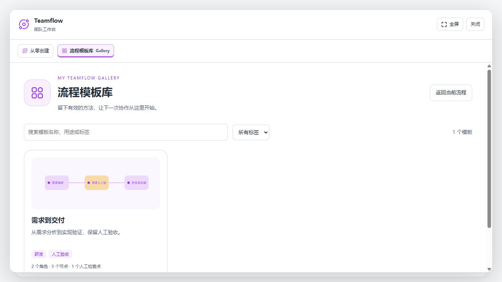
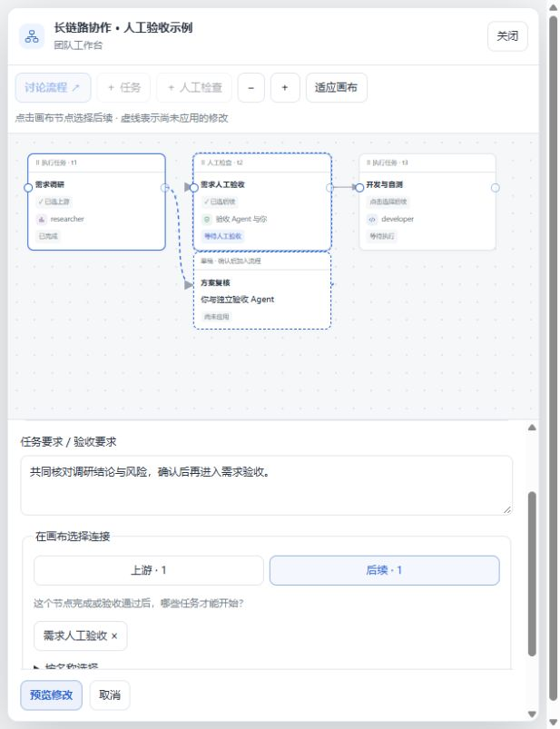

简体中文 · [English](./README.md)

# DSH TeamFlow

**把目标变成可编辑的工作流，让 AI 分工执行，由人在关键节点把关。**

TeamFlow 是 [DeepSeek Harness](https://github.com/deepseek-ai/deepseek-harness) 的工作流插件，适合需要多角色协作、明确交接和阶段验收的任务。你可以从模板开始，也可以直接描述目标；审阅任务后启动执行，在同一张画布里查看进度、讨论修改、验收结果和安排重跑。

项目基于 [AgentTeams](https://github.com/NanmiCoder/dsh-agent-teams) 演进，现在围绕完整的工作流程组织协作：规划、执行、人工验收、返工与复用。

- **先审阅，再执行。** 启动前确认成员职责、任务要求、依赖关系和验收标准。
- **交接看得见。** 每个任务由谁负责、等待什么、哪些分支可以并行，都在画布上呈现。
- **关键决定由人做。** 与 AI 讨论证据，在人工检查点明确通过或退回。
- **好流程可以复用。** 保存为模板，适配新目标，不带入旧结果和审批状态。



*使用模拟数据的开发界面预览；不同版本的文字和布局可能有所变化。*

## 先选版本

**继续与重跑**：开始全部会恢复未完成、暂停或中断的任务，保留已完成结果。选择“运行到此节点”会恢复必要上游，并暂停目标之后的节点；人工验收仍需确认。模型中断时继续无需填写信息，修改并重跑则需在卡片中填写理由。连接恢复后先读取最新状态，界面不会自动重发操作。阻塞与恢复面板会说明配置、依赖、验收或执行会话的问题，并提供处理入口。

本页介绍 `dev` 上的循环测试开发版 **`0.2.11-dev.3`**，详见[发布说明](./release-notes/v0.2.11-dev.3.md)。`main` 保持原流程式稳定版本，通用 bug 修复单独移植。包名为 `@yogurtss/dsh-teamflow`，请通过本仓库或本地构建包安装。

第一次打开工作台，可以点击顶部「使用指南」。每一步会高亮当前界面的一个控件，点击「Got it」继续，也可按 Esc 退出。

在开发版画布上点击菱形门控，展开「配置 IF 路径与审核」。启动前可以选择 PASS 的下游任务、REJECT 的上游入口、审核方式和轮次上限（含首轮）。通过即离开循环；退回时可固定从入口重跑，也可由审核者指定返工任务。暂停后可更换审核者和调整剩余轮次。运行视图默认收起循环任务，点击「展开循环任务」可查看内部步骤。

选择返回入口时，面板会预检路径，并在不可选的审核人旁显示其负责的循环任务。人工审核时，打开本轮材料可对照上轮与本轮结果。面板优先展开本轮重跑、验收变化和失败记录，并标出沿用结果的执行轮次。归档任务中断后重试时，会清理该次尝试未发布的文件，保留先前已发布的归档。


| 版本 | Git 安装源 | 适用场景 |
| --- | --- | --- |
| 稳定版 | `github:yogurtss/dsh-teamflow#main` | 原流程式稳定版本，不包含 dev 循环测试功能 |
| 开发版 | `github:yogurtss/dsh-teamflow#dev` | 下一轮迭代中的功能与修复 |
| 经典版 | `github:yogurtss/dsh-teamflow#classic` | 不含 Gallery 的历史版本 |

本版接受 DSH `0.2.1-rc.5`，仓库开发依赖仍使用 `0.2.1-rc.2`。精确版本与验证范围见[兼容记录](./docs/harness-0.2.1-rc.5/README.md)和[兼容矩阵](./compatibility.json)。稳定版与开发版分别发布。

## 跑通第一个工作流

### 1. 从模板或目标开始

**使用模板：** 打开左侧 **Workflow**，浏览流程模板库 Gallery，填写本次需求。浏览时不必先选项目；应用时选择已有工作区，或通过「添加工作区」选择、新建文件夹。在对话里也可以通过 **Teamflow → 流程模板库 Gallery** 进入。

内置模板包括**功能开发**、**问题排查与修复**、**算子开发与优化**。内置模板只读，需要调整时保存为个人副本。

**从目标开始：** 在项目对话里发送：

```text
/teamflow 给订单列表增加 CSV 导出。先确认需求再实现，完成后测试，最终由我验收。
```

TeamFlow 先规划成员、依赖和通用任务要求，再生成适用于本次目标的完整任务，最后由你统一审阅确认。套用模板时直接适配本次任务，不重复生成流程结构。

### 2. 审阅方案，再启动

进入画布，逐个查看任务的**要求、交付物和验收条件**，确认成员的职责、执行指令、模型和思考等级。同一个成员可以负责多个任务。

任务分为**通用要求**与**本次要求**：前者描述可复用的方法，后者是这次执行的完整任务书。执行 Agent 只接收本次任务文本，因此它必须包含适用的全部约束，不能只写相对模板的补充说明。适配中发现的问题需要先处理，再启动。

你可以直接编辑，也可以与 AI 讨论某个任务、成员或整个流程。AI 提案会展示改动，支持修改字段、跳过单项操作后再应用。确认最终方案后，才开始执行。

### 3. 跟进执行，在检查点验收

点击对话右侧的状态胶囊即可回到流程画布。选择节点查看要求、状态、结果和已有验证记录；「待处理」入口可以定位尚未确认的提案、节点配置、人工验收和重跑决定。

连线 `A → B` 表示 B 等待 A 完成。没有依赖关系的分支，在负责成员可用时可以并行执行。暂停或未配置完成的任务不会启动；启用下游任务也不会绕过前置条件。

到达人工检查点后，打开证据，点击**通过验收**或**退回**。验收讨论帮助你检查结果和缺口，最终决定由你做；在聊天中说“通过”不会写入审批。退回会阻止依赖该检查点的任务继续，不影响无关分支。

在开发版工作台中，循环门控和验收节点都可以在画布卡片或右侧面板切换人工／AI 审核。循环门控有输入、PASS 下游和 REJECT 上游返回三个端口。先连接上游，再从底部 REJECT 拖回上游任务并保存环路配置。AI 门控需要指定独立审核成员。循环默认展开，可在画布工具栏收起。验收节点只接输入和输出，选择 AI 后由该节点的独立验收 Agent 检查本轮材料并提交决定。

从检查点详情、顶部「待处理」或对话中的验收提醒进入**验收工作台**，在画布旁查看要求、提交条目、命令记录和文件摘要，也可以放大面板、比较历史轮次或与 AI 讨论。通过前需再次确认，退回时需填写原因。新审批会保存当时的证据快照；旧记录没有快照时会明确标注。证据仅按同名验收条目关联，Agent 报告通过不等于人工验收通过。

在 Workflow 顶部点击 **交付内容**，按来源任务查看提交说明、验证记录和文件。Markdown、文本/代码、CSV 和常见位图直接读取当前工作区预览，收集、整理和展示均不调用模型。文件只来自任务声明的交付物和报告的变更；当前文件不代表历史版本，Agent 报告通过也不代表人工验收。通过「查看原任务」或下游检查点继续核对。

退回后，可点击 **重新验收当前结果**，保留退回记录并开启新一轮验收；需要修复时，在 **安排返工** 中选择上游任务、确认要求并重跑。随后点击 **运行到此节点**，恢复到本检查点的执行路径，本轮材料就绪后自动加载，再重新验收；其他受影响分支保持暂停。

**开始全部** 同时确认全流程中待重跑的节点。已启用节点按依赖执行，遇到人工检查点等待，通过后自动继续，无需逐个启动下游。**暂停全部** 停止当前执行并阻止后续排队任务启动；未配置节点、已退回的验收和失败任务仍需单独处理。

状态胶囊显示已完成节点的百分比和待处理数量，悬停查看明细，点击打开工作台。运行卡片以轻微明暗呼吸提示执行状态；系统设置减少动态效果时关闭动画。

### 4. 修改重跑，沉淀模板

对已完成、失败或取消的任务，先查看上一轮结果，填写必填的本次重跑要求，再选择「保存并重跑此任务」。提交前检查受影响的下游节点：它们会重置并暂停，等待逐项确认，人工检查点也需要重新验收。历史结果保留在执行记录中；受影响的任务如果仍在运行，需要先停止。

完成后的流程仍可查看和编辑。全部工作完成后再归档；「恢复并编辑流程」会保留归档记录，准备新的成员会话，并让未完成任务保持暂停，审阅后再启动。恢复不会覆盖已有的活动团队。

通过「保存为模板」让 AI 提炼通用要求，检查草稿后存入个人模板库。模板保留角色、任务、依赖和人工检查点，不保存旧执行会话、模型路由、结果或审批。模板版本与已应用的流程相互独立。

### Super Agent（开发版）

从 Harness Web 侧栏打开 **Super Agent**，选择工作区，在「监听设置」中逐条选择 Workflow。初始订阅为空。每条流程可分别选择人工验收、待确认提案和需要人工处置的阻塞。侧栏显示当前工作区的待办数量，新待办在 Web 界面提示。点击待办可进入对应节点或提案，处理后可返回提醒。原工作台顶部也能进入 Super Agent，再返回继续编辑。

整条流程完成时默认退订。开启「整个流程完成后继续监听」可保留订阅，手动取消会停止提醒。工作区主对话使用宿主模型，按需读取已订阅流程的当前待办；流程审批和修改在原工作台操作。

## 动手试试：两个开发版示例

使用 `dev` 开发版，在空白工作区尝试下面任一任务。第一个需要 GPU，第二个只需 Python 3。

### 1. 开发并验证 Triton Softmax 算子

准备一台已能运行 PyTorch 和 Triton 的 GPU 机器。在流程模板库选择 **算子持续优化循环**，把下面这段粘贴到本次需求：

> 用 Triton 实现二维 FP32 张量沿最后一维的 Softmax，以 `torch.softmax(x, dim=-1)` 为参考。固定随机种子，测试 4096 行、列数分别为 1024 和 1025 的输入，以及一组带有 1000 和 −1000 的输入。由独立验证成员检查所有输出均有限，并用 `rtol=1e-4, atol=1e-6` 逐元素比对。两种实现使用同一 GPU、精度和输入，预热后同步计时，报告两个形状各自的耗时中位数。首次启动前确认性能目标；例如要求 1024 列时的中位耗时不高于参考实现。最多运行 3 轮，交付实现、测试和可复跑的基准命令。

**怎么验收？** 打开门控的验证记录，单独看 1025 列的末列是否与参考值一致；它能检验最后一个不完整分块的边界处理。正确性和约定的性能目标都达标才放行。若退回，查看审核意见是否指明失败的形状、误差或耗时，方便下一轮复验。

### 2. 把训练日志汇总成可复现的模型对比报告

从空白流程开始，把下面的任务和样例一起发给团队：

> 先按表格在 `logs/` 下生成 7 个 JSON 日志文件，每行一个文件，字段为 model、seed、epoch、accuracy。开发一个只依赖 Python 标准库的命令行工具，让我能运行 `python report.py logs` 得到 Markdown 报告。同一模型和种子的续跑属于同一次实验，以最大 epoch 的记录为最终结果。报告列出各次实验的最终 accuracy、每个共同种子的 B−A 差值和平均差值。请另一名成员用样例独立核对，并把核对写成回归测试。

| model | seed | epoch | accuracy |
|---|---:|---:|---:|
| A | 1 | 10 | 0.80 |
| A | 2 | 10 | 0.82 |
| A | 3 | 10 | 0.84 |
| B | 1 | 10 | 0.83 |
| B | 2 | 4 | 0.70 |
| B | 2 | 10 | 0.84 |
| B | 3 | 10 | 0.85 |

**怎么验收？** 亲自运行命令：7 个文件应汇总为 **6 次实验、3 对种子**。模型 B 的种子 2 应取 0.84；三个配对差值分别是 +0.03、+0.02、+0.01，平均提升 **2 个百分点**。

## 在画布里协作



*使用模拟数据的开发界面预览。*

| 想做什么 | 如何操作 |
| --- | --- |
| 增加任务、Agent 或人工检查点 | 使用画布顶部工具栏；新节点需完成配置后才能执行。 |
| 调整执行顺序 | 拖动连接点连线。要在 A、B 之间增加验收，将 `A → B` 替换为 `A → 验收 → B`。 |
| 浏览较大的流程 | 平移、缩放、适应画布或按依赖整理；需要时展开详情面板。 |
| 细化某个任务 | 选中节点后进入任务讨论；跨节点调整使用流程讨论。 |
| 修改成员指令或模型 | 选择成员卡片；画布会高亮该成员负责的任务。 |
| 查看团队活动或历史记录 | 从画布进入「团队活动与历史」。 |

流程、任务、成员和验收讨论都留在 Workflow 内，主对话保留在 Session 列表。讨论保留历史，宿主支持时显示实时回复。**Enter 发送，Shift+Enter 换行。**

手动属性修改可以直接保存，AI 提案需要确认。「保存全部属性」只保存草稿，不会启动任务或确认重跑。未保存的属性和讨论草稿会在当前浏览器标签页备份，但不能作为跨设备备份。

### 成员的 Gallery 访问

在成员属性中分别开启「允许使用 Gallery Skill」或「允许使用 Gallery MCP」。成员从 Gallery 当前可用的资源中自行选择，工具权限仍受原有成员策略约束。新建成员默认关闭。旧模板未保存开关时沿用原有权限。显式开关需要同一 DSH 进程加载支持成员访问接口的 Gallery。

## 安装与更新

### Desktop

在 DSH Desktop 插件管理器中添加仓库地址：

```text
https://github.com/yogurtss/dsh-teamflow
```

默认分支是稳定版 `main`。体验开发版请使用 `github:yogurtss/dsh-teamflow#dev`。安装后启用插件并重启 Desktop。

从 AgentTeams 迁移时，先在同一 profile 中移除 `@nanmicoder/dsh-agent-teams`；更新 TeamFlow 时，先移除已安装的 TeamFlow 再添加。操作前停止正在执行的工作并备份重要记录，保留工作区的 `.agent-teams/` 目录。不要同时启用两个插件。

Desktop 使用自己的内置核心和 profile。向独立 CLI profile 安装插件，或升级全局 CLI，都不会更新 Desktop。

### CLI / Web

先检查 `dsh --version`，停止目标 Harness 进程，并把下方 `web` 替换成实际使用的 profile。首次安装跳过移除命令；从旧版迁移时先移除 `@nanmicoder/dsh-agent-teams`。

```sh
dsh plugin --profile web remove @yogurtss/dsh-teamflow
dsh plugin --profile web add github:yogurtss/dsh-teamflow#main
dsh --profile web
```

要安装本页介绍的开发版，将 `#main` 换成 `#dev`。Git 安装源已包含构建产物。安装或更新后重启 Harness，并刷新浏览器。

检查已安装的包：

```sh
dsh plugin --profile web list @yogurtss/dsh-teamflow --depth 0
```

必要时检查目标 profile 的 `package.json`，确认依赖指向预期 Git 分支或本地包。需要可重复安装时，可以用完整 commit SHA 固定版本。

<details>
<summary>从本地源码构建安装（Windows PowerShell）</summary>

在仓库目录执行，将路径替换成实际位置：

```powershell
cd G:\dsh_agents
pnpm install --frozen-lockfile
pnpm build
pnpm pack --out "$env:TEMP\teamflow-local.tgz"

# 先停止目标 profile；首次安装跳过 remove。
dsh plugin --profile web remove @yogurtss/dsh-teamflow
dsh plugin --profile web add --save-exact "$env:TEMP\teamflow-local.tgz"
dsh --profile web
```

源码 ZIP 需要先解压、构建，不能当作插件安装包。开发时也可以用 `dsh plugin --profile web add "G:\dsh_agents"` 安装已构建的目录；保留该目录，修改后重新构建并重启 Harness。使用压缩包安装则需要重新打包、安装；同版本包被缓存时请换一个文件名。

</details>

## 配置与数据

默认配置即可开始使用。需要调整时，在 DSH 配置的 `teamflow` 插件 `config` 中设置：

| 配置项 | 默认值 | 作用 |
| --- | --- | --- |
| `stateDir` | `.agent-teams` | 工作区内的团队记录目录 |
| `templateDirectory` | `~/.dsh-teamflow/templates` | 跨项目共用的个人模板库 |
| `maxMembers` | `8` | 单个团队的成员上限 |
| `memberMaxDepth` | `0` | 默认禁止成员创建嵌套子代理；设为 `1` 可开放一层 |
| `memberProvider` | `spawn` | 子代理运行后端，不是模型服务商 |
| `slashCommand` | `true` | 启用 `/teamflow` 命令入口 |

使用已配置的团队 profile：`/teamflow --profile <名称> <目标>`。Profile 可以提供固定任务，也可以让 Captain 根据目标规划。模型路由、思考等级、管理员定义的工具策略和 profile 示例见[使用参考](./docs/usage.md)。

旧 `/agent-teams` 命令已移除。为延续已有记录，内部 `agent_teams_*` 工具和 `.agent-teams/` 目录仍保留原名；历史报告保留当时的名称与截图。

## 使用边界

- **验收讨论不等于独立测试。** 验收 Agent 阅读提交结果和宿主计算的文件摘要；需要实际运行验证时，应安排明确的测试任务。
- **一个 Captain 同时管理一个活动团队。** 状态由单个 DSH 进程写入文件，不要用多个进程同时修改同一团队。
- **模型可能漏报状态。** 如果节点状态与实际产物不一致，先核对团队状态和已有证据，再判断是否完成。
- **返工可能需要多次确认。** 下游节点和人工检查点需重新确认；跨越检查点的返工应分段处理。
- **兼容范围按版本区分。** 声明支持某个宿主版本不代表每项功能都在所有平台验证过，请查阅下方记录；将 TeamFlow 专有状态迁回上游尚未验证。

## 验证与更多文档

已有验证包括使用本地确定性模拟模型完成的 rc5 运行时、浏览器检查，以及较早使用真实 DeepSeek 模型完成的 Desktop 流程实测。Desktop 示例最后由审查者要求继续修改，并非内容全部验收通过。这些是有记录的实测范围，不代表覆盖所有宿主与模型组合。

| 文档 | 内容 |
| --- | --- |
| [rc5 兼容与验证](./docs/harness-0.2.1-rc.5/README.md) | 精确宿主产物、运行时检查、浏览器覆盖和未验证范围 |
| [Desktop 实测图解](./docs/desktop-live-test-2026-10-27/README.md) | 真实模型建队、验收、退回、返工与恢复 |
| [使用参考](./docs/usage.md) | 工具、配置、profile、状态与运行机制 |
| [验证指南](./docs/verification-guide.md) | 本地检查与宿主验证方法 |
| [更新记录](./release-notes/) | 各版本变更与验证证据 |
| [贡献指南](./CONTRIBUTING.md) · [项目技能](./skills/README.md) | 开发流程与维护指南 |

参与开发时运行 `pnpm install --frozen-lockfile`、`pnpm build` 和 `pnpm verify`。日常修改进入 `dev`；发布到稳定分支 `main` 需要单独决定。

## 许可证

[MIT](./LICENSE)。基于 [NanmiCoder 的 AgentTeams](https://github.com/NanmiCoder/dsh-agent-teams) 开发。
