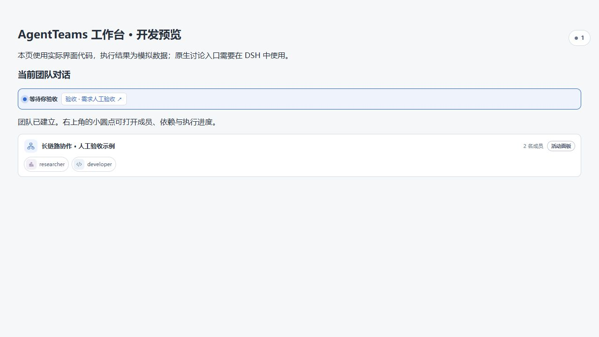
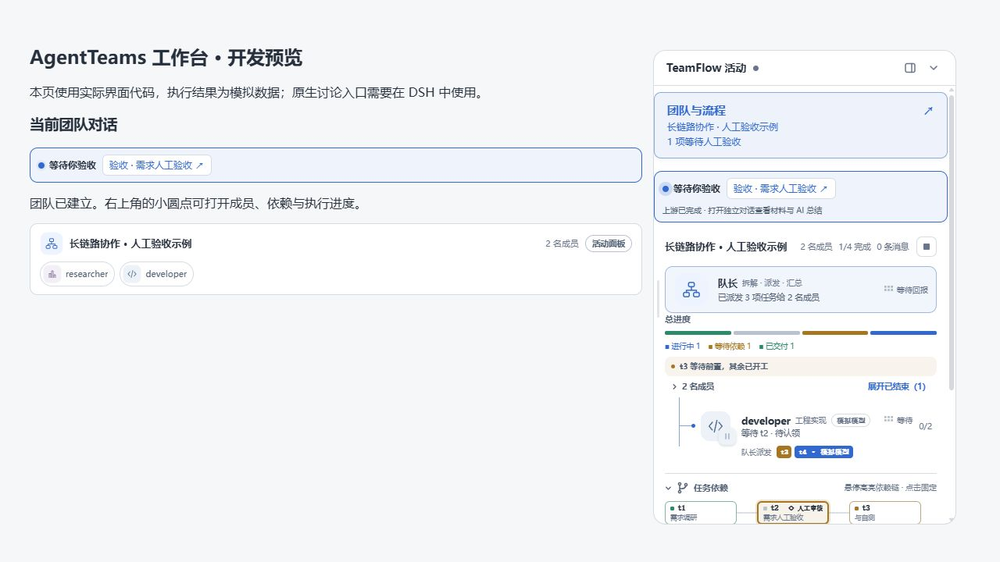

# 恢复活动小圆点与紧凑面板

支持右侧原生工作区的宿主此前会用「查看团队」及原生标签页替换活动小圆点，普通团队页还默认展开了「查看对象」讨论资料，导致入口和信息排布一起改变。

现在所有宿主均以原来的活动小圆点和紧凑活动面板为主入口，团队卡片恢复「活动面板」按钮。原生讨论资料入口保留，但仅在独立讨论上下文中展开。成员、进度、任务依赖、人工审核提示与完整流程画布保持可用，完成或取消后重跑和运行中动画不变。

## 验证

- 服务端及客户端 TypeScript 编译、客户端打包通过。
- workspace-summary、workspace-activity、workbench-usability、proposal-review 共 27 项测试通过；项目 verify 检查通过。
- 使用实际 ActivitySurface、TeamChatEntry 和 AgentTeamsSummary 组件及模拟 API，验证小圆点打开、收起、团队卡片再次打开同一面板，确认普通团队页面不出现「查看对象」。预览含人工审核与运行中任务。
- 预览使用模拟团队，不启动真实模型任务；尚未在用户已安装的 DSH 插件中部署。

## 小圆点入口

## 紧凑活动面板

