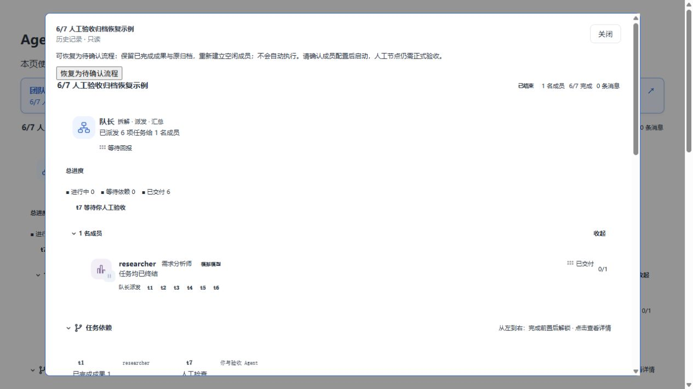
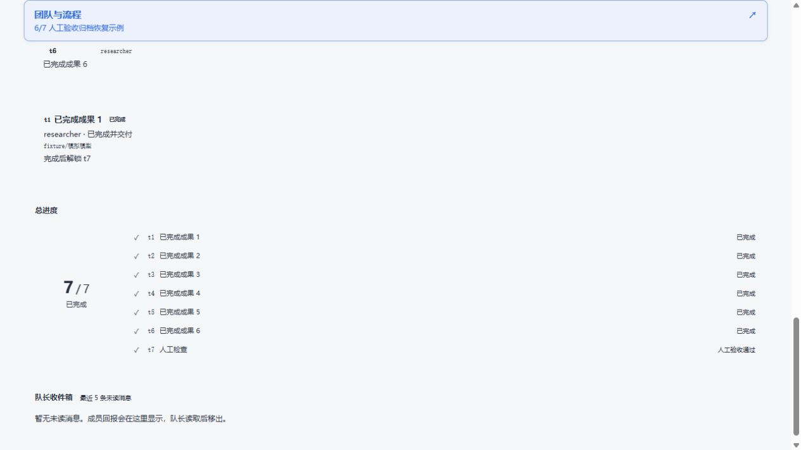
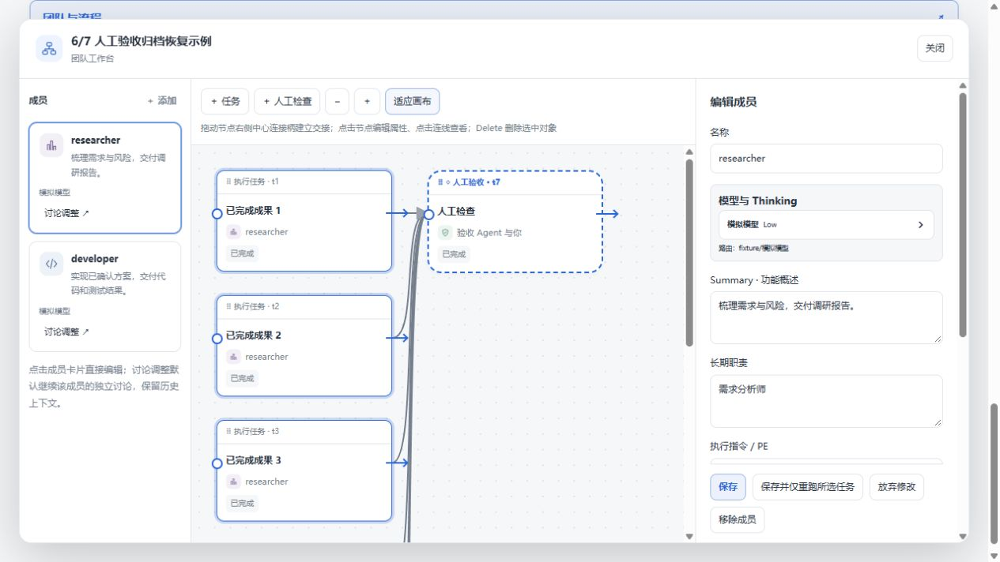

# 6/7 人工验收与误归档恢复（2026-10-27）

主对话中的“验收通过”是聊天内容，原实现没有把这句话写入人工节点审批。若队长随后调用归档工具，团队便会变成历史只读，而最后的人工节点仍未完成，进度保持 6/7。修复后，归档工具会在修改成员、移动文件之前拒绝未完成的 TeamFlow 流程；队长协议要求保留可编辑流程，仅在用户明确要求时归档。

人工节点在活动页和总进度中显示「等待人工验收」，不再显示成可领取、可开工的执行任务。节点的正式审批仍由用户在验收材料旁点击「通过验收」或「退回」完成，聊天文字不直接修改审批记录。

## 恢复已有的历史团队

1. 更新插件、重启 DSH，打开原队长对话。
2. 点击历史「团队与流程」，再点击「恢复为待确认流程」。原归档保留为备份；恢复生成同一团队的可编辑状态，不覆盖已有的其他活动团队。

3. 恢复后先确认成员、模型和任务。已完成的六项结果保留；成员使用新的会话，旧会话留在历史中。未完成的执行任务暂停，不会因恢复自动执行。确认配置并启动流程后，打开人工节点的验收材料。
4. 阅读材料、与验收 Agent 讨论，然后点击「通过验收」。验收记录写入后，主页面同步显示 7/7，人工节点显示「人工验收通过」。

5. 团队继续保留编辑、讨论和单独重跑入口。归档与完成验收是两个独立动作。

恢复不会把未批准的节点伪装成完成，也不会应用过期的 AI 提案。若存在其他活动团队，恢复操作会拒绝覆盖。只有原队长或已授权的队长继承会话能够恢复。

## 验证范围

- 67 项针对性回归通过，覆盖真实工具提前归档拒绝、成员和结果不被部分修改、恢复权限与防覆盖、原归档保留、恢复不调度、六项结果保留、人工审批从 6/7 到 7/7、主页面同步与中英文人工节点文案。
- Windows 构建与隔离 WSL 完整 `pnpm verify` 通过。
- 浏览器使用真实 React 界面和独立模拟团队，完成了历史只读 → 恢复 → 确认启动 → 查看六项成果 → 正式审批 → 7/7 → 再次编辑成员的流程。模型回复为占位数据，本轮未调用真实模型，也没有修改另一台电脑上的真实归档；需要在更新后的插件中手动恢复。
