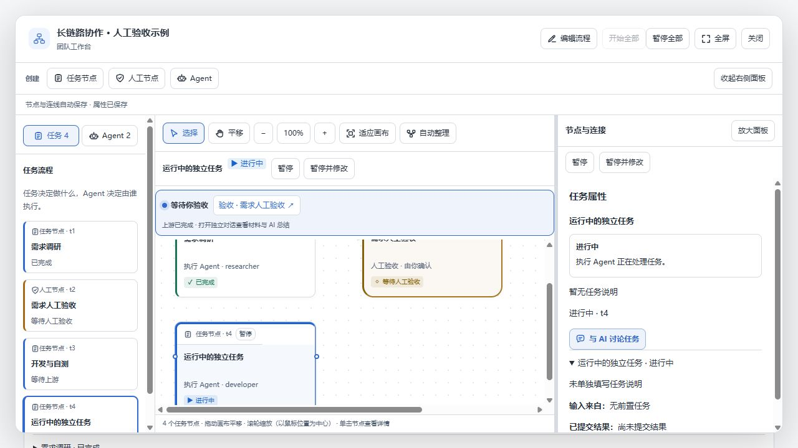

# 画布内暂停与重新执行

画布节点标题的按钮会随画布缩放变小；原先还把节点的未保存草稿作为暂停按钮的禁用条件，导致准备修改任务时无法直接停止执行。暂停后也缺少自动进入编辑的连续操作。

本次增加画布固定操作栏。选中任务后，在画布工具下方显示任务名、状态与可用操作；收起右侧面板或缩放画布均不影响它。

- 运行中：可直接「暂停」，或「暂停并修改」。后者等待真实停止请求成功后，打开同一任务编辑；停止失败时保留错误，不进入编辑或自动重新开始。
- 已暂停：修改要求后「保存并重新开始」，先保存再恢复调度。历史执行记录保留。
- 已结束：点击「修改并重跑」，进入已有的上一轮结果与本轮要求编辑。
- 未保存草稿只阻止直接开始旧要求，不阻止暂停、取消排队和重试停止。保存期间仍禁止重复请求。
- 停止期间切换选中对象或关闭画布，晚返回的响应不会把用户拉回原任务。

暂停重启与已结束任务重跑沿用原有后端规则。队长亲自执行且宿主不允许插件停止时，仍会报告宿主限制；本次不绕过停止或依赖校验。

验证：24 项界面／草稿／状态测试和 59 项真实流程路由测试通过。浏览器使用实际 React 界面与模拟执行服务，验证选中运行节点、画布内暂停并编辑、保存后重新排队，以及收起属性区后进入已结束任务的重跑编辑。未停止或重跑用户的真实任务。

