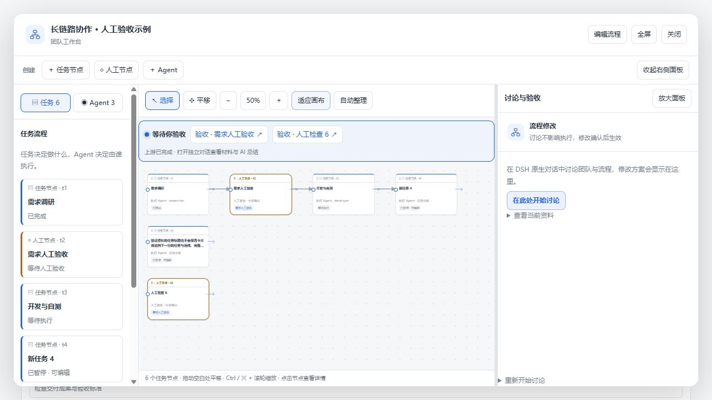
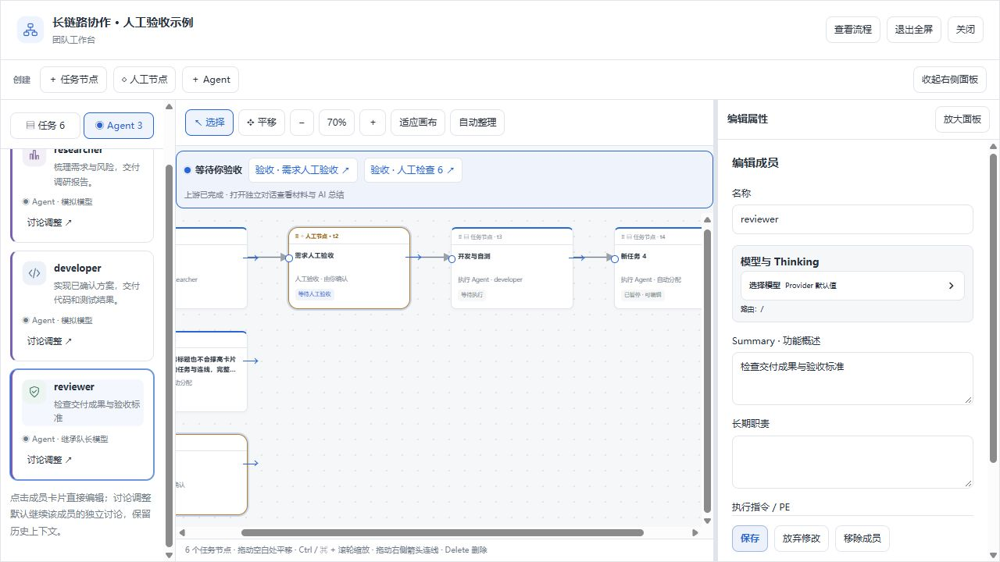
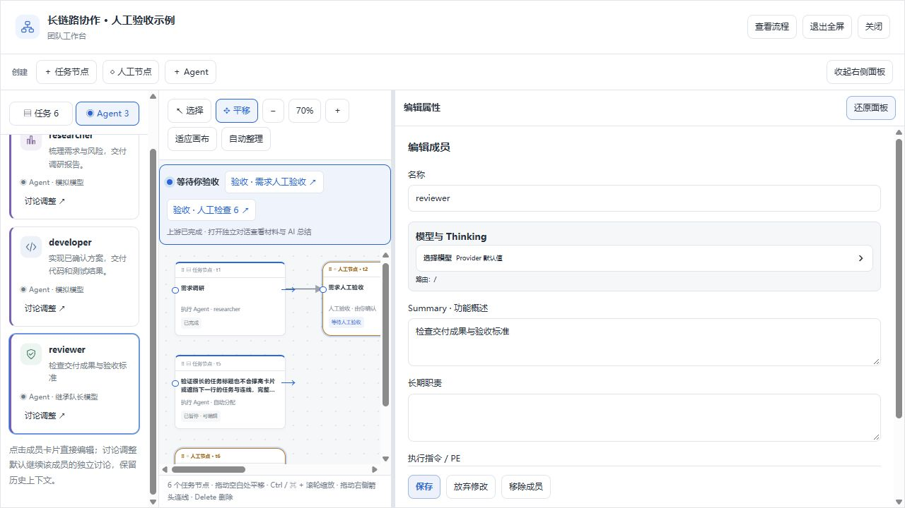

# 画布分栏、视图操作与直接创建节点

本次优化参考 draw.io 的工具栏、对象库、画布和属性区布局，保留 TeamFlow 原有的执行、独立讨论和人工验收语义。

- 左侧通过「任务 / Agent」切换分类，分类栏固定可见。任务使用蓝色边框，人工节点使用金色边框，Agent 卡片使用头像和紫色边框；任务卡片不再用成员头像混淆对象类型。选中 Agent 仍高亮其负责的任务。
- 顶部统一创建任务节点、人工节点和 Agent。任务及人工节点先以默认名称持久保存，随后可直接连线或补充要求；不再只显示一个切换对象后消失的临时草稿。运行中的团队新增执行任务继续保持暂停，需明确确认执行。Agent 仍需填写名称、概述并保存。
- 右侧属性与讨论面板可拖动分隔条调宽，也可聚焦分隔条后用左右方向键调整；支持放大、还原、收起和重新显示。工作台支持全屏。
- 画布支持选择／平移模式、拖动空白区域或按住鼠标中键平移、10%–200% 缩放、点击比例恢复 100%，以及 Ctrl / ⌘ + 滚轮缩放。适应画布同时考虑宽和高。
- 「自动整理」按依赖重新布置节点，并通过同一个加锁的布局请求原子保存全部位置。布局不更改任务执行状态或使待确认提案过期。长标题限制为两行，完整标题在提示和属性区可见；卡片高度固定，避免撑高后压住其他行。
- 窄窗口使用「对象列表 / 任务流程 / 修改与验收」切换；查看任务属性时画布与属性上下排列，放大面板可专注编辑。

## 验证范围

Windows、Node 24.19.0，使用仓库已安装依赖（Harness 开发依赖 0.2.1-rc.2）。TypeScript 服务端／客户端检查、构建、63 项 workflow / proposal-review / workspace-activity / workspace-summary 回归测试，以及 `scripts/verify.mjs` 离线检查通过。新增断言覆盖分支布局不重叠、按宽高适配、创建空内容任务后连线仍持久保存、布局不改变任务指纹、非法批量坐标不能部分写入。

交互验证使用实际 React 界面、本地工作流 reducer 和模拟团队数据。当前环境未提供 Ego Lite 工具或 skill，按项目规则使用内置浏览器作为替代。实际验证了：

1. 创建「新任务 4」，不填写要求，直接从「开发与自测」连接；刷新后任务和连接仍存在。
2. 新建人工节点；填写名称和概述后保存 Agent；三类对象分别进入对应属性区。
3. 长标题保存后自动整理，卡片保持固定高度；缩放比例、全屏、右侧放大／还原及分隔条键盘调整正常。
4. 平移使画布水平滚动位置从 87 变为 0；不改动节点位置。
5. 768px 与 390px 宽度下切换分类、创建节点和编辑属性，恢复默认视口后保存截图。控制台错误为 0。

本轮没有调用真实模型，也未替换用户日常 DSH Desktop profile。截图属于开发预览，不代表已安装或重新验证原生 Desktop 端到端执行。
