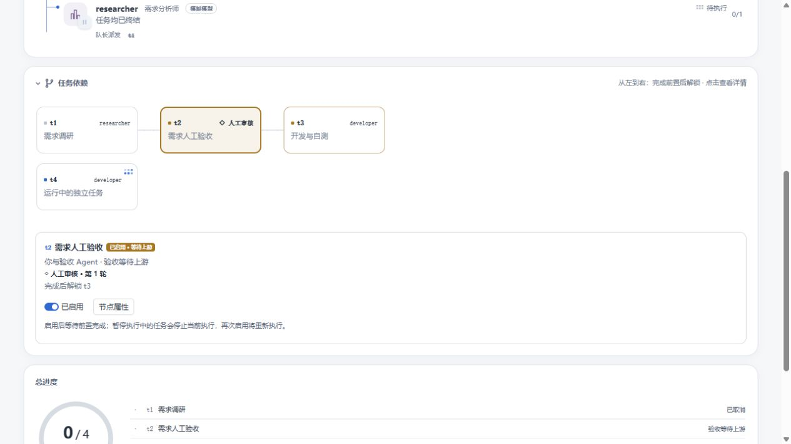
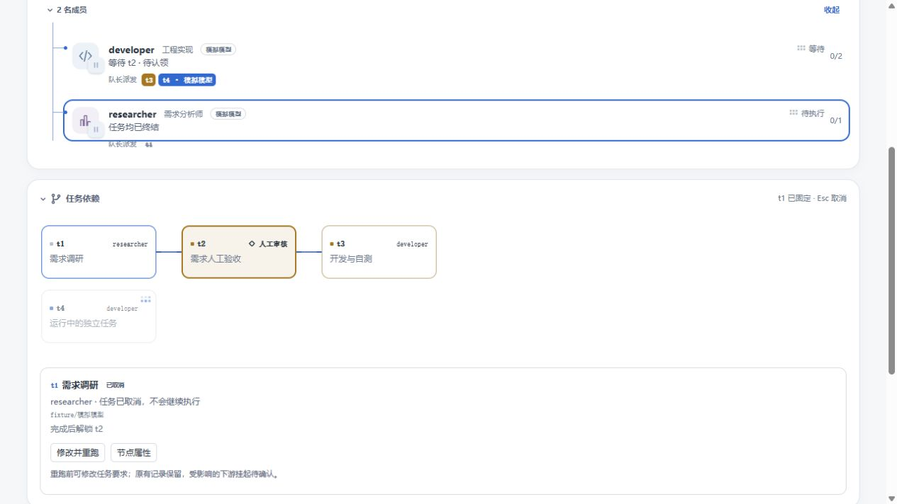
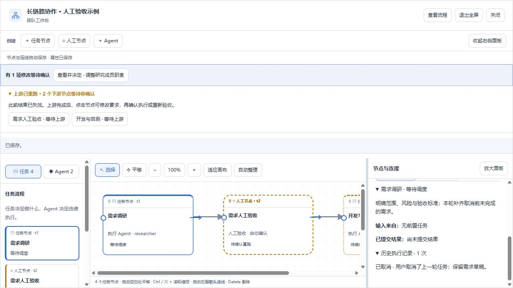
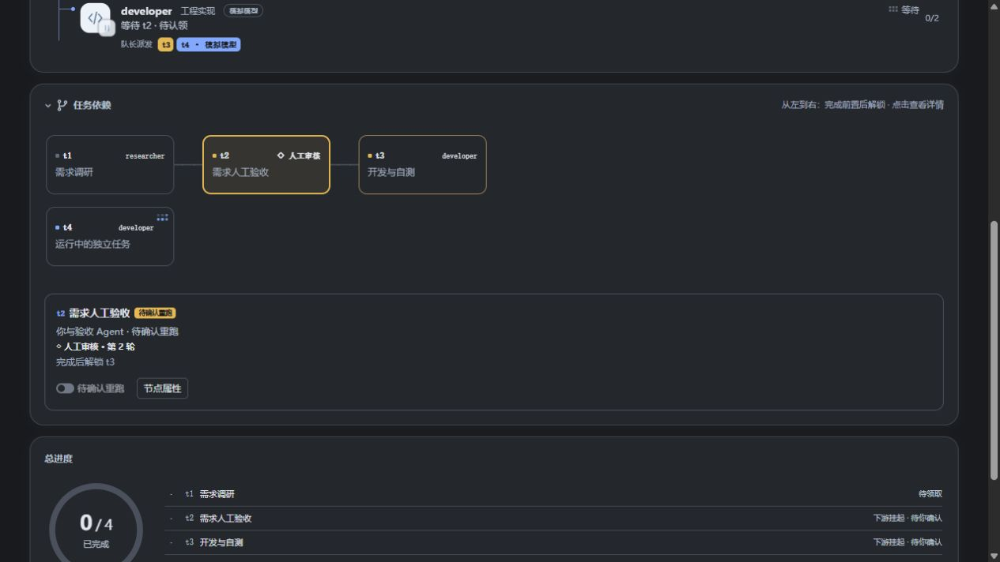

# 紧凑依赖卡片与结束任务重跑

本轮恢复 `d1f492b` 时的卡片尺寸与布局：工作区为 164 × 76，浮层为 92 × 30。卡片只显示身份、标题和运行提示；启用／暂停、审核及属性操作放在选中节点的下方详情中。

人工审核使用语义警告色边框、浅底色和「◇ 人工审核」标识，轮次在详情和提示中显示。运行任务沿用原有 `WorkGlyph` 点阵动画，工作区中放大到 14px，避开负责人文字；系统减少动态效果偏好仍生效。

## 重跑

运行中团队的已完成、已取消及失败的普通任务，在依赖页详情中提供「修改并重跑」。它只打开原有任务的编辑表单，核对要求和受影响下游后，点击「保存并重跑此任务」才提交。任务 ID 和连线不变，开始新的执行轮次；普通状态更新接口依然不能直接回滚终态。

旧状态和提交结果保存到「历史执行记录」。新执行不能沿用旧执行凭证和验证证据。所有直接与间接下游挂起，需在前置完成后逐个确认执行；人工检查重新验收。无关分支不变。负责人或受影响下游仍在执行时，服务端拒绝重跑。已停止团队不通过节点开关重启，归档流程仍需先恢复、确认并启动团队。

## 验证

- TypeScript 服务端和客户端检查、客户端构建通过。
- 工作流、摘要、活动、草稿可用性及提案审阅共 81 项测试通过。对完成、取消和失败分别经过真实工作流接口及调度器，验证新执行派发、历史保留、实时活动快照、上游等待、下游确认和重新人工审批。
- 核心离线验证通过。
- 浏览器使用实际 React 界面和模拟数据验证：取消任务进入重跑表单，保存后原节点重新待调度、两级下游挂起，关闭画布后依赖详情立即更新；检查浅色和深色样式及运行指示。
- 截图来自隔离预览，不代表已替换用户正在运行的 DSH 插件或发起真实模型执行。

复现预览：设置 `TEAMFLOW_PREVIEW_PORT=8396`、`TEAMFLOW_PREVIEW_DISCUSSION=1`、`TEAMFLOW_PREVIEW_DEPENDENCIES=1`、`TEAMFLOW_PREVIEW_CANCELLED=1`、`TEAMFLOW_PREVIEW_RUNNING=1` 后运行 `node scripts/workflow-preview.mjs`。去掉取消变量即可检查完成任务入口；页面加 `?dark` 检查深色主题。
