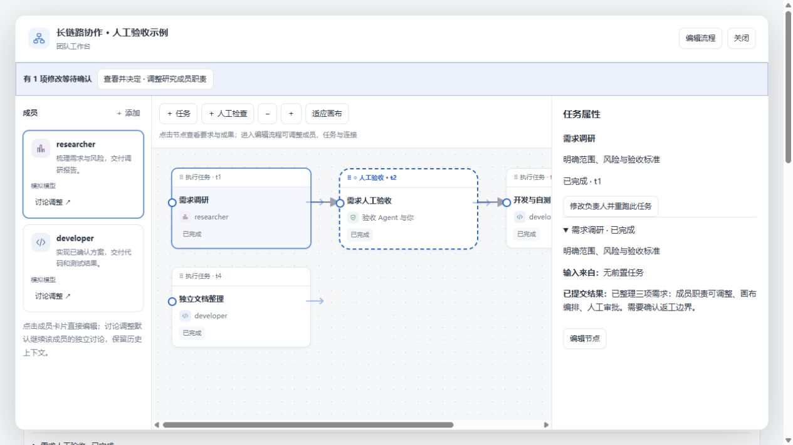
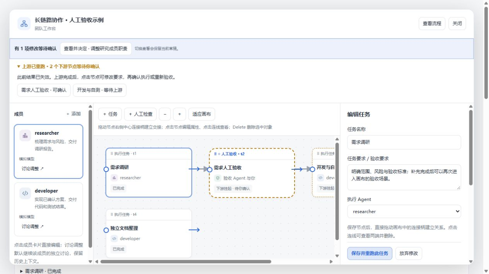
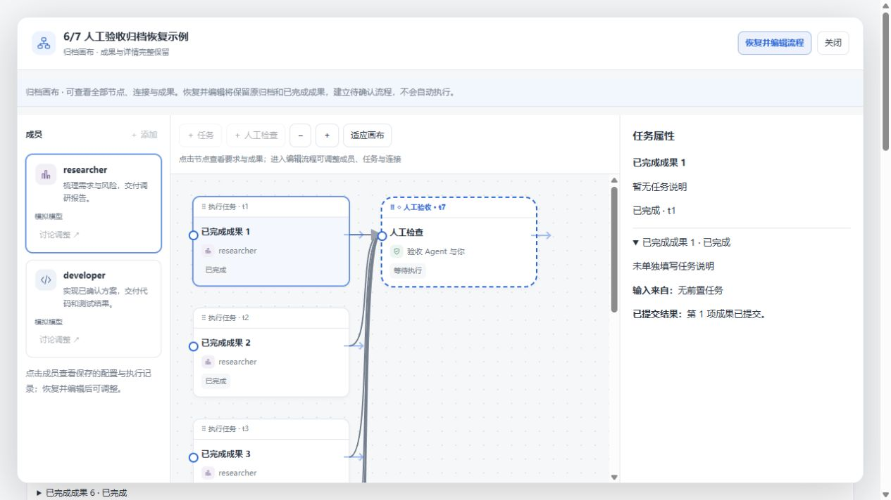
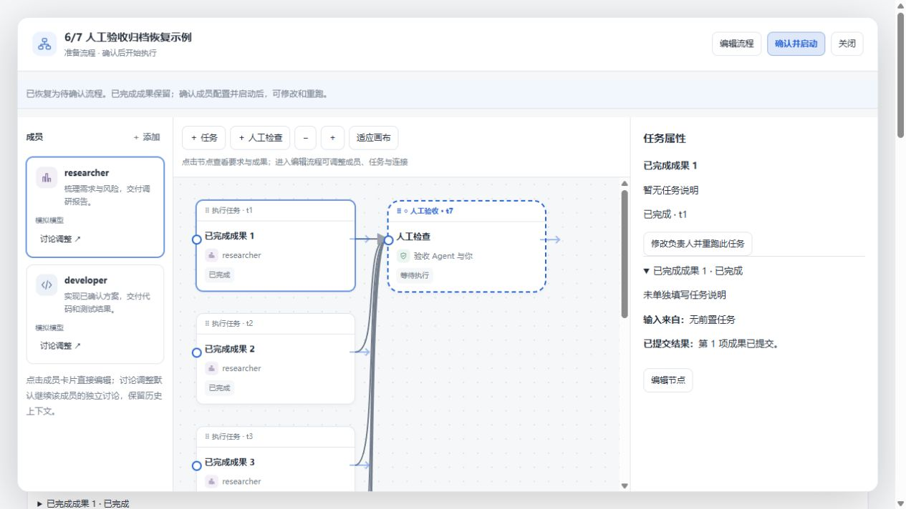

# 完成后继续查看、编辑与重跑

验证日期：2026-10-27。截图来自本项目实际 React 工作台和流程处理代码；执行结果及讨论回复为模拟数据，没有调用真实模型。后端归档访问、恢复、审批和调度另有自动化回归验证。

## 1. 全部完成后仍能打开画布

从 TeamFlow 活动面板或团队页点击「团队与流程」。完成状态不会隐藏入口，也不会强制切到简化历史窗口。

画布默认查看模式。点击节点，右侧显示任务要求、上游输入、约定验收、提交结果和已报告的验证记录；存在时也可展开审查发现、停止前记录及历轮人工审批。运行中的任务同样可以查看。

## 2. 修改已完成任务并重跑

点击顶部「编辑流程」，或者选中执行节点后点击「编辑节点」。修改名称、任务要求或执行成员，再点击「保存并重跑此任务」。成员的职责、PE、模型和 Thinking 仍在左侧成员卡片的属性面板调整，也可以从成员设置中指定单个已结束任务重跑。

保存前会说明覆盖结果和受影响的下游。保存和重跑是同一次原子修改：参数无效、成员正在运行或受影响下游尚未停止时，后端拒绝修改，旧成果保留。

验证示例：调研任务重跑后，人工验收及其后续开发节点挂起；独立文档分支仍为完成。任务 ID 和连线保持不变，当前结果覆盖，不提供结果版本管理。

上游结束后，点击顶部挂起节点，按需修改要求，然后「保存并确认执行」或「保存并确认重新验收」。本次浏览器验证也走通了重新验收材料展示、正式通过以及后续节点仍等待手动确认。人工验收记录不能通过普通属性保存篡改。

「查看流程」与「编辑流程」之间切换保留当前选择和未保存草稿。查看模式不执行拖线、移动和 Delete 删除。运行中的执行任务需先停止，再应用修改。

## 3. 归档也能查看完整画布

归档团队使用同一个画布，点击节点可查看保存的完整成果。查看归档不会恢复团队或启动任务，也不会提供当前轮次的审批操作。

点击顶部「恢复并编辑流程」。恢复后仍在当前画布、保留当前节点选择，显示待确认状态和可用的「确认并启动」按钮。原归档及完成成果保留，成员重新准备；未完成的执行任务暂停。确认配置并启动后，可编辑、重跑和重新验收。同一队长已有活动团队时拒绝覆盖。

早期仅剩聊天卡片、没有完整团队状态或归档的记录仍只能查看卡片内容，无法凭空恢复执行信息。

## 验证范围

- Windows 构建与 69 项针对性回归：覆盖已完成任务修改重跑、无关分支保留、下游挂起、非法编辑原子拒绝、归档所有权和只读访问、成果详情呈现。
- 隔离 WSL 环境运行完整 `pnpm build` 和 `pnpm verify`。
- 浏览器手动操作项目真实界面，覆盖完成后查看、编辑重跑、下游重新验收、归档原地恢复。模拟模型与执行不等于真实 DSH 模型端到端验证。

本次未重装或重启用户日常 DSH profile，也未操作已有真实团队。其他电脑需要安装本次 Git 提交版本并重启相同 profile 的 DSH Web，浏览器刷新后使用。
