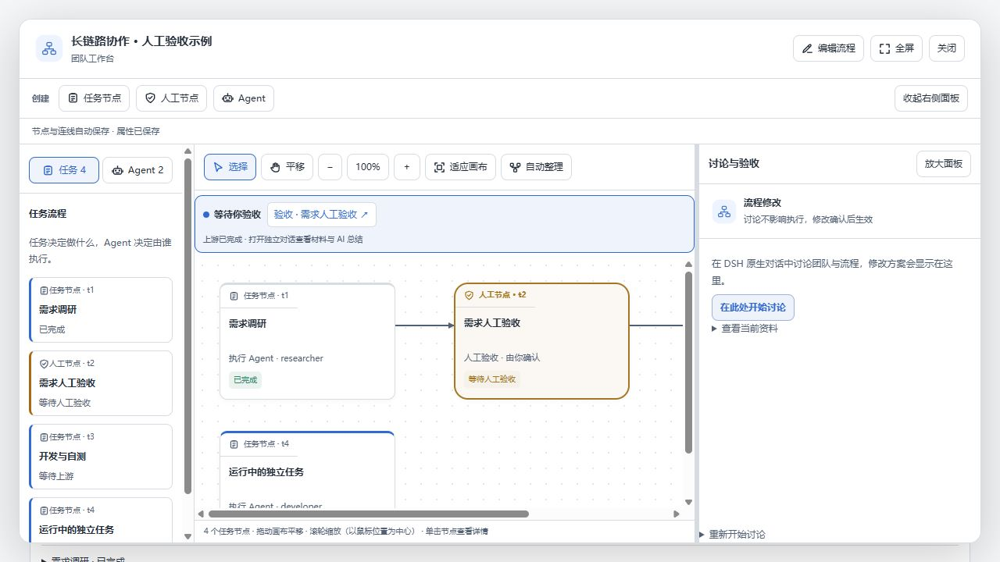
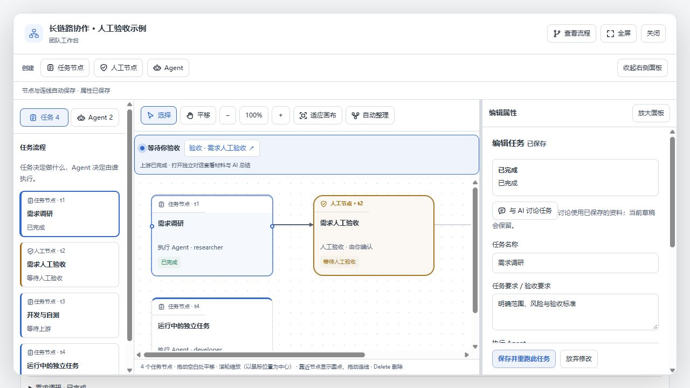

# 悬停连接圆点与查看模式平移

节点两侧使用 8px 圆点，默认隐藏；悬停节点、键盘聚焦或连线拖拽期间显示。圆点保留 28px 点击区域，触屏保留可见的可用入口，支持减少动态效果偏好。替换的是节点上的连线操作箭头，已有连接仍保留方向标记。

查看模式允许从节点或空白处拖动平移；超过 4px 才判定拖动并捕获指针，结束后抑制误触选择。单击仍打开详情，平移不写入节点布局。编辑模式下保留节点移动与连线，平移工具及中键继续可用。

验证：客户端 TypeScript 编译、打包、相关界面回归测试与项目 verify 检查通过。实际组件模拟预览确认默认所有连接点不透明度为 0；从查看模式节点拖动后视口 scrollLeft/scrollTop 从 0/0 变为 100/50，单击随后可打开任务属性。编辑模式从圆点拖动，新增「需求调研 → 开发与自测」连接成功。未调用真实模型或更新用户已安装插件。

