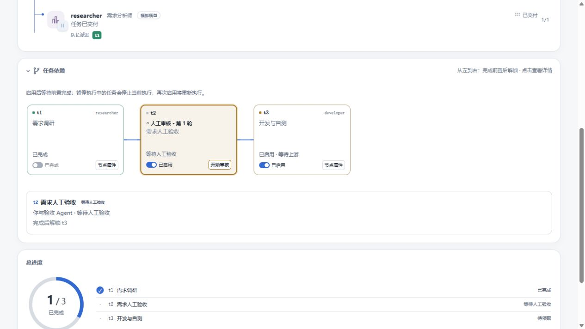
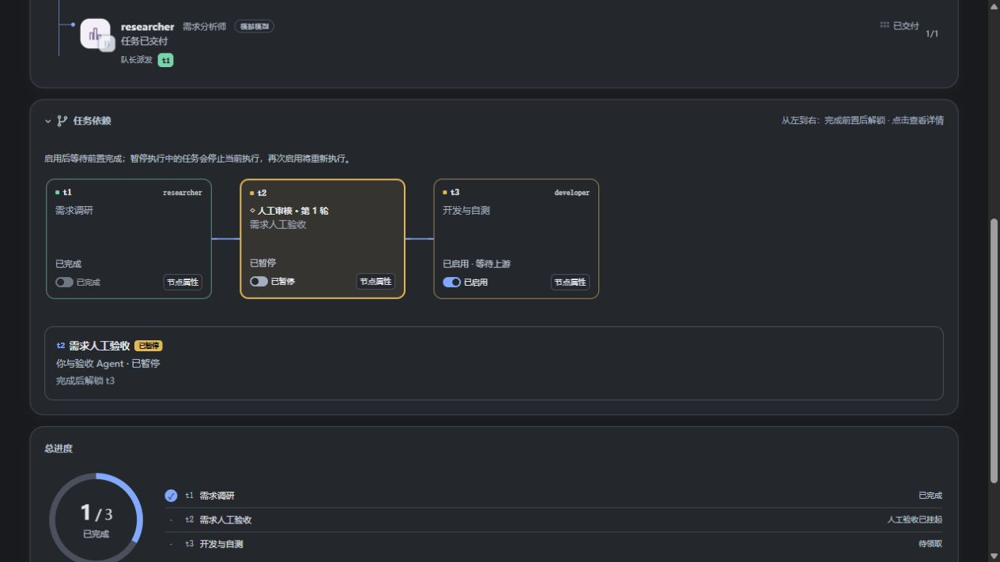

# 任务依赖页：人工审核与启用开关

人工审核卡片以独立底色、较粗边框、「◇ 人工审核」和轮次标识区分；就绪时突出「开始审核」，直接打开对应节点的验收工作台。退回意见在节点详情展示。明暗主题均使用宿主语义颜色。

每个节点分别显示启用状态与实际进度：

| 场景 | 行为 |
| --- | --- |
| 启用下游、前置未完成 | 显示「已启用 · 等待上游」，不启动前置、不跳过依赖 |
| 前置暂停、失败或人工审核未通过 | 下游保持等待；详情列出未完成前置 |
| 前置全部完成 | 已启用的普通任务等待调度；人工审核等待用户操作 |
| 暂停待执行节点 | 只暂停该节点；其后续节点继续遵循依赖 |
| 暂停执行中的任务 | 停止对应成员执行会话，隔离旧执行身份，保留停止前记录；再次启用重新执行 |
| 停止执行失败 | 显示等待停止及错误原因，提供「重试停止」；不误报完成 |
| 暂停人工审核 | 停止其验收资格；不代表通过或跳过审核 |
| 已完成／失败／取消、已退回、待配置、待确认重跑 | 开关不可修改，通过节点属性执行明确操作 |
| 未启动团队／已停止团队／历史记录 | 未启动团队的开关不启动团队；已停止或历史团队只读 |

开关请求携带当前任务时间戳，服务端在团队锁内重新核对状态，防止旧页面停止后来已变化的任务。成功返回真实活动快照，依赖卡片立即更新；停用人工审核不生成执行会话。队长正在执行的任务仍须先从宿主停止队长当前执行，页面会显示该限制。

## 验证

- 服务端和客户端 TypeScript 编译、客户端打包、构建产物一致性及离线 `scripts/verify.mjs` 检查通过。
- 工作流、工作区摘要、工作区活动、草稿和提案审阅共 77 项测试通过。新增测试覆盖真实调度器的上游等待、人工批准后派发、开关版本冲突、终态和配置保护、执行停止及失败重试、历史记录保留、卡片无障碍开关和审核入口。
- 浏览器验证下游暂停／启用、审核暂停／启用、直接进入正确审核节点，以及明暗主题。控制台无错误。截图来自实际 React 界面的本地预览，模拟执行与模型响应；未修改用户安装或触发真实执行任务。
