# 本机 DSH 实测与操作图解

测试日期：2026-10-27。以下截图均来自本机 **DeepSeek Harness 桌面应用**，使用真实 DeepSeek 模型，不是 `127.0.0.1:8371` 开发预览，也没有用模拟状态替代操作。

已验证从建队、配置讨论、插入人工检查，到退回返工、第二轮通过和下游执行的流程。实测发现并修复了工具参数说明和冷启动界面恢复两处问题。最后的审校 Agent 返回 `needs_revision`，所以示例内容没有全部验收通过；这与插件能否正常调度是两项不同结果。

## 1. 环境和安装来源

| 项目 | 本次使用值 |
| --- | --- |
| 宿主 | Windows 桌面 DSH，官方 CLI 报告 `0.2.1-rc.3` |
| Profile | 桌面应用的 `desktop` |
| 模型 | UI 显示 `DeepSeek-V4.1-Flash · 1017 · High` |
| 插件 | 本 fork，本地 tarball；包名 `@nanmicoder/dsh-agent-teams`，版本仍为 `0.1.27` |
| 代码起点 | `6e93f3bd69b4c240c1c50c9dc992c3c3e33b44d5`，测试中加入本报告所述修复 |
| 独立测试目录 | `G:\dsh_agents\node_modules\dsh-live-test` |
| 测试团队 | `reading-club-prep` |

最初这台电脑的桌面 profile 没有本 fork。插件页中的“智能体团队（实验性）”是宿主内置功能，不能据此判断本插件是否已安装。

本次通过桌面安装自带的 CLI carrier 安装本地包，随后在插件详情确认“运行中”和代码来源。以下是**这台电脑**的命令示例，其他机器应替换为自己的安装路径：

```powershell
& 'C:\Apps\DeepSeek Harness\resources\runtime\cli\bin\dsh.cmd' --version
& 'C:\Apps\DeepSeek Harness\resources\runtime\cli\bin\dsh.cmd' plugin --profile desktop add --save-exact 'G:\dsh_agents\node_modules\workflow-results\desktop-live-final.tgz'
```

图中记录的是初次安装的 `desktop-live-test.tgz`；测试中依次更新为修复包，最终安装为 `desktop-live-final.tgz`。最终包 SHA-256：

```text
F4271759695FA19462822724B34E459BC5F3EEA3A1EB74A932E1763A0B379300
```

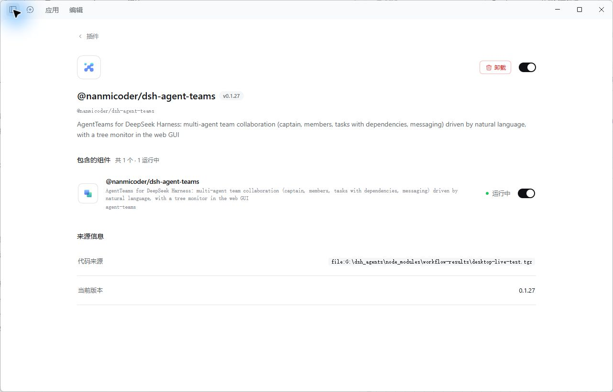

**替换已有版本后，完整退出并重新启动 DSH。** 本次发现界面热更新不等于后端模块已经替换；仅刷新页面或插件列表不足以证明新代码生效。不要在还有任务运行时退出。

完整的 Git、本地目录和 tarball 安装方法见 [项目中文 README](../../README_ZH.md#卸载旧版并安装本分支)。另一台电脑上的 CLI Web 仍需核对它自己的启动命令、profile 和安装来源，本报告不能代替那台电脑的验证。

## 2. 从 DSH 中间的对话建队

在新会话选择独立测试工作区，然后发送：

```text
/agent-teams 为虚构的社区读书会做一份活动准备清单。这是插件验收测试，只需两名成员：策划负责提出三项准备工作，审校负责检查表达是否明确。先创建待审核团队和两个串行任务，不要启动执行，等我在画布上添加人工检查节点。不要联网、不要读取其他项目、不要执行终端命令。
```

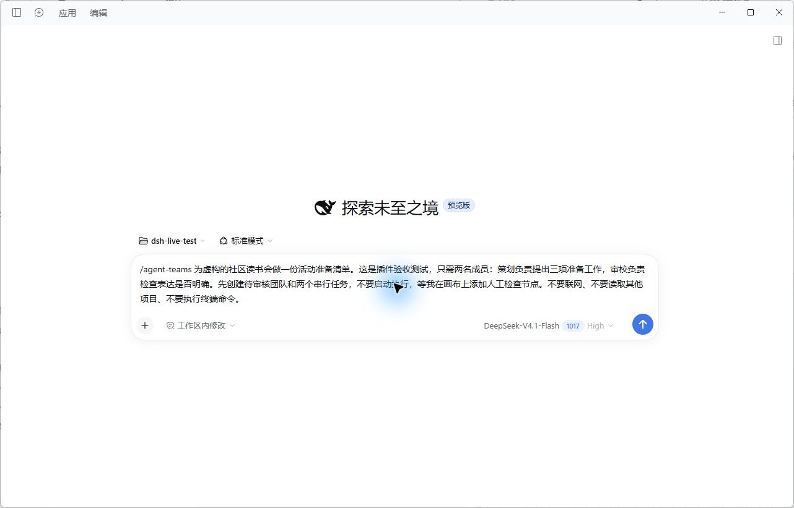

模型实际生成了两名成员、各自的职责概述和两个任务：`t1` 由 planner 撰写，`t2` 由 reviewer 审校，初始依赖为 `t1 → t2`。团队停在待审核状态，未立即执行。

在会话标题或团队卡片点击“查看团队”，右侧出现“团队协作”。顶部的“打开编排画布”就是新界面的入口。下面的“讨论资料”展示已保存的成员、任务和成果信息。

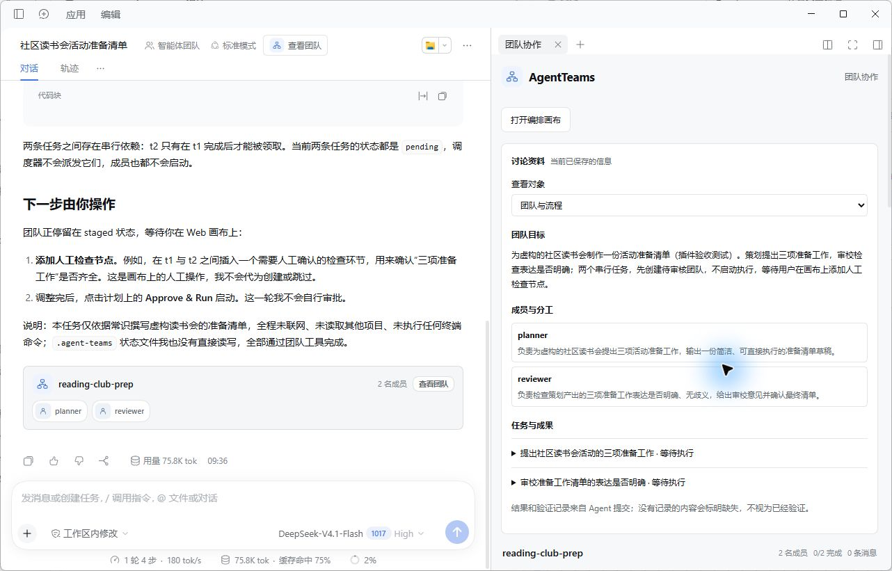

## 3. 打开画布查看成员与任务

左侧是成员及 Summary，中间是任务交接图，右侧是讨论资料与待确认方案。节点代表任务，负责人显示在节点内；同一成员可以负责多个任务。

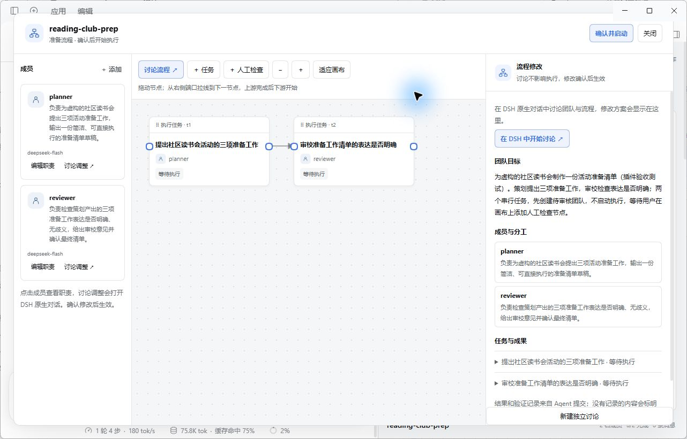

没有单独的“手动模式”。先通过对话生成团队，再在同一流程中编辑或讨论调整。主应用首页不会整体变成这个画布。

## 4. 在原流程上插入人工检查

点击“＋ 人工检查”，填写名称和验收要求。在“上游”状态点击策划任务，再切换“后续”点击审校任务。编辑器在右侧，原画布仍然可见，选中状态和虚线会预览连接。

本次填写：

- 名称：人工验收三项准备工作。
- 要求：草稿恰好三项，每项说明做什么及完成标准，不得虚构真实人员和联系方式。
- 上游：`t1`；后续：`t2`。

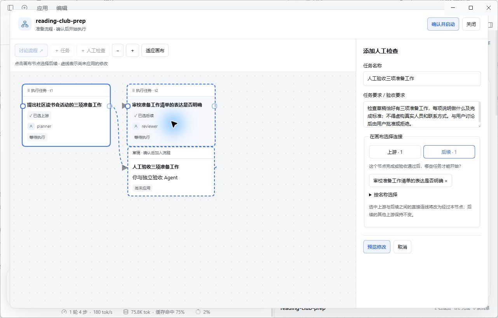

点击“预览修改”，审阅后“确认应用”。本次实际将 `t1 → t2` 改成 `t1 → t3（人工检查）→ t2`，没有留下绕过检查点的直连依赖。长提案可以收起“修改预览”来显示确认按钮。

## 5. 与模型讨论修改 Summary 和 PE

点击 planner 的“讨论调整”，会打开 DSH 中间的独立配置对话。右侧仍显示该成员当前保存的 Summary、长期职责、PE、角色提示词快照入口和任务结果。

本次要求模型把 Summary 改为“产出恰好三项、每项含动作和完成标准的读书会准备清单”，并补充中文三条清单、动作和完成标准等 PE。模型生成提案，实际配置在画布“确认应用”后才变化。

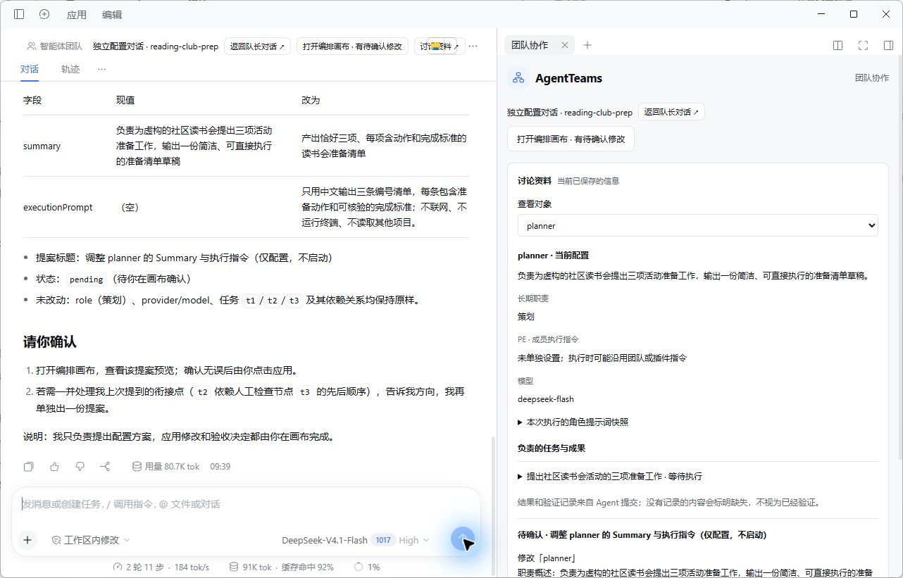

初次提交暴露了 `action` 字段说明缺失的问题，详见后面的修复记录。此图是模型最终生成的真实提案，不表示初次尝试无错误。

## 6. 启动团队

确认职责、任务和依赖后，点击画布右上角“确认并启动”。“适应画布”可以一次看到完整依赖链。

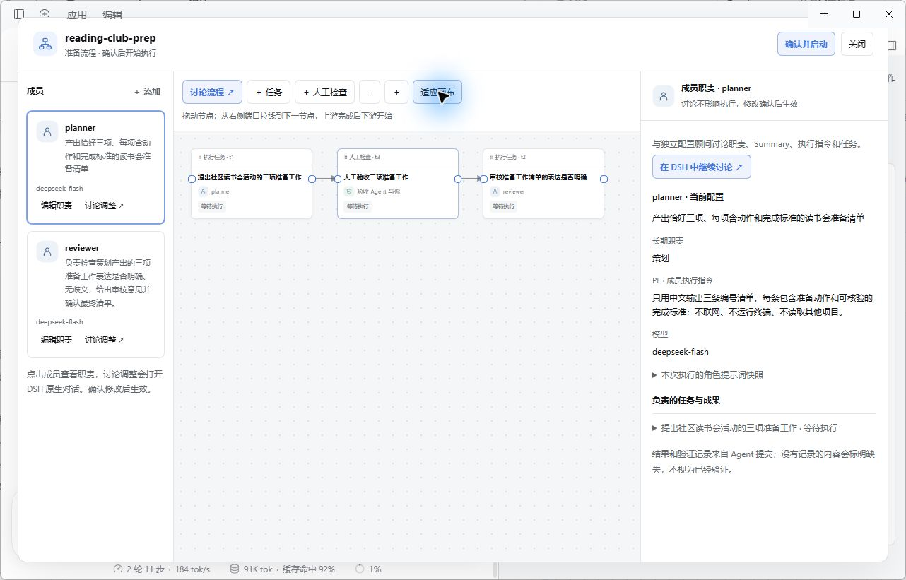

策划执行完成后，画布出现明显的“等待人工验收”提示，审校任务仍处于等待状态。

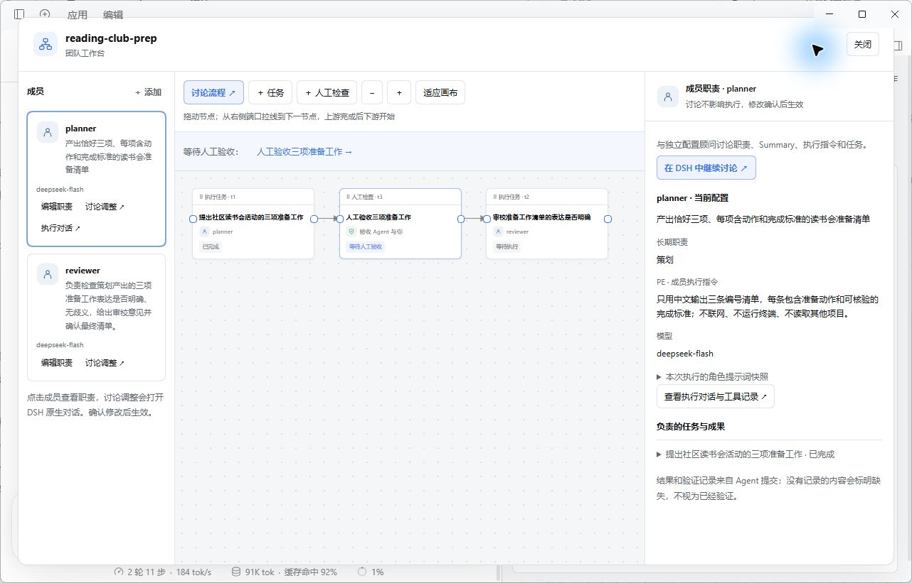

## 7. 在独立验收对话中讨论成果

点击待验收提示，打开独立验收 Agent 的原生对话。它读取上游提交成果，整理验收要点和证据缺口。这里可以继续追问，而不是只看一个摘要弹窗。

本次草稿含“至少 8 人”和活动结束后的实际时间等标准。测试中提出：它们不适合作为准备阶段的完成标准。验收 Agent 给出分析，并等待画布上的决定。

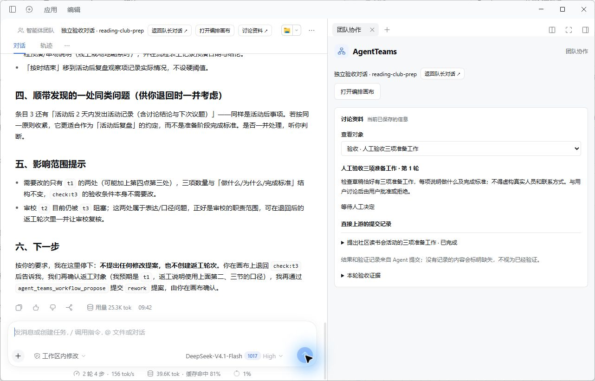

材料来源也会标明：任务输出与命令结果由执行 Agent 提交，文件摘要由宿主读取；本例是纯文本任务，没有独立文件或命令证据，不能把 Agent 的自述当作额外验证。

## 8. 退回后讨论返工对象

回到画布，填写验收意见，点击“退回并讨论返工”。下游继续等待。再在验收对话中确定只返工 `t1`，要求去掉人数阈值、把事后结果改为活动前可检查的标准。

验收 Agent 提出 `rework` 方案，画布确认应用后才创建新轮次。

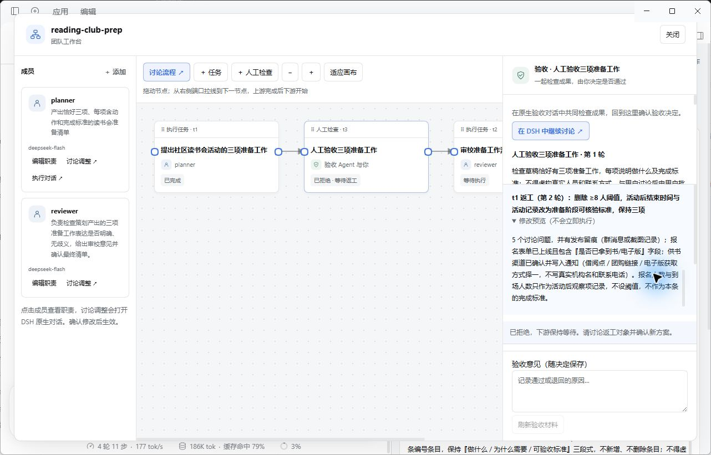

实际结果：旧 `t1` 和输出保留；新增 `t4` 交给 planner 执行；检查点 `t3` 的依赖改为 `t4`，轮次变为 2；`t2` 仍依赖 `t3`。

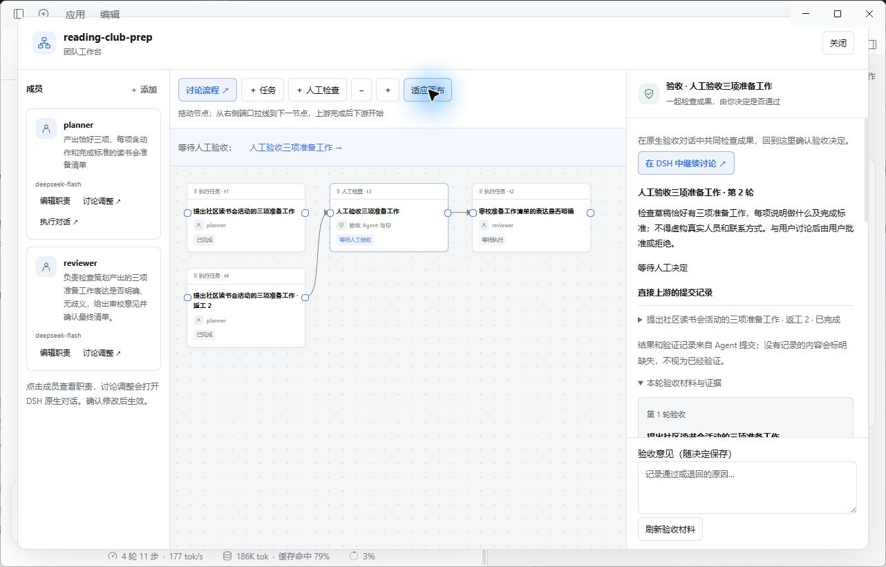

## 9. 第二轮通过后放行

重新打开验收对话时，材料更新为第 2 轮，验收 Agent 重新读取并分析。本次第二轮移除了人数阈值与事后结果门槛，测试中接受其独立标注的活动后观察项，并记录“仅验收清单文本，不代表活动实际落实”。

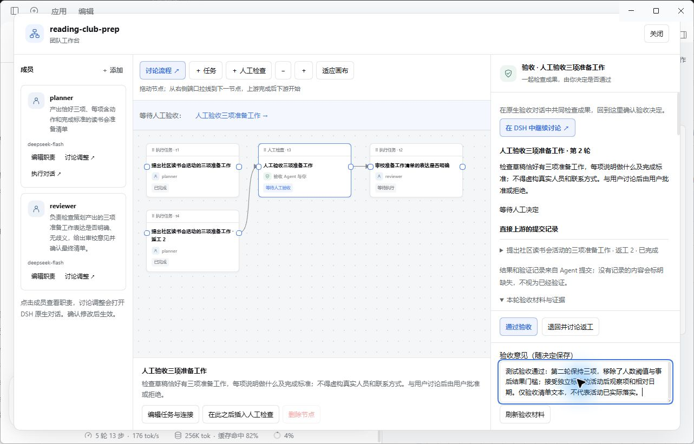

点击“通过验收”后，`t3` 完成，下游 `t2` 从等待进入执行。检查记录保留了第一轮退回与第二轮通过两次决定。

## 10. 下游审校的真实结果

审校 Agent 执行后返回 `verdict: needs_revision`，并提交 8 条表达问题，例如责任角色缺失、占位角色与“已确认”冲突、时间标准不明确。按现有工具契约，`needs_revision` 对应任务状态 `failed`，所以图中审校显示“失败”。

这说明下游已被放行并实际执行；不能据此声称示例内容最终合格。本次流程测试保留此结果，没有把它改成绿色通过。

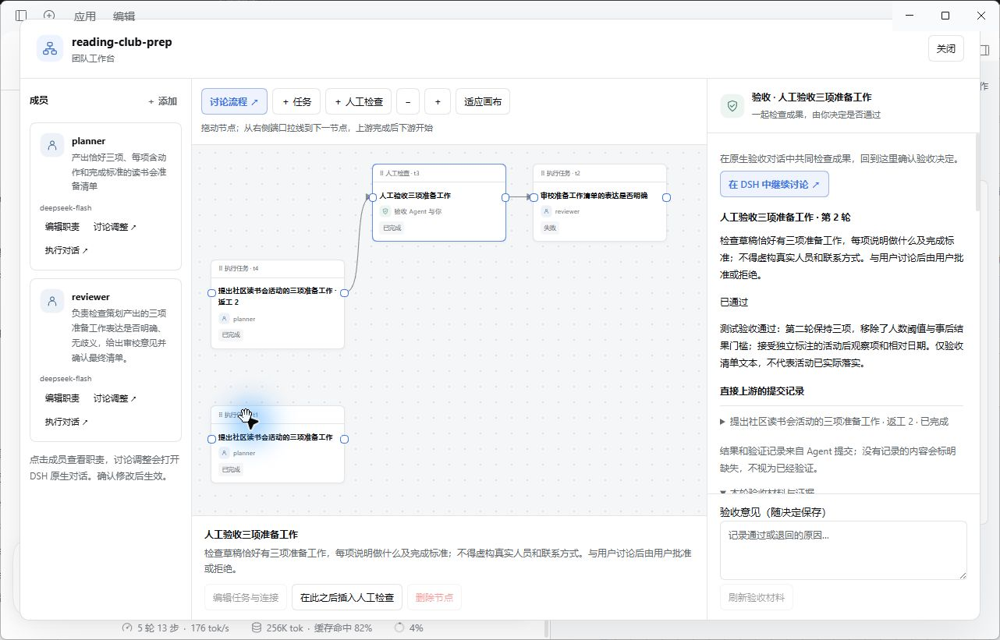

## 11. 拖动布局和重启恢复

测试中将旧任务 `t1` 拖到画布下方，正常退出 DSH 后重新启动。没有发送新的模型消息，独立验收对话、团队关联、第二轮通过记录均能恢复。

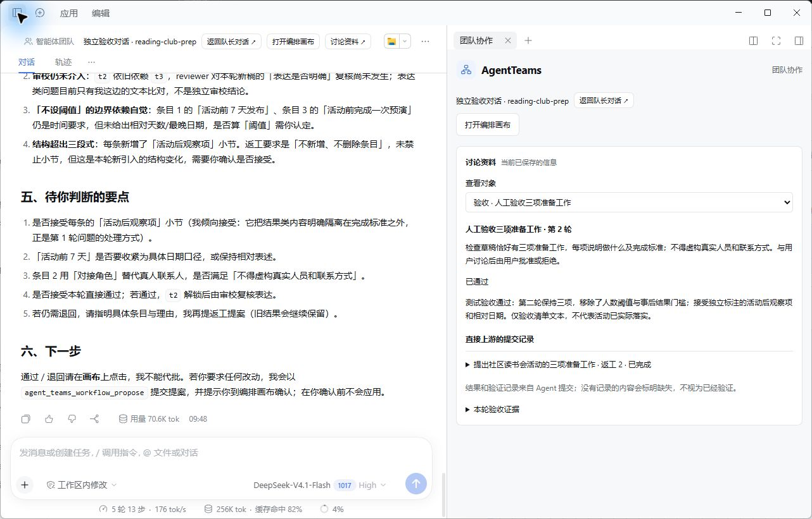

重新打开画布后，`t1` 的拖动位置也保留了。最终主链为 `t4 → t3 → t2`，原始 `t1` 作为历史结果保留。

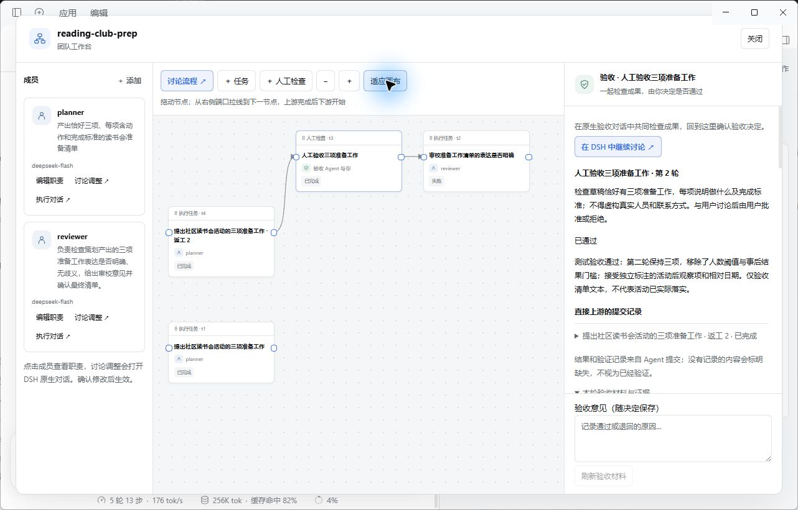

## 实测发现与修复

| 问题 | 修复 | 验证 |
| --- | --- | --- |
| 模型提交修改时猜测 `type`、`op` 等格式，报“未知修改操作：undefined” | 在 persona 和工具参数说明中明确 `action`、同层字段和完整 JSON 示例；缺少 action 时返回可操作的错误 | 24 项工作流测试通过；完整重启后真实模型成功提交返工提案 |
| 冷启动独立讨论时，首次读取早于宿主 Agent 就绪，界面一直显示“当前会话还没有团队” | 未取得团队 ID 时继续定时发现状态，避免首次失败后不再刷新 | 完整退出并重新启动，无需发新消息即恢复团队与验收记录 |
| 替换安装包后页面更新，但后端仍使用旧模块 | 操作说明要求完整退出并重启宿主 | 重启后使用新的工具说明，真实模型提案成功 |

## 验证结果与范围

| 项目 | 结果 |
| --- | --- |
| 本地包安装、运行组件、来源确认 | 通过 |
| 真实模型建队、Summary 与 PE 讨论修改 | 通过；初次参数说明问题已修复 |
| 原画布选择上下游、插入检查、依赖改写 | 通过 |
| 执行 → 待验收 → 下游阻塞 | 通过 |
| 原生验收讨论、退回、确定返工对象 | 通过 |
| 旧结果保留、新任务执行、第二轮材料更新 | 通过 |
| 人工通过后下游开始执行 | 通过 |
| 下游审校内容结论 | `needs_revision`，示例内容仍需修改 |
| 节点拖动持久化、完整重启恢复 | 通过 |
| 构建与自动检查 | 构建、24 项工作流测试、核心验证、隔离 Linux 环境完整 `pnpm verify`、构建产物一致性检查通过 |

最终持久化状态和安装代码哈希检查的摘要见 [verification.json](verification.json)。该文件只核对最终状态；阻塞、放行和重启等过程证据见上面的操作记录与截图。

本次没有覆盖所有模型、其他机器的 CLI Web、全部主题和窗口尺寸、从端口拖线的吸附细节、复杂并发分支或大型文件验收。这里验证的是一条真实桌面流程及其退回分支，不是所有宿主版本的兼容性承诺。

测试团队和本地安装保留，方便继续查看。截图已收起个人侧栏；没有把账号、凭据、原始会话库或其他项目文件放进文档。
