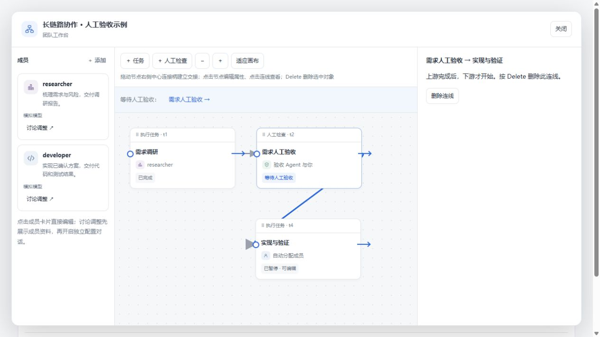
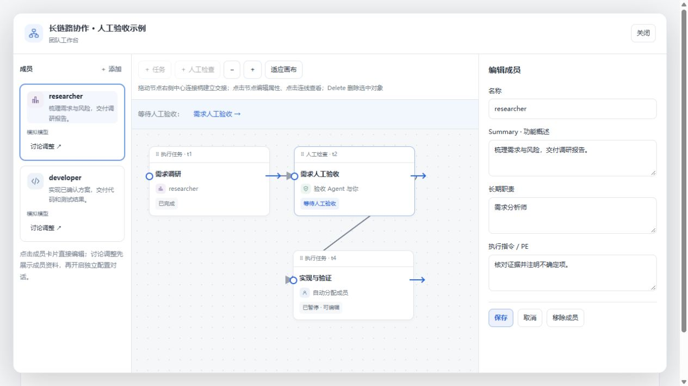
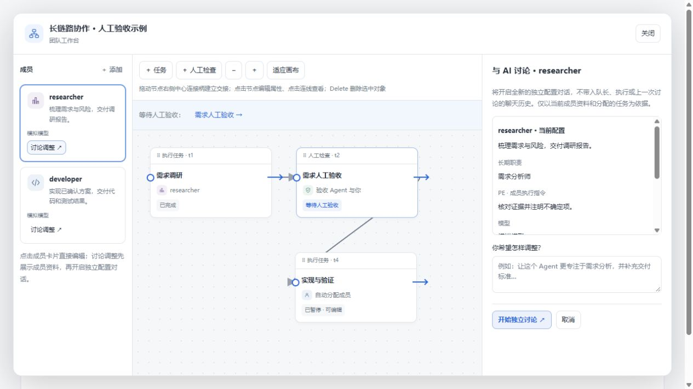

# 直接编辑画布与独立配置讨论

这次将手动编排统一为 draw.io 风格的直接操作，不再使用上游／下游勾选器，也不再为每次手动连线打开提案确认页。

## 操作方式

| 对象 | 操作 |
| --- | --- |
| 任务／人工检查节点 | 拖动节点本体移动；点击未开始的节点，右侧显示属性；保存后立即生效 |
| 连线 | 从节点右侧中心连接柄拖向目标节点；靠近时吸附提示；点击连线查看起点和终点 |
| 删除 | 选中节点或连线后按 Delete；删除节点会一并移除可编辑的关联连线；输入框中的 Delete 只编辑文字 |
| 成员 | 点击卡片编辑 Summary、职责和 PE；成员列表、画布、属性面板保持在同一工作台 |
| 配置讨论 | 点击「讨论调整」直接新建独立对话，在对话开头查看成员信息并说明调整意图 |

手动操作立即保存，AI 的修改提案仍需用户确认。连线改变不自动重排节点。已开始／已完成任务继续遵守原有状态保护；运行中新增的执行任务先暂停，完成连线后在节点属性中点击「继续执行」。

## 浏览器交互截图

以下为真实 React 界面与本地工作流状态逻辑的开发预览，使用模拟执行数据；不是新的真实模型端到端测试。

历史截图：当时先在画布展示讨论资料。当前版本点击「讨论调整」直接新建独立对话，成员资料在对话开场显示。

配置讨论创建新的普通 DSH 会话，不复用队长、执行会话或上一轮配置讨论的聊天记录。初始消息含成员 Summary、职责、PE、任务和用户调整意图；配置上下文工具只返回当前成员及其任务信息。旧讨论保留归档，新讨论依旧只能读取资料与提交提案，不能执行任务或替用户批准。

## 验证范围

- 浏览器已操作验证：单击成员／节点编辑、拖动节点本体、创建新节点、拖线连接、选中线查看两端、Delete 删除连线及节点、连接后位置保持、独立讨论准备界面。
- 运行时回归覆盖：手动修改原子保存、过期画布拒绝覆盖、循环连接拒绝、运行中新任务暂停，以及新配置会话不继承旧历史、保留工具隔离。
- 构建与构建产物检查通过；34 项工作流／工作区相关测试通过；本轮 WSL 隔离环境完整 `pnpm verify` 通过。
- 本轮保持日常 DSH profile 的卸载状态，没有自动安装插件或调用真实模型。
