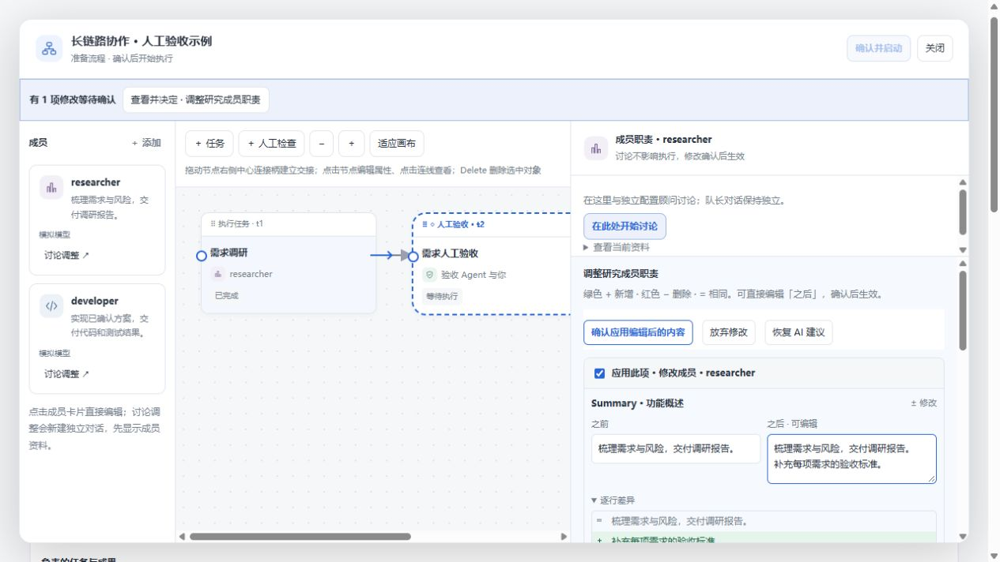

# 可编辑审批对照（2026-10-27）

在「团队与流程」的待确认修改中查看每个字段的「之前」与「之后」。未变内容显示「= 相同」；逐行差异用绿色 + 显示新增、红色 − 显示删除。窗口较宽时前后并列，窄面板纵向排列。

「之后」可以直接编辑，差异随编辑更新。可以取消勾选某项修改，保留对应对象。点击「确认应用编辑后的内容」应用最终版本；「恢复 AI 建议」重置当前草稿，「放弃修改」丢弃整个提案。审批过程中切换到画布或切换回来会保留当前页面中的草稿；刷新页面不保留尚未确认的草稿。

应用时继续校验提案 ID、原始团队基线、运行状态、任务依赖和模型路由。过期或非法编辑不会部分覆盖团队。历史记录保留最终应用内容，同时在 suggestedOperations 中保留 AI 原建议。

验证：51 项工作流、差异算法、工作区回归测试通过，隔离 WSL 完整 pnpm verify 通过。浏览器使用模拟数据操作了前后对照、直接编辑、草稿跨面板保留、跳过单项和最终应用。本轮未调用真实 DSH 模型，不代表已完成真实宿主端到端验证。
