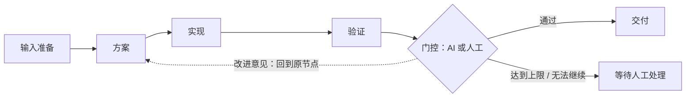

# 门控循环与多轮执行历史设计

日期：2026-11-09。目标分支：`dev`。源码调研基线：`a18f68fe5ad59444f39bd22b1137de74961afe54`（包版本 0.2.7）。

状态：原始设计记录。后续实现已进入 `dev` 的 `0.2.8-dev.1`；实际能力、首版取舍和验证范围以[开发版说明](../release-notes/v0.2.8-dev.1.md)为准。本文保留设计时的建议，不代表每项都已实现，不变更稳定版。用户已明确：**每个环可选择 AI 自动评审或人工门控**。下文的默认值和首版边界是设计建议，不是已确认的产品事实。

补充方向：用户提出换到新版本后可能需要默认关闭质量评审。这里将产品策略具体化为：**新建流程默认关闭旧式隐式质量评审/自动扩图返工，按画布显式配置执行；旧流程保留原策略。** 环内评审由用户选择的 AI/人工门控承担，基础证据和权限校验不随之关闭。

## 1. 产品目标与核心决策

允许用户表达“执行 → 检查 → 按意见改进 → 再检查”，任务身份和画布节点保持稳定；每轮结果、意见、证据和修改原因可以追溯。

采用 **普通依赖 DAG + 显式门控回退边 + 循环控制器**。回退边是控制流，不能写进 `TeamTask.dependencies`。每一轮内部仍按普通依赖执行，门控决定放行、开启下一轮或停止自动推进。画布显示真实的回退连线，运行时不让任务相互等待。

仅要求环里有门控不足以保证终止：评审可能一直不通过，执行也可能挂起。因此同时设置有限轮数、执行超时和有限故障重试。保证的是“自动推进有界、可以停止并交给人处理”，不是保证模型最终产出合格结果。达到上限绝不自动判定通过。

示例：

第一轮为 A₁ → B₁ → C₁ → G₁。若意见只要求修改 B，则下一轮可复用 A₁，执行 B₂ → C₂ → G₂。A/B/C/G 的节点 ID 不变，新增的是执行与决策记录，不是画布任务。

## 2. 当前实现与需要改变的地方

| 已核对的源码 | 当前行为 | 设计影响 |
| --- | --- | --- |
| `src/workflow.ts:validateWorkflowGraph`、`src/client/workflow-connections.ts:connectionIssue` | 拒绝普通依赖中的循环 | 保留此保护，另校验回退边和循环区域 |
| `src/scheduler.ts:nextReadyTask` | 等待所有前置 completed；人工 checkpoint 不派发 | 增加循环运行状态、轮次输入和门控模式的就绪判定 |
| `src/workflow.ts:applyWorkflowOperations` 的 `rework` | 复制上游任务，产生新 ID，重接门控依赖 | 环内改为原节点新执行；环外旧流程保留 |
| `src/task-rerun.ts:resetTaskForRerun` | 原节点重跑；仅保留旧 attemptId、文本 output、时间，清除结构化证据 | 必须先保存完整执行快照，再清理当前状态 |
| `src/workflow-types.ts:Checkpoint`、`src/workflow.ts:decideCheckpoint` | 人工决策、round、history 和材料指纹 | 复用材料绑定原则；AI 不直接冒用人工审批入口 |
| `src/tools.ts:applyQualityFollowUp`、`src/quality-gates.ts:planQualityFollowUp` | 自动新增 repair/review，并改接待执行下游 | 环内必须由循环控制器独占返工推进权 |
| `src/state.ts:writeTeam`、`withTeamLock` | team.json 全量写入、进程内锁；Windows 存在直接覆盖降级 | 多文件历史提交不能假定已有跨文件事务或跨进程互斥 |
| `src/templates.ts` | 模板只有任务依赖、checkpoint，校验无环 | 模板、提案、导入导出必须一起支持循环定义 |
| `docs/performance-0.2.7/README.md` | 已处理全量状态、历史和轮询带来的性能问题 | 完整多轮内容不可再塞回高频状态响应 |

现有 `TeamTask.round` 是质量评审轮次，`Checkpoint.round` 是人工验收轮次，`attempt` 是执行代数。不能把任一字段直接当成新循环的统一轮次。

## 3. 首版支持边界与图校验

首版支持单入口、单出口门控的结构化循环，内部可串行、并行、分叉与汇合；一个流程可有多个不重叠的循环，可串接或并列。不支持嵌套环、共享节点的环、多出口环和任意普通依赖环。

循环定义显式记录 `entryTaskId`、`bodyTaskIds`、`gateTaskId`。门控有专用“需改进”输出，回退连线指向入口；单轮反馈可以选择区域内更靠后的返工目标。服务端验证：

1. 普通依赖仍必须是 DAG；所有引用存在且不重复。回退边只允许属于该环的门控发出。
2. 每个 body 节点都从入口可达，且可到达门控；不存在隐藏的额外环或不能到达门控的支路。
3. 环内只有一个循环决策门控。普通验证任务可以存在；首版不允许在 body 内混入另一人工 checkpoint 或另一循环门控。
4. body 输出不能绕过门控流向环外；门控是唯一对外出口。外部输入可以供 body 使用，但绑定到本次运行的输入快照。
5. body 与 gate 只能属于一个环。所有环收缩为单节点后，外层依赖也必须无环。
6. 门控模式、验收要求、评审成员和轮数上限必须配置完成才能启动。AI 评审成员不担任该环内执行任务，以保留独立复核。
7. 运行期间禁止通过通用编辑、删节点、改依赖或普通 rework 绕过这些约束。暂停并排空执行后修改配置，形成新定义版本和新运行。

前端预览相同规则，后端是权威。拖出闭环时给出“配置门控循环”入口与区域预览；用户提交前只展示草稿。不能简单放开“这条连接会形成循环”的错误检查。

## 4. 两种门控的共同契约

每个环独立选择 `gateMode: ai | human`。AI 模式在启动循环时授权按已确认策略自动返工；人工模式每轮等待人的决定。变更模式要暂停循环并明确确认新配置，不允许模型自行切换。

两种模式提交同一逻辑结果：

| 字段 | 语义 |
| --- | --- |
| `decision` | `pass` 通过、`revise` 改进、`blocked` 无法判断/缺少输入 |
| `summary` | 本轮结论及原因；revise/blocked 必填 |
| `findings` | 稳定问题 ID、目标任务、问题描述、依据、要求的修改、复验条件 |
| `requestedTaskIds` | 建议重新执行的原任务；必须在循环区域内，revise 时非空 |
| `inputBindings` / `evidenceFingerprint` | 被评审的精确执行版本、材料与指纹 |
| `loopRunId` / `roundId` / `decisionId` | 防止串轮、重复处理和迟到写入 |
| `actor` | AI 的成员/模型/会话，或现有鉴权体系能够确认的人工来源，不虚构用户身份 |

AI 使用专用受限提交工具提交结构化结果；“建议通过”的普通消息不产生放行效果。门控自身的模型运行完成，不等于循环通过；控制器校验并接受 pass 后才将出口置为可满足依赖，避免短暂放行窗口。

人工界面提供“通过并继续”“按意见改进”“暂时无法继续”，查看材料、意见输入、历史比较复用验收工作台。界面可以将一段人工意见归入所选任务，但必须生成明确目标和修改要求，不能用空意见启动下一轮。

模型不得更改验收标准、提高上限、增加节点或扩大返工范围。范围不够、意见矛盾、无法判断时进入 blocked，交给人调整。已有硬性验证失败或证据失效时，AI 的 pass 不能覆盖这些失败。

## 5. 轮次推进与退出

运行状态建议为 `ready → running → reviewing → passed`，另有 `paused`、`needs_attention`、`cancelled`。revise 是一次决策及状态转换，不把它当作技术执行故障。

| 事件 | 控制器行为 |
| --- | --- |
| 首次启动 | 固定定义版本和外部输入，建立 run 与第 1 轮，启动就绪任务 |
| body 当前有效结果全部到齐 | 固定评审输入，进入 reviewing；派发 AI 门控或等待人工 |
| pass | 封存本轮决策和结果，将该 run 的出口结果发布给下游 |
| revise 且仍有轮次预算 | 保存反馈与完整旧执行；计算返工闭包；同一批原节点进入下一轮，门控再次等待 |
| revise 已到上限 | 保存最后一次意见，进入 needs_attention；下游保持阻塞 |
| blocked / 无效决策 / 证据漂移 | 不开启下一轮，记录原因并进入 needs_attention |
| 任务失败 / 超时 / 停止 | 保留执行记录，暂停自动推进；按明确的故障恢复策略处理 |
| 用户取消 | 排空或撤销活动执行能力，记为 cancelled；保留历史，不放行下游 |

业务验证失败需要专门的就绪规则：已明确失败的验证结果可以成为门控的评审输入，其后因失败而无法执行的 body 任务标为本轮 blocked，并进入评审汇总；不能继续套用“所有前置 completed”而永远到不了门控。活动执行先完成或排空，再允许 revise 重置闭包。技术故障、缺失结果与业务不达标分开记录，前两者进入 needs_attention，不由 AI 猜测成功。

建议默认 `maxRounds = 3`，包含第一次执行；可配置 1–20，不提供无限模式。轮数按持久化的 run 计数，刷新、重启、暂停恢复不能清零。到上限后只允许人工明确追加有限预算、修改配置开启新 run，或取消；预算变更保存原因和操作者记录。新 run 与旧 run 保留关联，不能借自动新建 run 绕过上限。

模型执行和 AI 评审都必须设置有限超时，执行器故障恢复次数也有独立上限。建议初始执行超时 30 分钟、AI 评审超时 10 分钟，可在启动前调整；基础设施重试最多 2 次，任何可能重复外部副作用的执行优先转人工确认。人工等待不占模型执行时长，也不因超时自动通过，可长期保持待处理或由用户取消。宿主不可用时不承诺即时中止，重启后先处理超时与撤销，再调度。

同一业务轮中，崩溃恢复或故障重试增加 execution attempt，不增加 loop round；通过有限重试与超时约束总自动工作量。暂停不得隐式恢复手动暂停的任务。用户主动延长或重试的行为记入审计，不与自动预算混为一谈。

## 6. 反馈传播、局部返工和结果有效性

返工集合 = 门控明确选中的目标 + 这些目标在 body 内的全部后继；门控每轮重新评审。先整体校验，再一次性切换状态，不能逐个重置到一半失败。

- 第一轮执行所有 body 任务；后续轮只重跑受影响闭包。比如 A → B → C，只改 B 就重跑 B/C；并行 A → B、A → C，改 B 不重跑 C，但汇合任务必须重跑。
- 复用的结果不是复制成“本轮重新执行过”：新轮的输入映射显式引用旧 executionId 并标记 reused。从旧结果产生的文件发生变化时，该复用失效，进入待处理并展示新的影响范围。
- 每次派发携带原任务契约、上一有效结果、当前反馈、相关未解决问题、精确上游执行引用。原始 description 不追加无限“返工要求”。
- 反馈 ID 跨轮保留，记录 open/resolved/reopened 与验证依据；不能因模型忘记某问题就自动消失。未解决的阻塞问题禁止通过。
- 旧轮输出只作历史材料，不能作为新 attempt 的成功证据。新执行必须重新提交验证结果；评审绑定本轮输入映射和实际材料指纹。
- 固定外部输入不等于冻结整个工作区。外部前置被重跑，或其他任务改变相关文件，应使该 run 的受影响材料失效；先暂停并说明原因，再明确安排新执行。不能悄悄读到新旧混合结果。
- 一个循环仍在运行时，外部下游不得消费 body 的中间 completed。循环已经通过后再次开启新 run，先按既有失效传播规则挂起受影响下游；如仍有活动执行，先排空，禁止直接重置。

首版不自动恢复历史工作区，不把历史文件路径当成当时文件内容。也不承诺并行代理对同一文件写入的隔离；材料漂移检测必须覆盖这种冲突。

## 7. 数据模型：节点、运行、轮次、执行分离

建议新增以下概念，字段名在实现时统一确定：

| 实体 | 关键内容 |
| --- | --- |
| `LoopDefinition` | id、revision、入口/body/gate IDs、gateMode、评审配置、验收要求、有限预算与超时策略 |
| `LoopRun` | runId、definitionRevision、状态、当前 roundId、累计预算、外部输入绑定、上一 run、停止/转人工原因 |
| `LoopRound` | roundId、序号、输入执行映射、返工闭包、复用项、起止时间、decisionRef |
| `TaskExecution` | executionId、taskId、runId、roundId、attempt、attemptId、契约快照、配置/成员/会话引用、输入绑定、状态和起止时间 |
| `ExecutionResult` | output、verdict/findings、acceptanceResults、commandsRun、changedPaths、supplementalEvidence、artifact digests、错误与停止原因 |
| `GateDecision` | 结构化反馈、证据材料快照、评审输入绑定、actor、时间、幂等键、预算或人工处置记录 |

`taskId` 表示逻辑节点；`executionId` 表示一次执行；`attemptId` 仍是现有更新工具要求的执行能力令牌，不用 roundId 代替。重新派发必须沿用现有单调 attempt 与撤销机制，并增加 run/round 校验。

`TeamTask` 保留当前状态投影供画布、任务工具和调度读取；完整历史独立存储。循环轮次、故障重试次数、人工审批轮次、旧质量协议 round 分别命名，不复用计数。

### 历史内容与存储

完整历史不仅是 output 文本。每次终止或失效前，保存当次任务契约、输入、执行结果、结构化验证、反馈、相关材料和会话引用。尚未提交结果的中断也记录，明确“不完整”。追加证据用新的不可变记录关联原执行，不能覆盖历史决策。

建议在团队目录下新增 `history/objects/<id>.json` 等不可变对象，team.json 只保留当前运行、提交版本和历史引用索引；历史正文通过分页 API 按需读取，活动轮询只传当前状态及简短摘要。随着规模增长，对索引分段，避免只把“正文膨胀”换成“索引膨胀”。

保存的材料文本与摘要可供逐轮比较；文件 digest 证明当时内容身份，但不能重建文件。完整二进制/工作区快照不纳入首版。有大小上限的材料必须显式标注截断及原始来源，不能把被截断的摘要宣称为完整证据。

### 写入顺序与恢复约束

不能直接沿用“修改几个 JSON 就算事务”的假设。建议采用不可变记录先写、当前清单最后提交的协议：

1. 在团队锁内验证 expected revision、run/round、当前 execution token、材料指纹和幂等键。正式支持范围为同一团队一个宿主写入者；另设团队写入租约/锁并拒绝第二写入者，不能把进程内锁当跨进程锁。
2. 在 detached copy 上计算全部状态转换；先写入并校验不可变历史对象，再提交包含引用和新 revision 的 team.json。
3. 循环状态提交必须使用严格原子替换；Windows 文件占用时重试失败就返回可恢复错误，不采用直接覆盖降级。评估 fsync/刷新支持后明确断电保证；不能声称文件 rename 自动提供断电事务。
4. 提交成功后才发出调度信号。崩溃后从已提交清单重建就绪状态；已写但未引用的历史对象不触发动作。重复 decisionId 返回已提交结果，不重复开启一轮。
5. 清单引用缺失/损坏的历史对象时停止推进，保留诊断信息。孤立对象只在安全的维护流程清理，不能在恢复时猜测它已提交。
6. 持久化 dispatch intent 与执行身份，复用现有恢复/撤销机制。调度事件可能重投，状态推进应幂等；不承诺工具或外部副作用 exactly-once。迟到回调只能作为旧执行诊断，不能覆盖当前执行。

归档、恢复、导出、团队删除都须处理这些引用及文件。归档恢复建立新的运行身份，保留旧历史只读且不自动执行；现有暂停/恢复则保留同一 run 和预算。未经确认不做历史自动淘汰。

## 8. UI 与上下文成本

- 画布增加循环区域边界和门控回退连线，普通边与回退边有明确样式和文字。节点标题保持稳定，显示“第 2/3 轮”“沿用第 1 轮结果”“待人工评审”等状态。
- 门控属性显示模式、评审成员/模型、验收标准、最大轮数、超时策略；AI 与人工状态不能混淆。
- 每次人工退回预览“直接修改目标、连带重跑、沿用结果、仍阻塞的下游”。AI 自动退回保存同样的影响计划，可在时间线追溯。
- 节点详情按“循环运行 → 业务轮次 → 执行尝试”查看历史，提供本轮与上一轮的结果/反馈/验证比较；复用结果标注真实来源。
- 门控历史展示每轮意见、问题解决情况和材料快照；历史内容只读。讨论上下文与意见草稿按 run/round 隔离，避免上一轮草稿误提交。
- 达到上限显示具体原因和最后意见，提供追加有限预算、调整配置重新运行、取消；不能显示“已完成”或留下无法解释的 pending。
- 模型上下文默认注入当前反馈、上一有效执行和未解决问题摘要，早期完整记录按引用读取；不会每轮追加整个历史。双语、窄屏、键盘交互与历史分页纳入验收。

## 9. 兼容、质量门控和权限

### 新版本的默认质量策略

建议新增明确的团队执行策略，例如 `executionPolicy: explicit_workflow | legacy_quality`，不要用 `reviewPolicy.maxRounds = 0`、删验收字段或关闭调度器模拟“关闭质量评审”。

| 情况 | 默认行为 |
| --- | --- |
| 新建流程/新模板 | `explicit_workflow`：不隐式注入质量评审，不自动新增 repair/review；只执行明确配置的任务与门控 |
| 新流程没有评审节点 | 不后台补建评审；界面明确没有配置评审。用户可添加 AI 或人工门控 |
| 新流程有显式循环 | 环内门控负责评审与原节点迭代；旧自动扩图逻辑关闭 |
| 升级前已有团队，策略字段缺失 | 按 `legacy_quality` 解释，保留历史行为，不能因升级静默删掉已有保护或节点 |
| 用户主动选用旧质量流程/旧模板 | 展示并明确保留旧策略；转换为显式流程需预览策略与图的变化 |
| 旧团队局部加入循环 | 环内由循环控制器接管，环外仍遵循旧团队策略；两套机制不能作用于同一任务 |

关闭范围包括初始任务注入、自动 repair/review follow-up，以及提示词中要求模型自行补齐这些隐式节点的指令。交付判定也应匹配选择的策略，不能关闭自动创建后又因缺少隐式评审而永久阻塞。相关入口需要在实现阶段逐一盘点，不假设当前已有可直接使用的开关。

始终保留执行 token、权限、输入代数、材料漂移、已配置验证条件与未解决阻塞问题的校验。用户显式配置了评审/验证，仍必须按配置执行。“关闭旧自动评审”不能让失败的必需验证直接成为成功交付。

### 历史流程与新循环兼容

旧 DAG、checkpoint 和环外“复制节点返工”保持原语义。旧 stoppedAttempts 以“旧版简略历史”展示，不补造状态、模型、验证或材料记录；旧流程不会自动推断成环。用户可以在静止状态显式配置新的循环。

新循环门控使用独立元数据，不把已有 human-only checkpoint 默默变成 AI 节点。人工审批入口继续只接受已鉴权的人；AI 提交工具必须验证指定评审者和当前执行身份。通用完成工具、队长补写状态、普通 rework、rerun、start_path、reopen_review、模板应用及模型提案都要经过循环约束，避免旁路。

现有质量协议与显式循环不能同时拥有返工推进权。若失败任务属于显式循环，自动 follow-up 分支转给循环控制器，不再创建 repair/review；原有证据绑定、范围校验和验收约束仍执行。普通质量失败先保持失败，交给门控判断返工；技术故障不伪装成业务 revise。交付审计需按当前有效执行与历史已解决问题判断，不能因节点重置而抹掉未解决失败，也不能将旧轮失败永久作为新轮阻塞。

增加持久化 schema/capability 标识和模板能力版本，读取时严格校验。新代码兼容旧数据；旧代码不理解循环，不能保证安全读取新状态。开发版数据回退须停止运行并恢复升级前备份/使用明确的兼容导出，不能只切旧 Git 分支继续写新团队。首个存储里程碑应确认旧读取器实际行为，并落实防误开隔离方案。

## 10. 实现顺序与涉及模块

| 阶段 | 可评审产物 | 完成条件 |
| --- | --- | --- |
| P0 历史与提交协议 | execution/round/decision schema、历史存储、分页读取、迁移与故障恢复 | 中断、重复提交、旧数据、归档引用测试通过，历史不再依赖复制节点 |
| P1 循环领域模型 | 图校验、纯状态转换、返工闭包、输入绑定、预算、退出策略 | 串行/并行/多环、陈旧反馈、上限/取消/失败用例通过 |
| P2 双模式执行接入 | scheduler、工具、HTTP、人审/AI 决策、默认执行策略、质量 follow-up 互斥 | 实际路由与调度验证原节点多轮；新流程无隐式评审，旧流程保留策略；禁止权限旁路、旧结果放行与重复修复节点 |
| P3 编辑与历史 UI | 回退边、区域配置、轮次详情、影响预览、比较与待处理入口 | 用户能完整创建、运行、退回、查看历史并结束循环；模板可往返 |
| P4 集成和开发版验收 | 构建产物、说明、固定宿主探针、性能与兼容回归 | 完整验证后提交 dev 开发版本；稳定推广另行授权 |

预计新增 `workflow-loops.ts`、`workflow-history.ts`、对应 types/validation/storage 模块；修改现有 workflow、task-rerun、scheduler、tools、quality-gates、state、workflow-runtime/lifecycle、snapshot/outcomes、templates 及客户端编辑/验收/历史组件。优先抽出共享状态转换和校验，不在每个 HTTP/tool 分支复制一套循环逻辑。

P0/P1 是基础能力，不作为“已支持环”的对外完成宣告。P2/P3 形成包含双模式的完整功能后再做可安装开发版验证，不把人工模式的临时实现当作最终交付。

## 11. 必须通过的验收场景

1. A → B → G，连续退回两次后通过：节点数和 task IDs 不变，三轮结果/意见齐全，下游只执行一次且使用最终有效结果。
2. 并行与汇合：改 B 只重跑 B 及受影响汇合，其他分支保留；每个复用输入的 executionId 可追溯。
3. AI/人工分别覆盖 pass、revise、blocked；空意见、环外目标、无效结构、非指定评审者、旧材料/旧轮决策被拒绝。
4. 达上限、模型挂起、执行超时、有限故障重试、手动暂停与取消均能停止自动推进；刷新/重启不重置预算。
5. 各持久化边界注入故障：历史写入前/后、清单提交前/后、派发前/后；不会半重置、丢已提交历史、重复开轮或误放行。
6. 双窗口重复点击、AI 与人工操作冲突、迟到完成/追加证据、旧 token、第二写入者及文件占用均有确定行为。
7. 拒绝无门控环、普通依赖环、共享/嵌套/多出口环、绕过门控的外连及运行时非法编辑；两个独立合法环可运行。
8. 环内质量失败不产生新增修复节点；环外旧 repair/review、旧 checkpoint、重跑路径行为不退化。
9. 外部输入重跑、文件漂移、跨环结果失效、已通过环重新运行能挂起受影响下游；旧批准不能继续放行。
10. 每个通用任务工具和 HTTP 操作都验证循环运行约束；AI 提案/模板导入不能绕过配置确认与权限。
11. 旧团队/旧历史能读取；新历史跨归档恢复、导出导入保持引用完整；降级流程有明确验证。
12. 大历史固定样本验证轮询响应不携带全文、分页顺序稳定、上下文大小有界、历史切换不自动调用模型；记录实测开销和运行环境。
13. 在实际支持的精确 Harness 产物与解析依赖图上测试冷恢复、派发、反馈、退出；确定性模型探针与真实模型体验测试分别记录，不能互相代替。
14. 新流程默认不注入旧式评审/修复节点，提示词与交付审计保持一致；旧团队缺字段保持旧策略；显式选择旧模板和局部转换的策略可见且可测试。

## 12. 本次验证范围

本方案基于上述 dev 源码与仓库已有验证文档的只读调研，未声称执行新的宿主兼容测试。新增文件只包含设计，检查现有源码引用与 Git diff，不需要重新构建运行时代码。后续进入实现时按 P0–P4 执行对应验证，不沿用本次调研作为功能通过证据。
