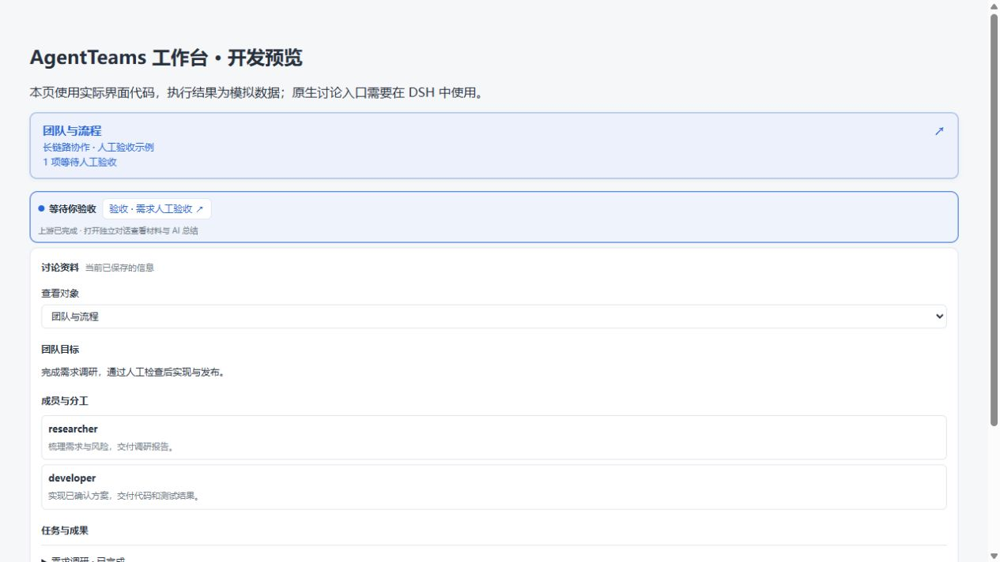
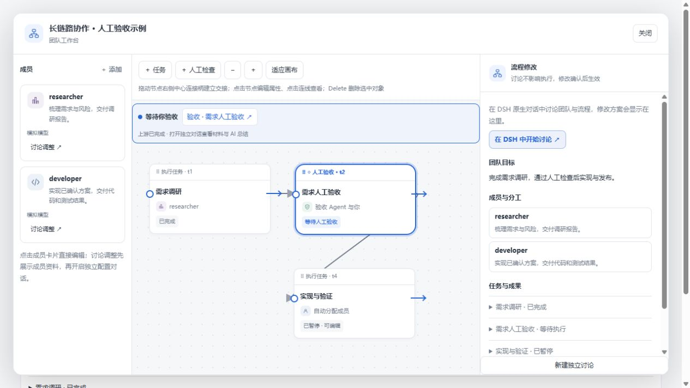

# 人工验收提示与开场材料（2026-10-27）

人工节点使用独立的圆角虚线框和「◇ 人工验收」标题；可验收时切换为实线高亮框。任务交接仍使用同一套拖线、选线、Delete 删除交互。

上游完成、检查点可以验收时，团队入口、画布和队长聊天标题区出现「等待你验收」及呼吸圆点。点击具体检查点直接进入独立 DSH 验收对话，不必先打开画布。系统启用减少动画时，圆点保持静态。

首次打开会先显示检查要求、轮次、上游任务及结果摘要，同时保存本轮完整证据。验收 Agent 随后读取材料，整理成果总结、逐项清单、证据缺口和待用户判断的问题。模型总结在打开对话后生成，不是在后台预先完成。通过或拒绝仍由用户决定，拒绝后讨论返工对象。

同一轮重复点击继续已有独立验收对话；返工后的材料变化会补充新一轮清单，避免重复创建会话。已有对话正在生成时，材料更新等待其空闲后重开入口。

## 界面验证

以下截图来自真实前端组件的开发预览，执行状态为模拟数据；没有重新安装日常 DSH，也没有在本次调用真实模型。原生会话创建、材料持久化、轮次刷新和不重复发送通过自动化测试验证。

验证：Windows 构建通过；35 项工作流及工作区相关测试通过；隔离 WSL 的完整 pnpm verify 通过。新增首次验收会话测试检查了开场清单、成果摘要、证据落盘、会话隔离及重复点击行为。
