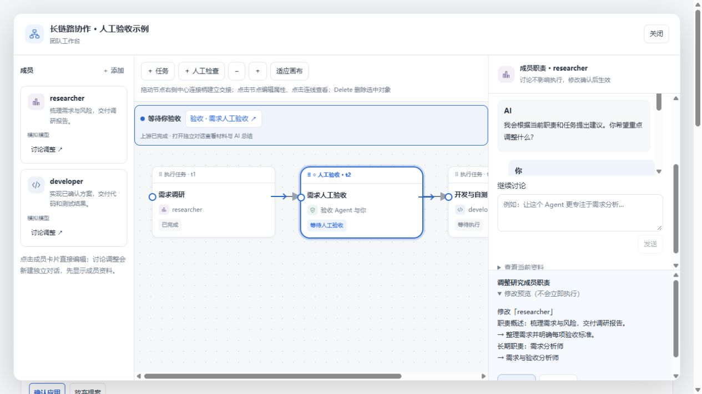
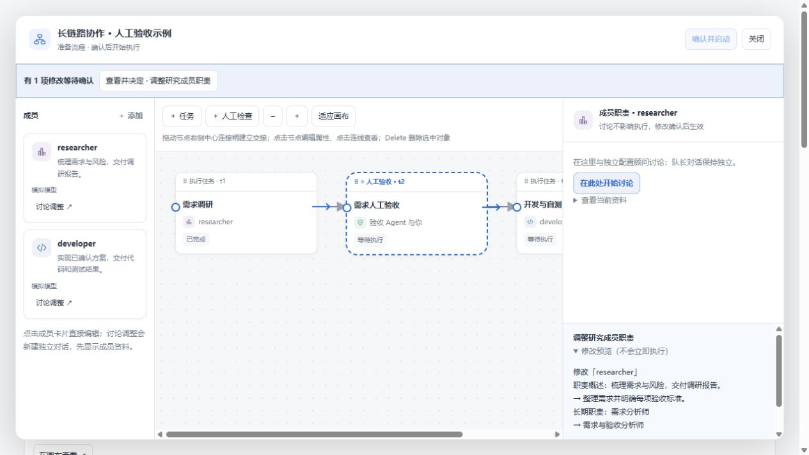

# 窗口内讨论与确认（2026-10-27）

在「团队与流程」中点击成员的「讨论调整」，右侧直接显示独立会话的消息和输入框，左侧成员与中间画布保留。团队流程讨论和人工验收讨论也可在工作台中进行；提案在同一窗口预览、确认或放弃。需要完整 DSH 原生对话功能时可主动打开原生会话。

同一成员重复进入默认延续已有上下文，仅首次打开生成开场说明；主动新建才归档并重新开始。独立会话不继承队长历史。可用时，宿主会按队长已归属的项目将新会话分组；宿主不支持或归属不明确时，保留宿主默认行为。嵌入视图目前按消息轮询展示已完成的文本，不显示原生界面的完整工具过程或逐字流式输出。

截图为模拟数据；本次没有在真实 DSH 宿主运行真实模型端到端验证。自动测试验证独立会话读取、发送、运行中保护、归属选择和人工确认；构建及回归测试见提交记录。

如果「确认并启动」变灰，窗口顶部会列出待确认的修改，点击「查看并决定」直接预览并选择「确认应用」或「放弃修改」；处理完所有待确认项后即可启动。若正在编辑表单，先保存或取消该编辑。

