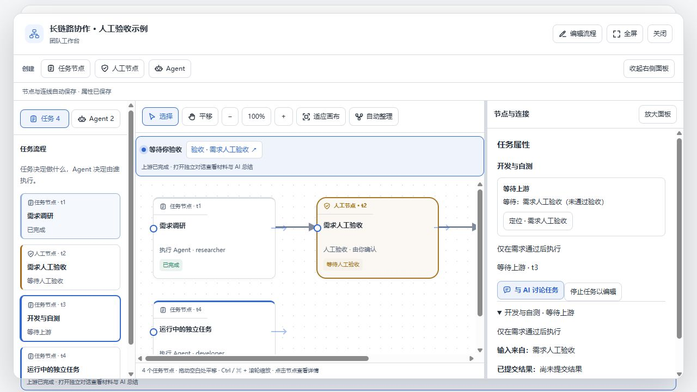
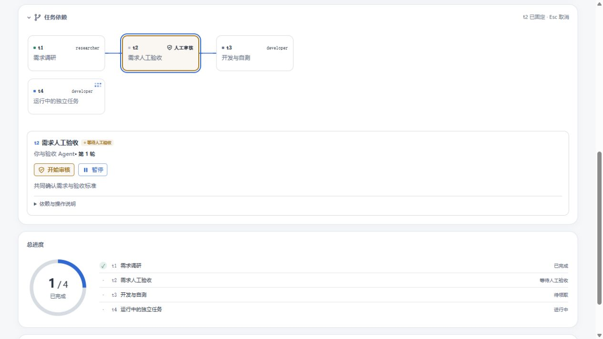

# 界面语义图标

复用插件已有 SVG 图标方式，使用统一的 currentColor 线性图标，未增加图标依赖或远程资源。

- 清单表示任务，机器人表示 Agent，盾牌勾选表示人工审核。
- 调节表示节点属性，对话气泡表示 AI 讨论。
- 画布入口、编辑、全屏、选择、平移、适应画布和自动整理使用对应工具图标。
- 所有新增图标隐藏于辅助技术，保留按钮文字与原有可访问名称；保留成员头像与运行动画。

验证：TypeScript 编译、客户端打包、27 项相关测试及项目 verify 检查通过。使用实际组件的模拟预览检查画布工具栏、任务／Agent 分类、节点类型与人工审核按钮的尺寸和对齐，未调用真实模型或更新已安装插件。

