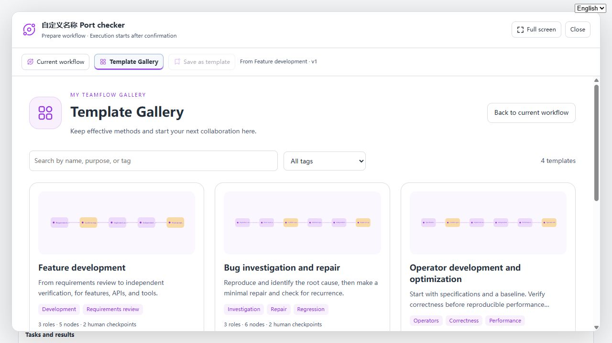
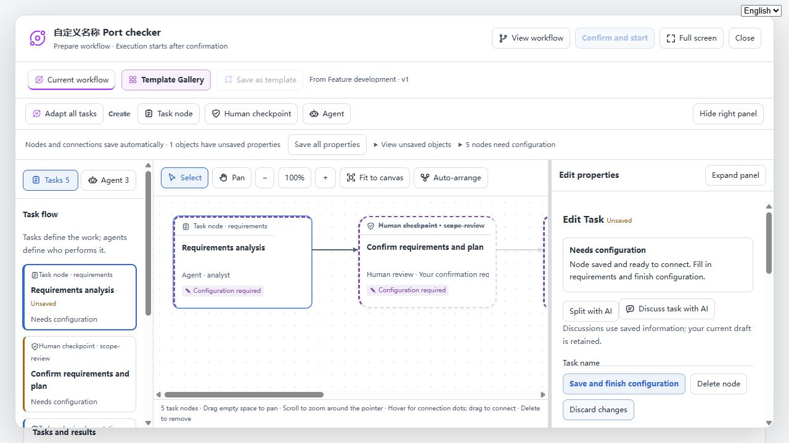

# TeamFlow 语言同步验证（2026-10-31）

版本：0.2.5-dev.3，仅 dev。

## 发现与修复

原活动面板使用宿主 locale 服务，但新增 Gallery、画布与分层编辑页面存在大量中文常量。新增局部翻译上下文，所有界面沿用宿主的语言回调；切换语言不重建编辑组件。插件反馈按当前语言显示，未知外部错误保留原文。

内置的三个模板提供中英文展示与通用要求。英文界面应用内置模板时，HTTP 请求携带语言，由服务端实例化英文内容。个人模板、已有任务、模型回复及用户草稿不自动翻译；模板 ID、成员 ID、节点和依赖不变。

额外修复：新模板的本次要求为空时，显示“待配置”，不误报为旧版执行要求。

## 验证

- 110 项 Node 回归测试通过：流程、模板、提案、可用性、工作区、issue-262 和新增双语回归。
- 新增双语静态渲染快照覆盖分层视图、分层编辑、讨论资料、提案审阅、重跑影响与讨论入口；检测英文残留中文及翻译占位符一致性。
- 本地浏览器使用实际 React 页面、模拟执行数据。验证 Gallery 列表及详情在中英文间即时切换，用户填写的流程名和目标保持原文；应用英文内置模板后，五节点通用层为英文。任务草稿切换语言、刷新页面后仍保留。最终浏览器控制台无 error。
- 打包后的插件在项目固定 Harness 0.2.1-rc.2 中通过真实 HTTP 路由验证：模板提炼、统一适配、人工确认、版本隔离、执行、一键拆分、内置模板和新增英文模板应用。此集成测试的模型输出使用确定性 fixture，不是本轮真实模型推理。
- 未连接用户远程 DSH 服务；浏览器语言选择器调用与宿主相同的 locale 回调接口，远程安装后的实际页面需要加载本开发版本才能获得修复。

补充校验：7 项发布元数据测试通过；修复旧校验不支持 -dev 版本的问题。开发包 publishConfig.tag 设为 next，未执行发布。
