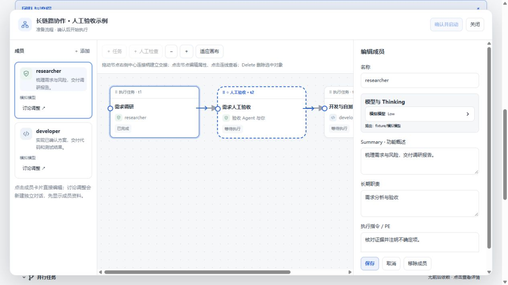
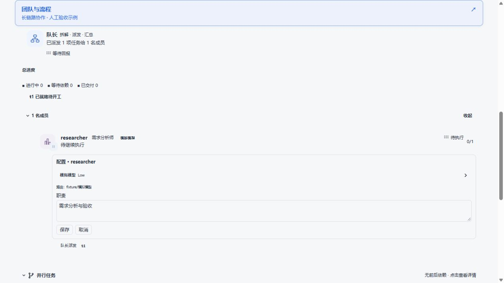

# 成员选中与快捷配置（2026-10-27）

在「团队与流程」中点击左侧成员卡片，右侧编辑区顶部显示模型与 Thinking；该成员负责的所有任务在画布中高亮。切换成员时编辑区回到顶部。没有任务的成员不会高亮任何任务节点。

在 TeamFlow 活动页面点击成员，直接展开模型、Thinking 和职责的简洁编辑区；点击「保存」写入。执行对话仍可通过单独的「执行对话」按钮打开。历史团队只读；成员正在执行时，保存配置会提示先停止任务。模型目录由宿主提供。

截图及交互测试使用模拟数据和模型目录，不代表本次在真实 DSH 宿主中完成验证。测试覆盖切换成员、显示设置、关联任务高亮、活动页保存职责并重新打开，以及现有工作流的回归测试。
