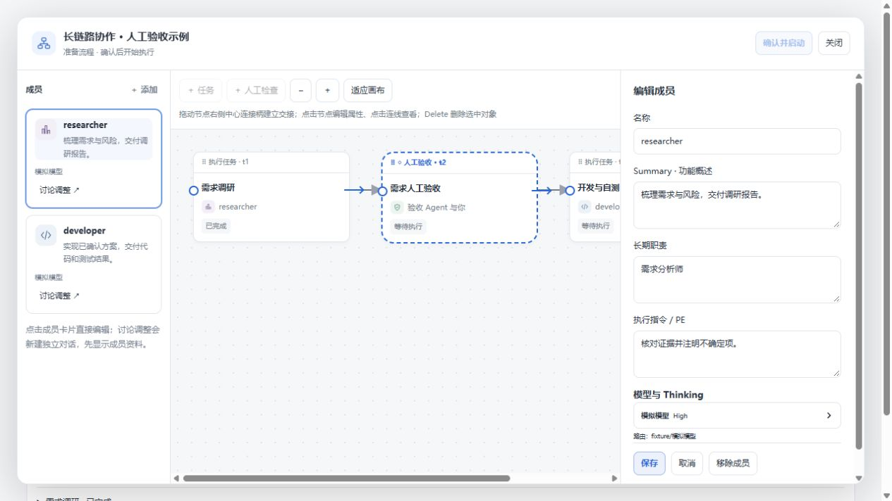
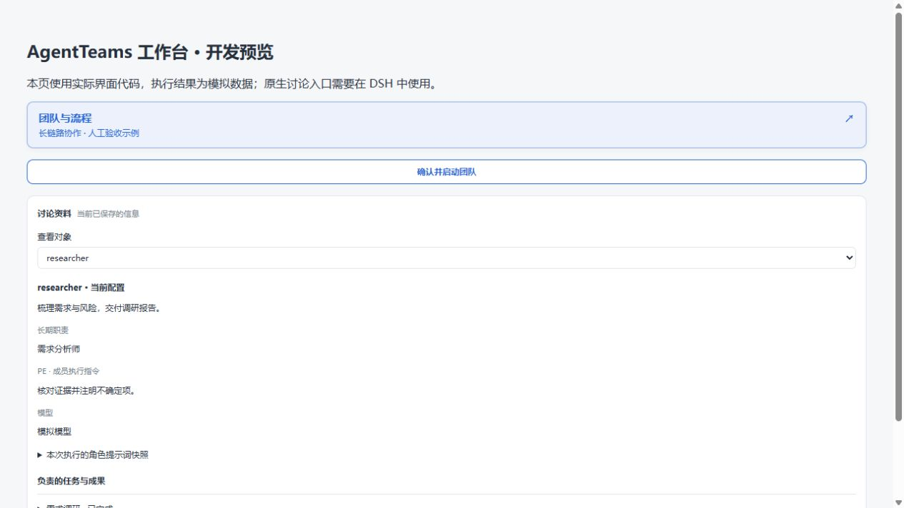

# 成员模型与团队启动（2026-10-27）

打开「团队与流程」并点击成员卡片，右侧「模型与 Thinking」使用 DSH 的模型目录选择模型和思考强度。点击「保存」后生效；更换模型时默认使用该模型的默认思考强度。若成员正在执行任务，先停止相应任务再编辑。手动选择新路由会清除旧的备用模型活动状态。

待启动团队在 TeamFlow 活动页可直接点击「确认并启动团队」，也可在工作台右上角启动。工作台中有未保存的编辑时需先保存或取消；有待确认的 AI 修改时需先处理。

截图来自真实前端组件的独立开发预览，模型目录、菜单容器和任务执行均为模拟；本次未安装至日常 DSH 或调用真实模型。自动化测试验证了路由和思考强度持久化、无效模型原子拒绝、旧备用状态清除及工作流回归。最终以目标机器上的 DSH 模型目录为准。
