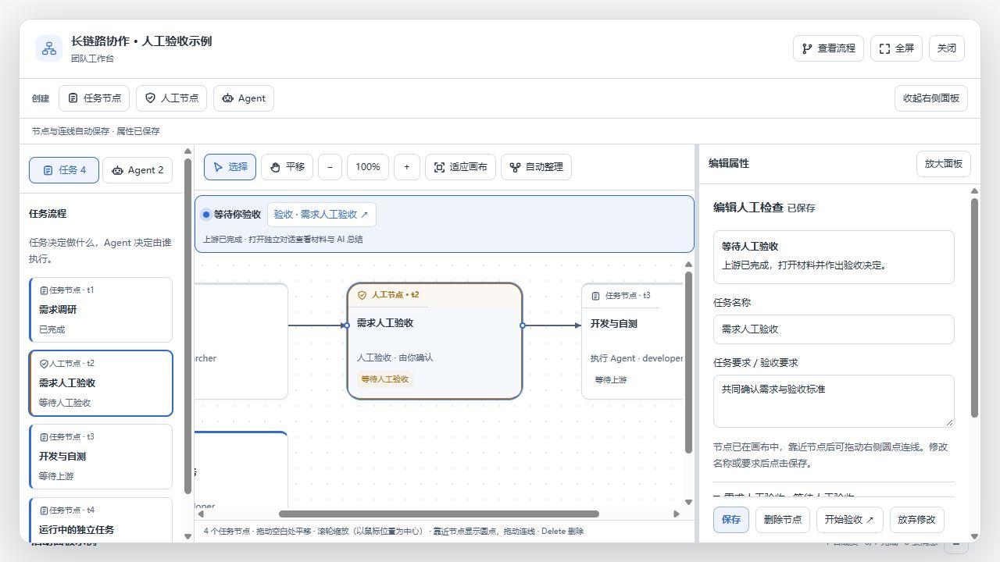

# 连接圆点与线端对齐修复

圆点绝对定位参照节点边框内侧，SVG 路径使用节点外侧坐标；此前普通节点顶部 3px、侧边 1px 和人工节点 2px 边框未补偿，导致偏移。CSS zoom 还会将边框取整到设备像素。

现在节点宽度与连接高度来自共享常量，持久连线、临时连线和目标吸附共用连接坐标。圆点按实际渲染的边框厚度定位，并在缩放、节点变化时更新；边框读取集中在样式写入之前，避免逐节点反复读写布局。箭头参考点使用实际尖端，取消额外 1px 偏移。

验证：客户端 TypeScript 编译、打包、连线吸附／布局回归及项目 verify 检查通过。实际组件预览测量「普通→人工」及「人工→普通」连线端点与圆点中心的屏幕坐标差：

| 缩放 | 最大横向偏差 | 最大纵向偏差 |
| --- | --- | --- |
| 50% | 0px | 0px |
| 100% | 0px | 0px |
| 150% | 0px | 0.015625px |

预览使用模拟团队，未调用真实模型或更新用户已安装插件。

