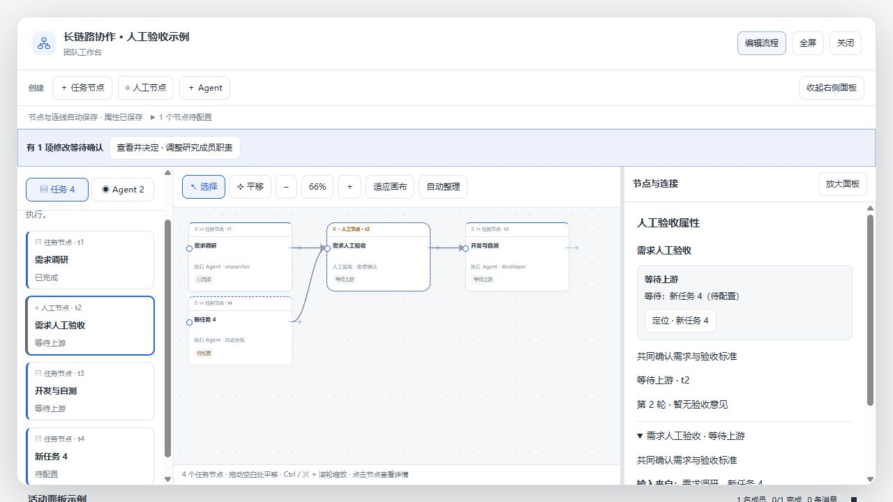

# 人工审核退回后接入新节点

修复退回人工审核后，将新增返工节点连入审核节点时错误提示「请先停止目标任务」的问题。前端拖线校验和服务端任务修改校验原先把所有已作出决定的人工节点都判为不可编辑，退回节点没有执行进程，无法通过停止操作解除限制。

现在可以从新增任务输出端连接到已退回审核的输入端：

- 连接成功后开启下一轮审核，保留上一轮退回意见和证据历史，清除当前轮的旧决定。
- 审核继续等待所有上游完成，旧轮次的材料不能批准新轮次，下游仍由新一轮人工通过后放行。
- 放宽范围仅限给待处理、已退回审核接入新上游的依赖修改。删除依赖、修改名称或要求不会隐式重开审核；已通过的审核和已开始的普通任务保留原限制。
- 循环、悬空依赖、过期请求继续拒绝，失败时不改变原审核轮次或历史。

验证：服务端／客户端 TypeScript 编译、客户端打包通过；`scripts/workflow.test.mjs` 50 项通过，新增覆盖前端连线检查、修改事务、审核历史、重复连线、循环、已通过节点保护及真实 HTTP 路由的材料刷新／再次审批。浏览器使用实际界面完成「退回 → 创建空任务 → 拖线接回 → 查看第 2 轮」交互，控制台无错误。截图来自本地模拟预览，未操作用户真实执行会话。
