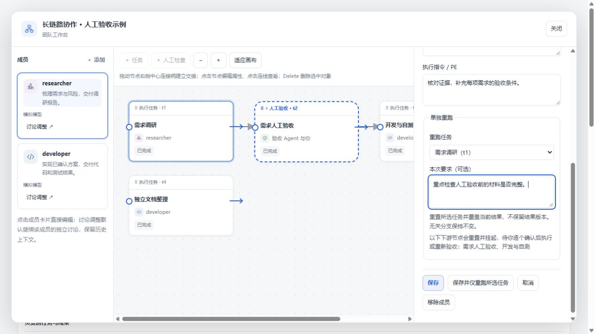
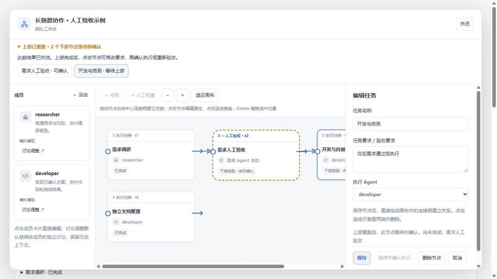
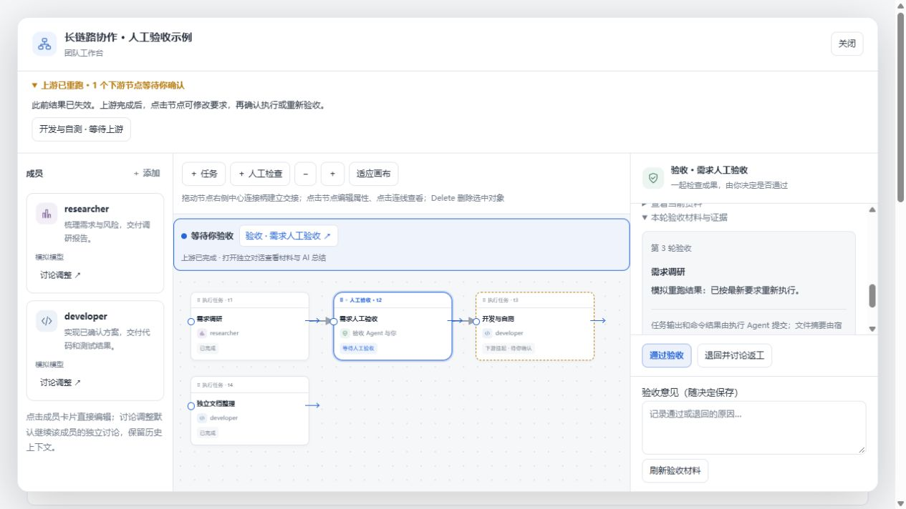
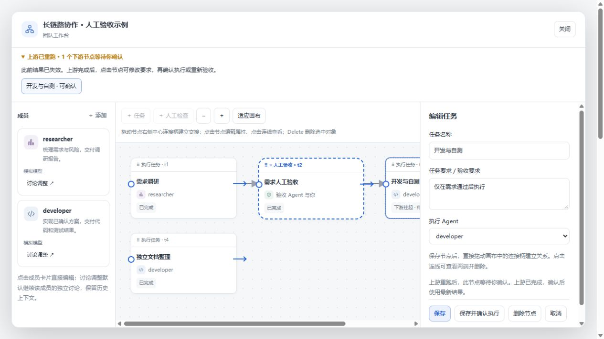
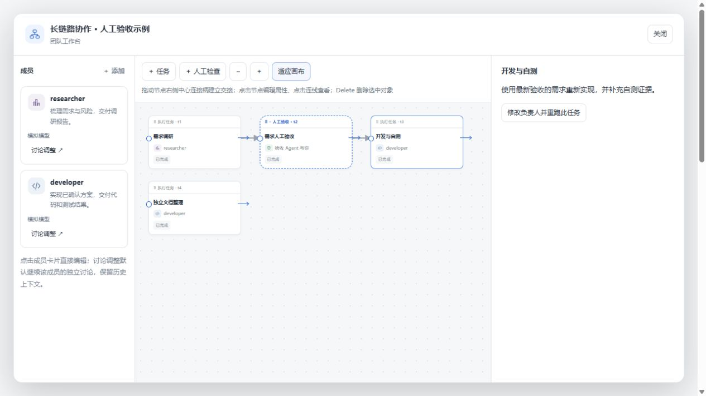

# 单个任务覆盖重跑与下游确认（2026-10-27）

流程已经结束，或停在人工检查时，仍可调整某个 Agent 并重跑它的一个已结束任务。任务 ID 和连线保持不变，当前结果被重置，新执行结果覆盖当前记录，暂不提供结果版本管理。

所有直接、间接下游节点都会重置并挂起，包括已经完成的任务和人工检查。无关分支及其他成员配置保持不变。实际工作区文件不会因此回滚；执行 Agent 仍按任务范围修改文件。

## 操作

1. 打开「团队与流程」，点击成员卡片。在右侧修改职责、PE、模型或 Thinking，在「单独重跑」选择任务，填写本次要求，点击「保存并仅重跑所选任务」。活动面板的成员快捷设置也支持选择重跑任务。

2. 顶部提示列出所有挂起节点。画布用虚线边框和「下游挂起 · 待你确认」标注。点击节点仍可编辑要求及拖线调整连接；上游尚未完成时，确认按钮不可用，并显示未完成的上游名称。独立文档分支继续保持完成。

3. 人工检查的上游完成后，点击「保存并确认重新验收」，直接在同一窗口打开验收讨论和最新材料。旧审批失效，原讨论上下文保留，材料按新轮次刷新。截图第 3 轮来自重复重跑检查；任务 ID 仍为 t1–t4。

4. 人工验收通过后，后续执行任务仍保持挂起。由用户点击节点，按需修改要求，再「保存并确认执行」。没有自动批量放行。

5. 确认后执行所选下游，结束后覆盖当前结果。整个过程不增加重复任务，也不重跑独立分支。

受影响的任务若仍在运行，先停止它们再发起重跑。保存和确认均校验当前状态，过期操作不会覆盖更新后的流程。旧执行凭据和结果证据随重置失效，执行次数继续递增。

## 验证范围

- 57 项工作流、审批差异和工作区回归测试通过；包含原地覆盖、传递挂起、无关分支保留、重复重跑、过期确认拒绝、新验收材料以及挂起状态持久化。
- 集成测试调用实际工作台 HTTP 路由和调度器，证明只派发所选任务；上游完成和人工批准均不会自动派发挂起下游。
- Windows 构建通过；隔离 WSL 副本完整 `pnpm verify` 通过。
- 截图来自真实 React 界面配合独立测试数据（`TEAMFLOW_PREVIEW_RERUN=1`），任务完成和聊天内容为模拟数据。本轮未调用真实模型，未重新安装到日常 DSH profile，不代表真实宿主模型端到端验证。
