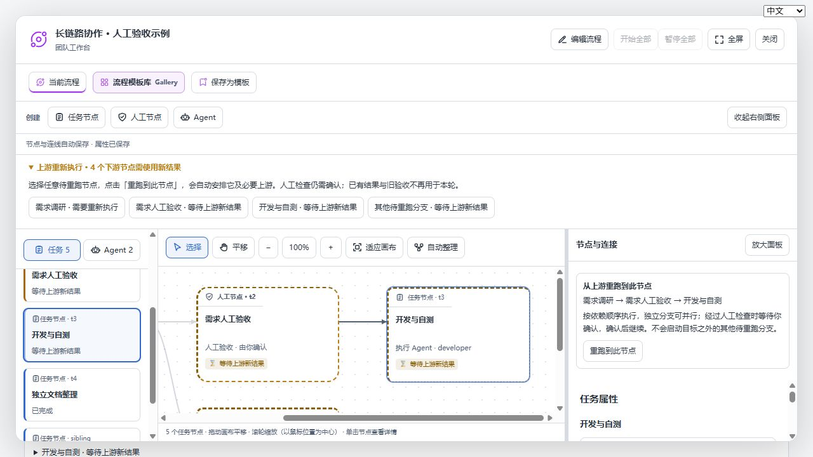
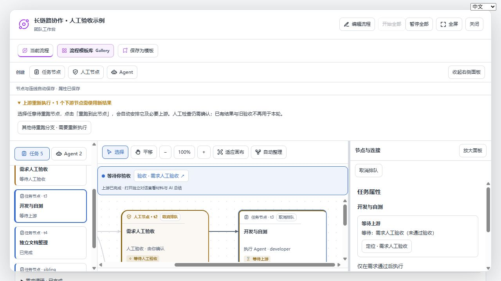

# 重跑到指定节点验证（2026-10-31）

开发版本 0.2.5-dev.5。

## 行为

例如 A → B → 人工检查 → C，上游 A 重跑导致下游失效后，直接在 C 的属性中点击“重跑到此节点”。系统确认并安排必要上游及 C，普通任务按依赖调度；人工检查需重新阅读材料并批准，批准后继续。其他待重跑分支保持暂停。

已完成的有效前置不重置；仍在运行的上游保持当前 attempt。未处理的失败、未完成配置或手动暂停需要先处理。重复点击和陈旧版本请求被拒绝，检查失败不会部分解除挂起。已排队的节点仍可使用原有暂停操作取消排队。

## 验证

- 75 项工作流、可用性和双语回归通过。新增实际调度器测试覆盖运行中上游不重复派发、菱形分支并行、汇合、人工关卡、批准后自动继续、无关分支与目标之后的节点保持暂停、重复/陈旧请求及失败时原子性。
- 本地浏览器使用真实 React 界面和模拟执行：点击末端节点后，最早待重跑上游执行，人工关卡等待确认，目标已排队，无关待重跑分支仍暂停；英文状态提示随语言切换。
- 打包插件在固定 Harness 0.2.1-rc.2 中，通过鉴权 HTTP 路由验证上游重跑后一次安排两层下游人工关卡，批准前一关后后一关自动进入可验收状态，无需再次恢复。该集成测试模型输出使用确定性 fixture。
- 未运行新的真实模型推理，也未连接远程 DSH。

集成测试初次运行暴露了脚本模型仅支持一次任务的问题：它将旧轮次工具调用当作本轮已执行。测试替身现按最新任务派发分隔历史；同一产品安装包重新验证通过。未为使测试通过更改产品调度逻辑。
