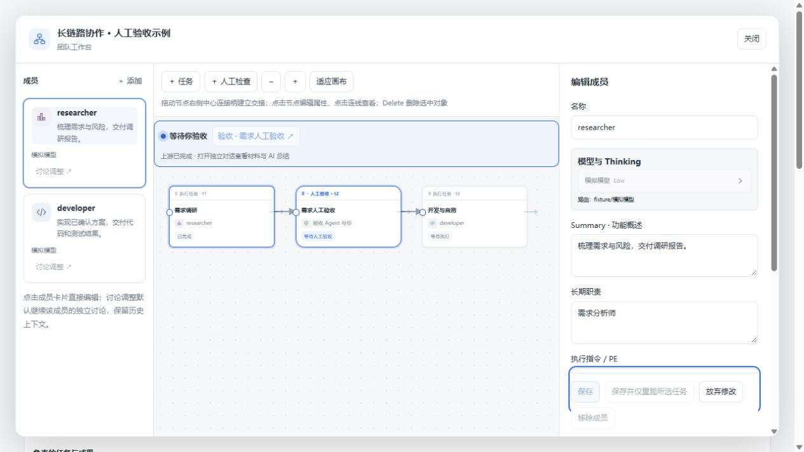
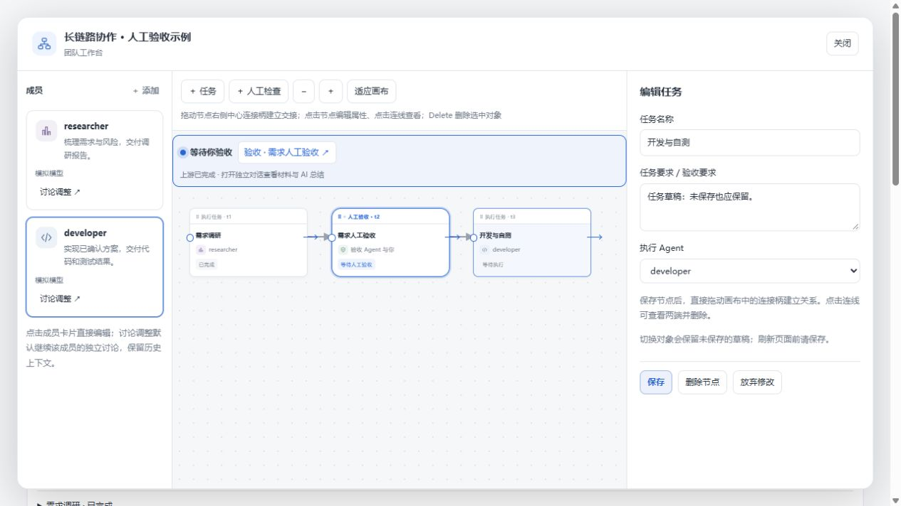

# 成员与任务选择统一（2026-10-27）

最左侧成员卡片固定打开成员配置（模型、Thinking、Summary、职责、PE）；画布节点固定打开任务或人工验收属性。已经开始或结束的任务展示任务属性及相应运行控制。关联成员或任务只同步高亮，不改变属性面板的对象类型。

旧实现中，成员卡片主按钮在请求处理中被禁用，而卡片空白区域仍能点击；成员、任务及连线又分别维护选择状态。现在使用单一选中对象，并允许在请求处理中切换；晚返回的保存、删除或讨论请求不能切回旧面板。关闭工作台也会使旧请求的自动打开动作失效。

成员、任务、人工检查和新建对象的草稿按团队与对象分别保留。切换、重复点击或关闭再打开工作台不会丢弃草稿；「放弃修改」只清除当前对象草稿。保存后仍停留当前对象。页面刷新会丢失尚未保存的草稿。

保存请求发出后继续输入时，返回结果只确认已经提交的值，后续输入仍作为草稿保留，可以再次保存。若当前对象配置被其他操作改变，会提示核对并提供「重新载入」，不会直接用旧草稿覆盖。移动或连接节点不会使不编辑连线的属性草稿失效。

验证：61 项工作流、审批及工作区回归测试通过，Windows 构建和隔离 WSL 完整 `pnpm verify` 通过。浏览器使用真实 React 界面与模拟团队数据，将保存请求延迟 12 秒，验证了请求中从任务切到成员、旧请求返回后保持成员面板、成员与任务草稿来回恢复、放弃当前草稿，以及保存期间继续输入后再次保存。截图来自独立测试页；本轮未调用真实模型，也未重新安装日常 DSH profile。
