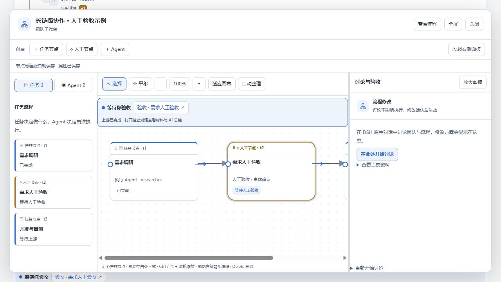

# 停止任务后可在画布删除

停止接口此前看到 `workflowPaused` 且成员没有 stopping 标记就直接返回成功；旧状态或中断停止可能仍保留 claimed/in_progress，使画布以为任务仍在执行。现在只有任务已回到 pending 且无交接或成员停止过程时，才把重复停止视为已完成；其余情况继续收尾、清理执行令牌，并发布最新快照。

预览接口同步补全 stop_task 和暂停后的状态收尾，避免仅更新暂停标记导致同样的删除拦截。

验证：TypeScript 编译及打包、55 项 workflow 测试、项目 verify 检查通过。新增正式接口回归覆盖 stop_task 和 set_task_enabled 两种入口、有／无执行子会话、停止前删除被拦截、停止后断开下游并删除及持久化结果。实际组件预览验证运行节点暂停→进入画布→编辑节点→删除，节点数从 4 变为 3；未调用真实模型。

