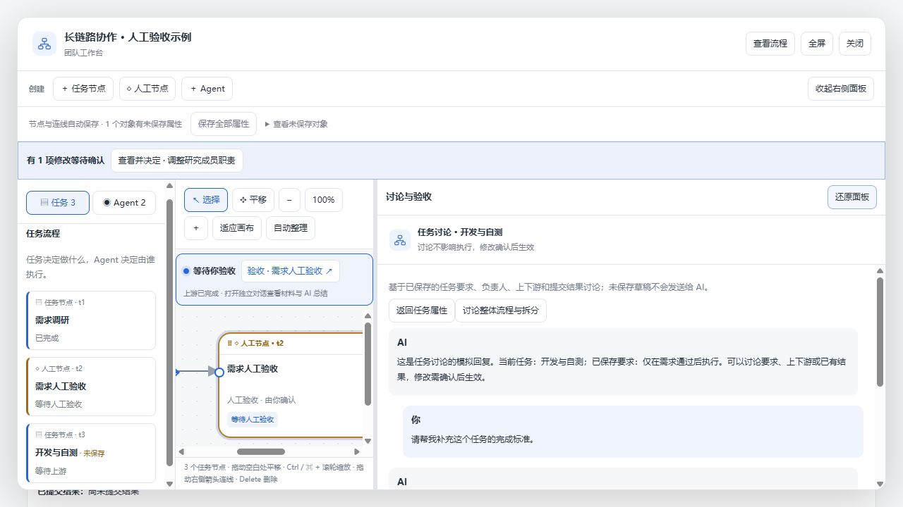
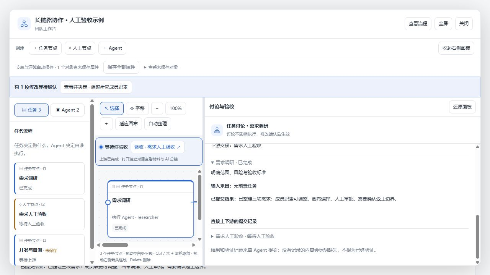

# 普通任务独立讨论

普通任务在查看和编辑属性时均提供「与 AI 讨论任务」。待配置、运行中、已完成、失败和已取消任务都可讨论；编辑运行中的任务仍须先停止，已结束任务通过明确的重跑提案处理。

- 每个任务使用独立的 `task:<id>` 讨论身份，复用自己的原生会话、历史和输入草稿，不混入 Agent 或其他任务的讨论。
- 自动读取已保存要求、负责人配置、直接上下游、已有结果、验证记录和失败信息。未保存的属性草稿不发送给 AI，返回任务属性后仍保留。
- AI 仅可读取上下文、为当前任务提出修改或重跑提案。用户在讨论资料／画布中确认后才生效。讨论和普通修改提案不解除「待配置」状态。
- 可以讨论拆分方案；涉及多个节点的修改通过「讨论整体流程与拆分」切换到流程讨论。人工节点继续使用原来的验收入口。
- 重新打开保留历史；每轮读取最新状态，过期提案不可应用。删除任务后，旧讨论不能继续访问上下文或生成提案。

## 验证

- 服务端／客户端 TypeScript 编译、客户端打包、Git 构建产物检查、`scripts/verify.mjs` 均通过。
- `scripts/workflow.test.mjs`：48 项通过；草稿、提案审阅和工作区摘要相关测试另 18 项通过，共 66 项。
- 新回归覆盖原生会话创建与恢复限制、上下文范围、跨任务操作拒绝、读取／发送隔离、仅用户确认后修改、待配置状态保留、过期上下文、任务删除、运行中任务不可修改、失败结果读取与重跑提案。
- 浏览器使用实际 React 界面及工作流 reducer 验证普通／已完成任务入口、消息发送、重新打开历史、不同任务消息隔离、返回编辑保留草稿和上下文显示；控制台无错误。
- 截图为本地预览，AI 回复为模拟数据。未触发用户真实任务执行，未更新用户安装或发布 npm 版本。
