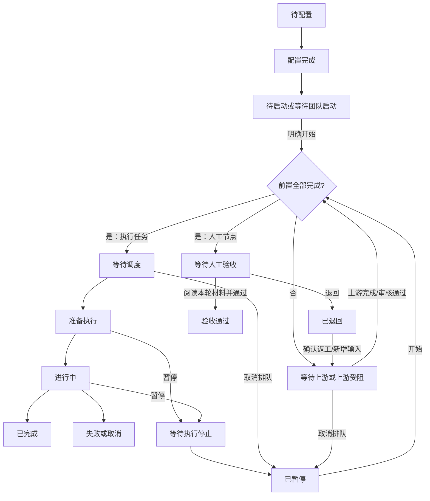
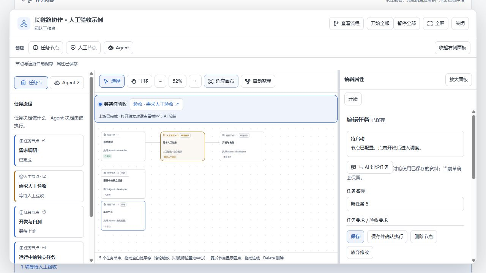

# TeamFlow 任务状态与控制规则

## 核心区别

任务是否允许调度、执行进行到哪一步、依赖是否满足，是三个不同的维度。`pending` 只代表尚未领取，不能直接翻译为「暂停」，也不能因为 `workflowPaused !== true` 就显示执行中的暂停按钮。

活动页、画布节点和属性区使用同一个 `taskControlState` 判断操作。画布的 `taskReadiness` 在相同基础状态上补充具体原因：缺少执行成员、成员繁忙、成员启动失败、等待队长以及具体上游。

## 状态和可用操作

| 展示状态 | 条件／含义 | 操作和下一步 |
| --- | --- | --- |
| 待配置 | 已创建占位节点，要求未填写完成 | 编辑并保存配置；不能开始或批量绕过 |
| 等待团队启动 | 初始方案仍在 staged 阶段 | 确认并启动团队；配置和待确认提案必须处理 |
| 待启动 | 运行中新增节点尚未明确启用 | 单节点开始或开始全部 |
| 等待上游 | 已允许调度，但至少一个前置未完成 | 自动等待；可取消排队，不显示执行暂停 |
| 上游受阻 | 直接上游失败、取消或人工退回 | 处理上游后继续；开始不会跳过依赖 |
| 等待调度 | 前置已完成，等待调度器和成员 | 自动调度；可取消排队 |
| 准备执行 | 原始状态 `claimed`，Agent 已领取，尚未进入 `in_progress` | 可暂停；不是完成，也不等于正式执行中 |
| 进行中 | 原始状态 `in_progress` | 暂停当前执行 |
| 等待执行停止 | 已请求暂停，但执行会话仍在停止中 | 禁止重新开始；失败时重试停止 |
| 已暂停 | 人工暂缓调度，或执行停止已完成 | 开始后重新调度；被中断的工作重新执行，不是从指令位置续跑 |
| 等待人工验收 | 审核节点启用，全部前置完成 | 打开材料后由人通过／退回；启用不等于通过 |
| 已退回 | 人工审核明确拒绝 | 讨论并确认返工，或增加新的上游进入下一轮 |
| 待确认重跑 | 上游重跑导致下游成果失效 | 等全部上游完成，逐节点确认使用新成果重跑／重新验收 |
| 已完成／验收通过 | 正常终态 | 保留成果；执行任务可明确重跑 |
| 执行失败／已取消 | 非成功终态 | 不放行下游；执行任务可修改后重跑 |
| 团队已停止／归档 | 团队停止或历史记录 | 禁止普通节点开关；通过已有恢复流程处理 |

状态优先级为：终态／审核决定、配置和返工确认、团队限制、停止中、节点暂停或待启动、团队待启动、实际执行状态、依赖、审核或调度等待。历史记录只读。画布另外显示执行成员的可用性说明。

## A → B → C 和新增节点

初始方案确认启动后，A 可以先运行，B、C 自动等待依赖，不应显示为正在执行。已排队节点使用「取消排队」，暂停按钮仅用于已领取或执行中的任务。

运行中通过画布手动添加、或确认 AI 提案添加的 B，统一进入待启动；人工节点也遵守同一规则。新占位节点先待配置。完成配置仅保存要求，不会偷偷启动。单独开始 B 只允许 B 排队，不会启动 A，也不会越过 A。开始全部可一次启用符合条件的 B、C，之后按顺序自动运行。

插入 B 必须同时建立 A → B、B → C，并移除不再需要的旧连接。如果 C 已领取或开始执行，须先暂停并等待停止，再编辑依赖；如果 C 已完成，不能倒改它的历史依赖来声称 B 曾是前置，应明确进入重跑／返工流程。删除仍被下游引用的节点也需要先处理连接。

## 人工审核与返工

链路 A → 审核 → C 中，A 完成只会使审核就绪，C 仍等待。点击开始全部不会代替审核决定。审核必须读取当前轮次材料并校验证据，材料变化后需要重新打开。审核暂停、退回、待配置或待确认重跑时均不能批准。

退回保留历史决定和意见。确认返工会建立新一轮；向被退回节点接入新的上游也会保留历史并开启新轮次。上游重跑会使受影响下游挂起，先等待新结果，再逐节点确认；批量开始不会代替这一步，也不会重跑已经结束的任务。

## 两个页面的操作范围

- 活动页提供开始全部、暂停全部，以及节点开始、取消排队、暂停、重试停止、审核和属性入口。
- 画布顶部提供相同批量控制；节点卡片本身和右侧面板均可直接控制，无须退出画布。存在该节点未保存属性时，开始等节点操作禁用，避免运行旧要求；可以先保存或放弃修改。全局暂停仍可用。
- 开始全部启用已配置、未结束、无退回／返工确认的节点。只开启调度，不承诺全部同时执行。
- 暂停全部先在团队锁内保存所有目标节点的暂停标记，再逐个停止子会话；停止其中一个失败仍继续处理其他节点，返回明确错误，保留停止中状态供重试。未启用的草稿保留原状态。
- 暂停不会变成取消，也不删除成果；旧执行尝试被隔离，记录保留。取消排队不应生成虚假的执行历史。
- 若任务由队长亲自执行且队长仍在运行，现有宿主限制要求先在宿主停止队长。批量暂停仍会阻止新调度并处理其他成员，界面会报告这个未完成的停止。
- 流程批量操作校验当前快照版本，节点操作校验节点版本，避免陈旧页面覆盖新状态。失败后刷新会得到真实状态。
- 「停止团队」沿用原有终止语义，与可恢复的「暂停全部」区分；归档也不是暂停。

## 验证范围

生产路由和真实调度器测试覆盖：手动／AI 新增任务与人工节点一致；A → 审核 → C 的依赖；批量开始只调度根节点；批量暂停的先阻断后停止；停止失败重试；停止中禁止恢复；配置、退回、返工确认和终态保护；快照版本校验；旧执行记录保留。现有审核材料、返工、删除和依赖编辑回归一并运行。

React 渲染测试覆盖状态和操作文案。浏览器使用实际界面和本地模拟执行服务验证活动页批量操作、画布直接控制和布局；这不等同于真实 LLM／桌面宿主的端到端运行验收。

本次检查通过：88 项流程／工作台／活动页／提案回归，14 项产物与 README 检查，10 项成员失败回归，以及核心检查、生命周期检查、真实 HTTP 路由检查和完整构建。Windows 沙箱限制了本地 HTTP 和临时目录重命名，相关检查在正常本机权限下重跑通过。

以下为本地预览：新增任务保存配置后仍为待启动；同一画布上同时保留等待人工验收、等待上游及已暂停节点。

