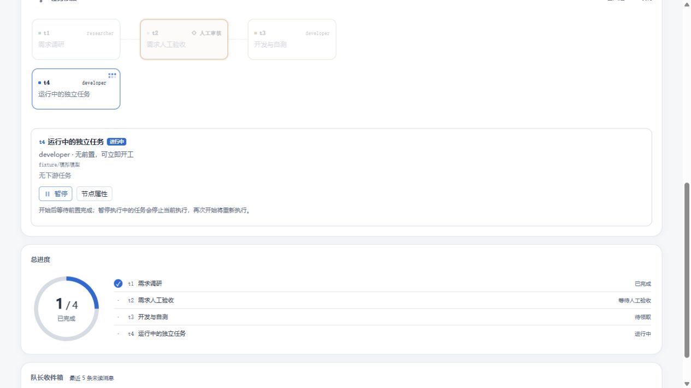
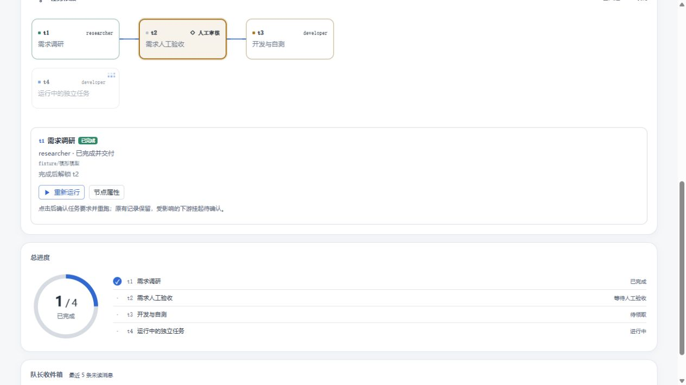

# 任务播放、暂停与重新运行

任务依赖详情中的启用开关改为播放／暂停按钮。已启用（含等待上游或调度）的任务可暂停，手动暂停的任务可开始；实际运行时暂停图标轻微呼吸，节点沿用原运行中动画。减少动态效果偏好下关闭新增动画。

已完成、已失败、已取消的普通执行任务提供播放图标「重新运行」，打开预填任务要求的编辑区，确认并点击「保存并重跑此任务」后进入新一轮。原状态、结果保留在历史记录，下游挂起待确认。人工审核继续走正式验收流程；归档及已停止团队仍按原生命周期处理。

验证：服务端与客户端 TypeScript 编译、打包、27 项相关测试和项目 verify 检查通过。实际组件配合模拟 API 验证暂停→开始后等待上游、运行中暂停按钮，以及完成任务→重新运行→保存→待调度；界面显示历史执行记录 1 次和两个下游待确认。未调用真实模型。

