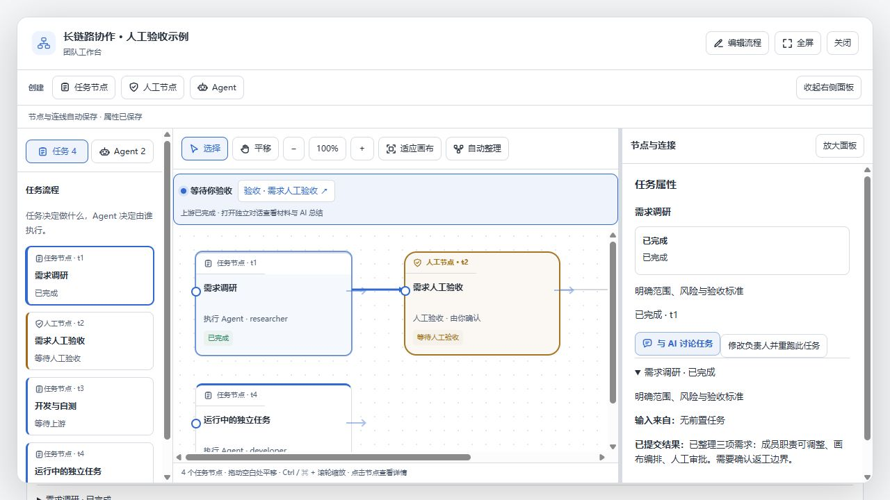

# 首次启动状态与画布连线聚焦

新建任务保持原来的显式启动要求，但不再把首次等待显示成暂停。待配置优先显示，完成配置后为待启动；开始后等待依赖与调度，主动暂停后为暂停。首次启动意图保存到任务并同步到活动快照，重跑和取消会清除该意图。旧普通任务在没有执行、停止或交接记录时兼容识别为首次待启动；旧人工审核不据此猜测首次启动。

画布点击任务时，其直接输入／输出连线加粗并变蓝，其他连线不透明度为 0.25。选中连线、悬停及键盘聚焦仍可高亮，无关线仍保留原来的宽点击区域。箭头尺寸固定为 8px，避免加粗线条时放大箭头。切换状态采用 180ms 过渡，减少动态效果偏好下关闭过渡。

验证：TypeScript 编译与客户端打包、73 项相关测试及项目 verify 检查通过；另验证正式接口新任务首次启动标记及主动暂停快照。模拟 UI 实测新建→待配置→保存配置→待启动→确认执行→等待调度，以及主动暂停显示手动暂停。选中需求调研后，浏览器实际计算样式确认直接连线为蓝色且不透明度为 1，无关连线为 0.25。未调用真实模型或更新已安装插件。

