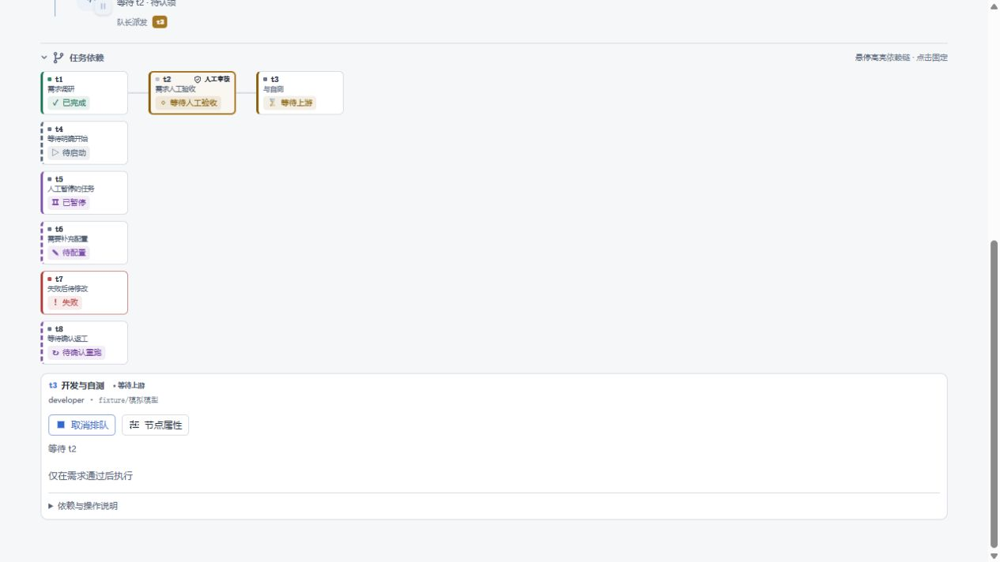
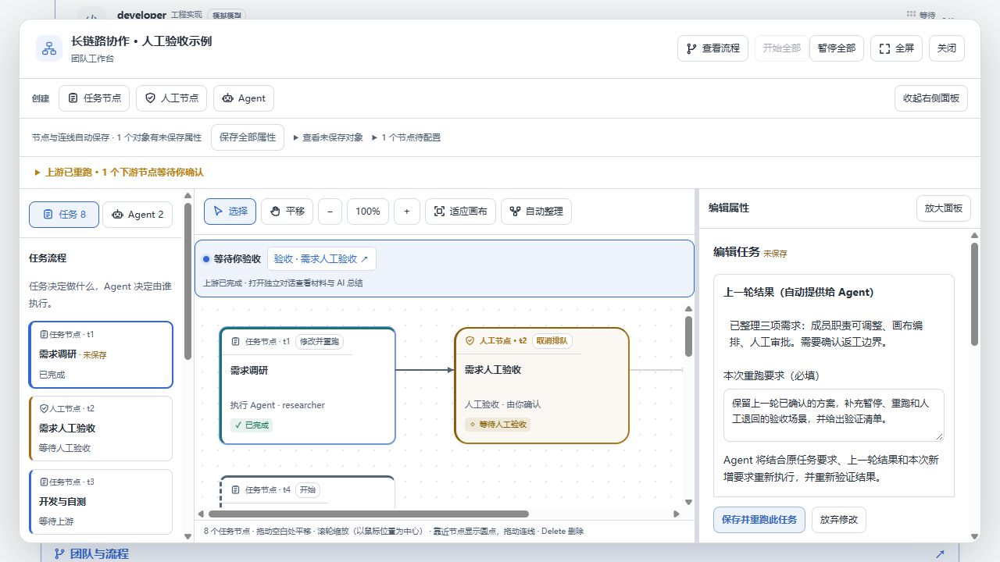
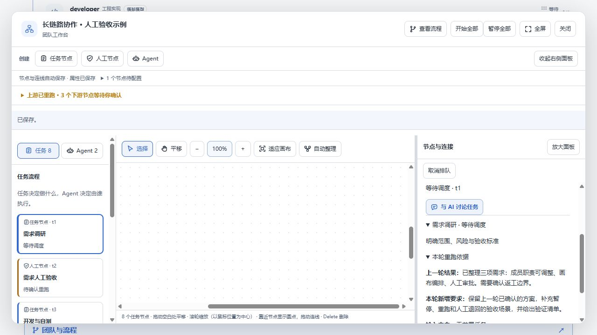

# 框图状态与带上下文重跑

这是[完整任务状态流转规则](../task-lifecycle-2026-10-29/README.md)的补充，覆盖活动页、紧凑浮窗和团队画布。

## 下游为何等待：新版显示

上游重新执行后，下游不能继续沿用之前的输入和验收。原来的「待确认重跑」拆为三个明确状态：

| 当前情况 | 节点显示 | 下一步 |
| --- | --- | --- |
| 任一上游尚未完成 | 等待上游新结果 | 先完成上游任务或人工审核；下游暂不执行 |
| 全部上游完成，普通任务 | 需要重新执行 | 打开节点，可编辑要求，点击「使用新结果执行」 |
| 全部上游完成，人工节点 | 需要重新验收 | 点击「使用新结果重新验收」，阅读新材料后决定通过或退回 |

例如 A → B → C：重跑 A 时，B、C 都等待上游新结果；A 完成后 B 需要重新执行，C 继续等待 B；B 完成后才轮到 C。旧的下游成果保留在历史中，不算新一轮成果。按钮会保存当前要求，再启用执行或打开新一轮验收，不会自动批准。仅调整展示和操作文案，仍由用户逐个启动受影响下游。

下方截图记录的是本次功能最初版本，其中「待确认重跑」和「等待你确认」现已替换为上述表达。

## 状态直接显示

每个节点始终显示文字与图标，并按状态使用边框和浅色标记；不需要悬停或点击。颜色不是唯一识别手段。

| 状态组 | 表现 |
| --- | --- |
| 待启动、等待团队启动 | 中性色、▷，虚线边框 |
| 待配置 | 紫色、✎，虚线边框 |
| 等待上游（含等待上游新结果）、等待人工验收、等待执行停止 | 暖色，分别使用 ⌛、◇、◷ |
| 等待调度、准备执行、进行中 | 蓝色，分别使用 ⋯、◷、▶ |
| 已暂停、需要重新执行、需要重新验收 | 紫色、Ⅱ／↻／◇；需使用新结果的节点用虚线 |
| 已完成、验收通过 | 绿色、✓ |
| 失败、上游受阻、人工退回、过期证据 | 红色，配合文字和 !／↩ |
| 已取消、团队停止、未执行 | 中性色、×／■／— |

两个面板共用状态判断和标记组件。人工节点继续保留节点类型标记。紧凑卡片增加状态行，图的节点尺寸和连线端点同步调整。

## 修改后重跑

1. 在活动页或画布点击已结束执行任务的「修改并重跑」，进入该任务编辑。
2. 顶部展示上一轮提交结果；没有提交结果时明确提示。填写必填的「本次重跑要求」，也可以修改任务要求和负责人。
3. 保存后，服务端从当前任务取上一轮结果快照，不接受客户端伪造历史结果。Agent 同时收到当前任务要求、上一轮结果和新要求。
4. 重新执行并重新验证；上一轮结果只是参考材料，不充当本轮成功或验收证据。
5. 下游挂起等待逐节点确认，人工审核必须重新验收。正在执行的受影响任务必须先停止；其他分支不变。

成员配置中的重跑入口先保存成员配置，再进入任务编辑。AI 提案的编辑审批区同样展示上一轮结果，并要求填写新要求，不能空要求直接重跑。

重跑依据持久化，调度和恢复后仍可传给 Agent；任务记录中可以展开查看。再次重跑使用最近一轮的结果和本次新要求，不把各轮指令不断追加到原任务描述。若编辑期间任务状态、执行轮次或提交结果变化，旧草稿会提示过期，需要核对后重新载入。

## 验证

覆盖紧凑／工作区节点状态渲染、空要求拒绝、历史结果快照、忽略伪造上下文、实际调度提示词、二次重跑不累积旧要求、磁盘持久化、下游失效与审核保护。核心检查、生命周期检查、成员失败回归、状态损坏与打包检查同时执行。Windows 的 POSIX chmod 权限测试按平台跳过。

浏览器使用实际 React 界面和本地模拟执行服务，验证跳转、必填保护、刷新保留草稿、保存后的状态同步与重跑记录；实际调度上下文由后端回归测试验证。此预览不代表真实 LLM／桌面宿主端到端执行已验收。
