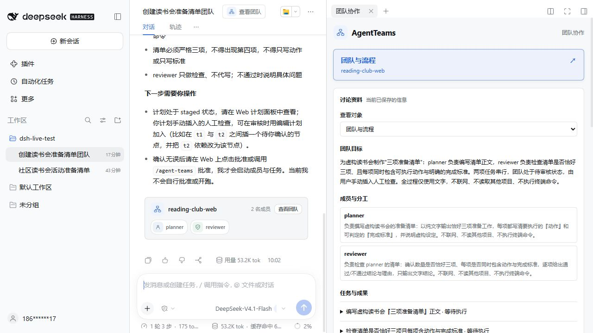
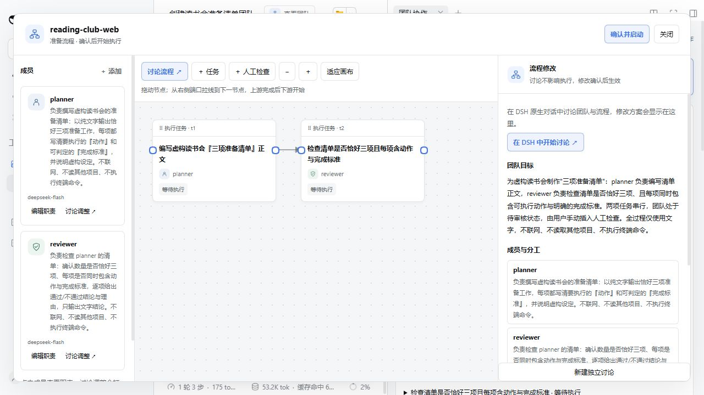

# 「团队与流程」入口更新

2026-10-27：在团队页面顶部放置整行强调色按钮「团队与流程」，并补齐旧式浮动 AgentTeams 活动面板中的入口。按钮显示团队名、待确认修改数和待人工验收数；无团队时进入讨论创建界面。历史团队通过独立只读窗口展示已保存的成员和任务记录，不调用可修改团队的工作流接口。

## 真实 Web 界面

本机官方 DSH `0.2.1-rc.3`，`web` profile，安装本次构建包。沿用此前的 `reading-club-web` 测试团队，未启动任务、未额外调用模型。

1. 打开创建团队的聊天，点击「查看团队」。右侧页面顶部可以直接看到新按钮。



2. 点击「团队与流程」，直接打开成员、流程画布和修改讨论工作台。关闭后回到原页面。



验证：构建通过；32 项工作流、工作区与摘要测试通过；核心 `scripts/verify.mjs` 通过；构建产物一致性检查通过。实际 Web 验证了当前团队入口的显示、打开及关闭。旧式浮动面板与历史入口本次完成代码检查和编译验证，未在旧版宿主中重新执行端到端测试。

## 另一台电脑如何更新

停止该电脑上对应 profile 的 DSH，然后执行（将 `web` 替换为实际 profile）：

```sh
dsh plugin --profile web remove @nanmicoder/dsh-agent-teams
dsh plugin --profile web add github:yogurtss/dsh-agent-teams#main
dsh --profile web
```

重新打开启动时给出的认证链接并刷新浏览器。只执行 `git pull` 不会更新已经安装的 Git/tgz 插件副本。
