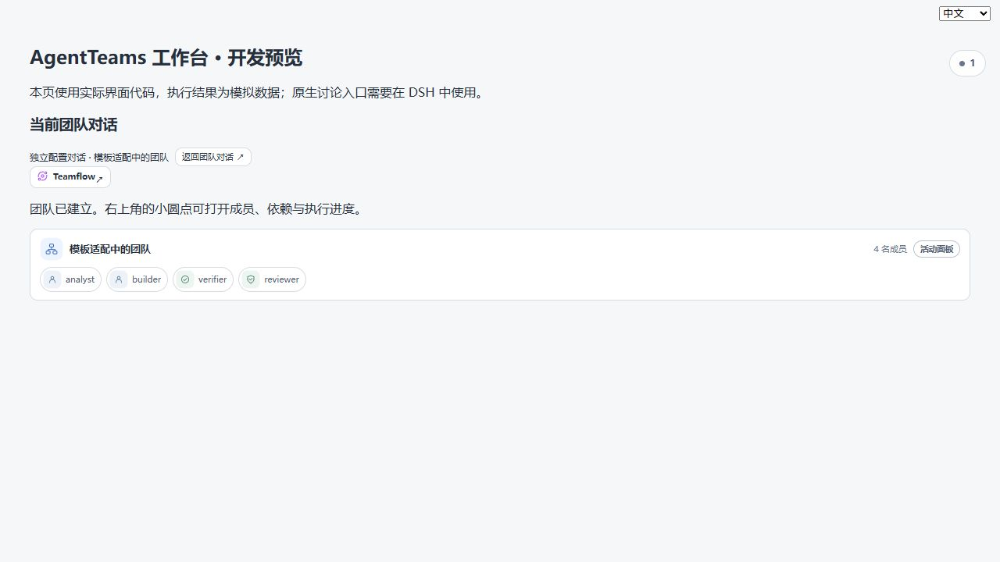
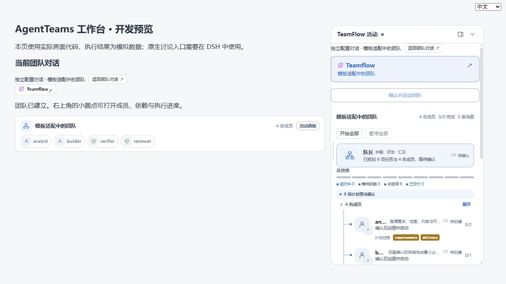

# 模板适配活动入口回归

版本：0.2.5-dev.6；开发分支：dev。

## 原因与修复

模板应用未返回活动快照；随后进入独立适配对话，活动面板又按队长会话 ID 严格过滤，导致已建立的团队无法显示。现在创建、应用和状态读取返回活动快照，面板通过服务端已验证的讨论绑定解析所属队长。普通会话保持原有边界，过期异步响应不会改变当前会话归属。

## 验证

- 本地实际 UI 组件预览：独立适配会话、4 名成员、9 个待配置节点；圆点显示，点击打开面板，收起并刷新后仍显示。
- 打包插件在项目锁定的 Harness 0.2.1-rc.2 中通过模板应用、原生独立讨论归属、冷启动、模板分层、英文模板、检查点与重跑路径回归；模型输出采用确定性 fixture。
- 首次打包回归暴露测试在等待 agent 收尾后继续使用旧版本号；已在等待结束后重新读取状态，再通过回归。产品乐观锁保持不变。
- 未连接用户远程 DSH Web，截图为本地预览，不代表远程已部署。

