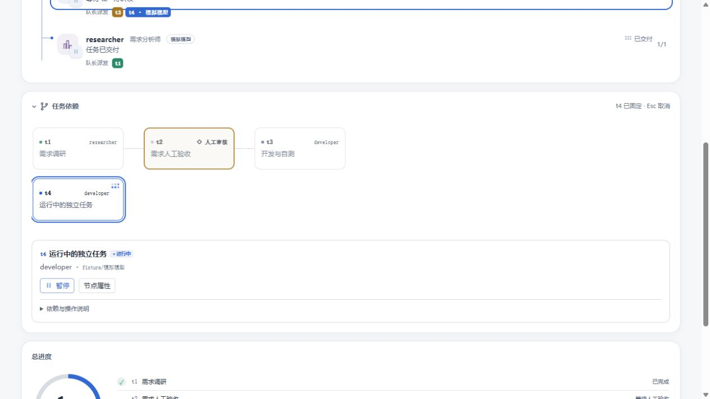
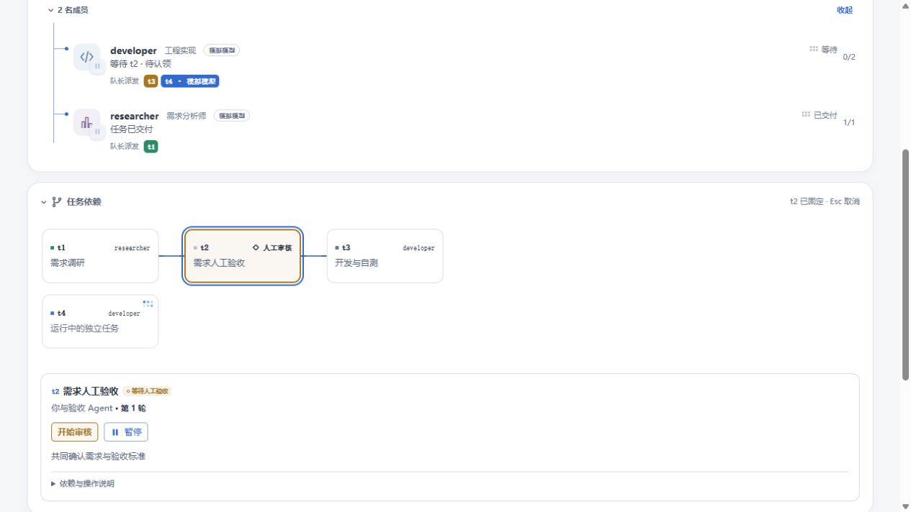
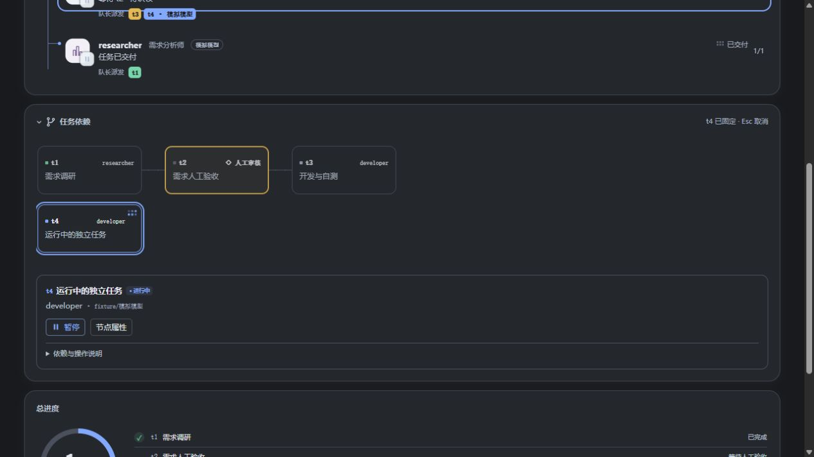

# 状态配色与任务详情打磨

沿用紧凑卡片、小圆点入口和运行小动画，调整视觉层级：

- 活动面板普通等待使用中性色；执行与选中使用蓝色；真正等待人工验收的节点使用橙色；完成使用淡绿色标记，失败使用淡红色标记。未就绪人工节点保留菱形与虚线轮廓。
- 选中节点后，无关卡片不透明度由 0.3 提高至 0.78，运行分支为 0.9；弱化连线保留 0.65。选中节点增加清晰描边。
- 任务详情保留完整任务名称，先展示状态、负责人／模型及操作；移除重复状态文字。任务要求提供两行预览，依赖与操作说明可展开。待验收时优先排列「开始审核」。旧验收成果失效仍使用警示色。
- 画布采用相同状态语义，普通节点顶部不再全部使用蓝色。

验证：服务端与客户端 TypeScript 编译、打包、27 项已有相关测试及项目 verify 检查通过。实际组件模拟预览检查浅色／深色模式、选中独立运行分支后的其他节点可读性、人工审核操作层级。未调用真实模型，未更新用户已安装插件。

