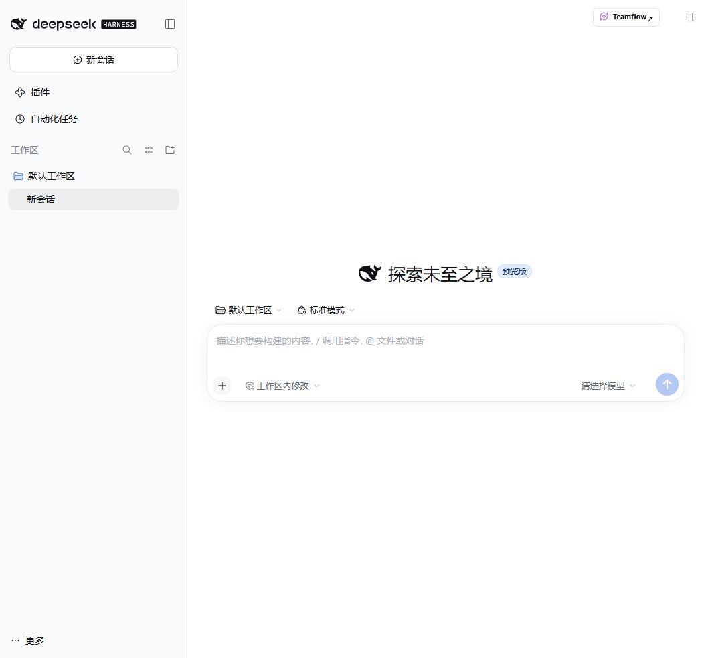
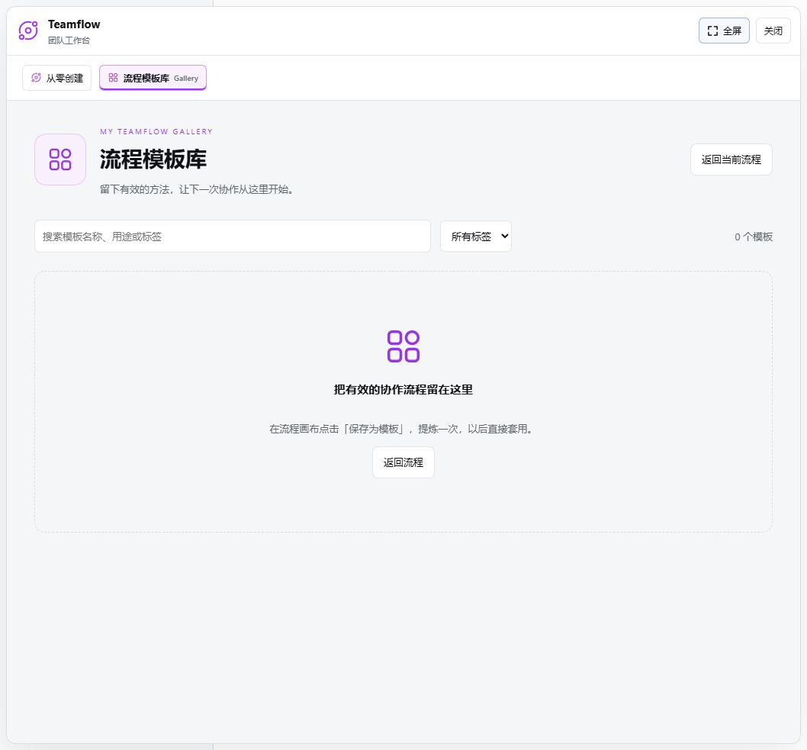

# 新会话入口修复实测

2026-10-30，本地 Windows，真实 Harness Web 0.2.1-rc.2，隔离 profile，Teamflow 0.2.1。未调用模型 API。

根因：ConversationSessionHeader 在 hideChrome 为 true 时不渲染 conversation.session.header.actions；空白新会话正是这个状态。此前预览直接挂载插件组件，没有经过宿主头部。

修复：空白会话通过官方 additive shell.overlay 提供右上角入口；正常会话继续使用 header.actions。入口注册不再等待可选右侧栏服务，不替换宿主右侧栏按钮。非对话页面不显示空白会话入口。

已验证：新会话未发消息时显示 Teamflow；点击直接打开 Gallery。实际界面截图如下。

回归命令：node --test scripts/blank-session-entry.test.mjs scripts/client-harness-migration.test.mjs

远程服务器需更新实际安装的插件，并完整重启 dsh web、强制刷新浏览器。此报告未直接访问远程服务器，也不代表所有宿主版本均已实测。
