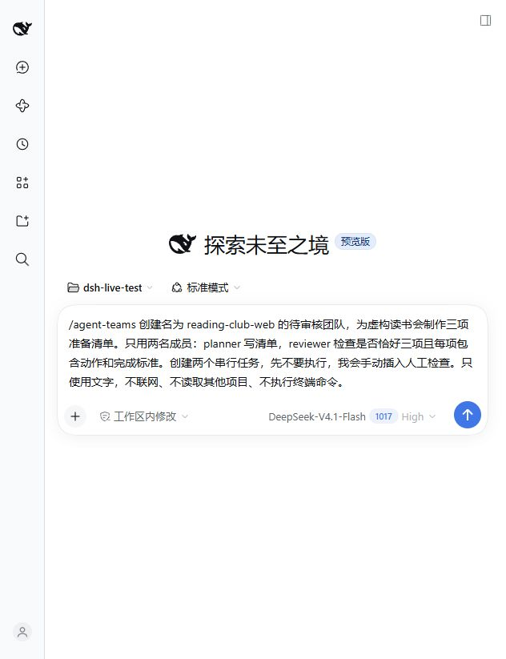
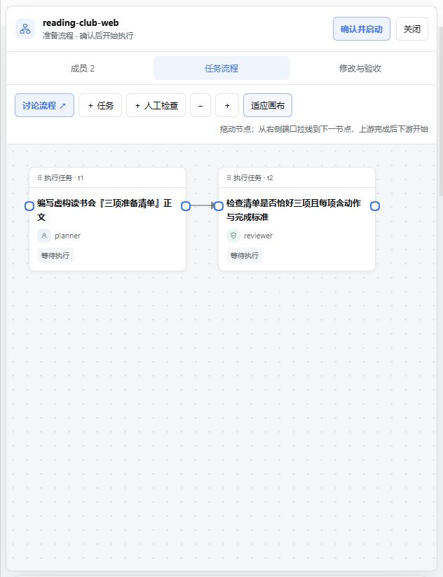
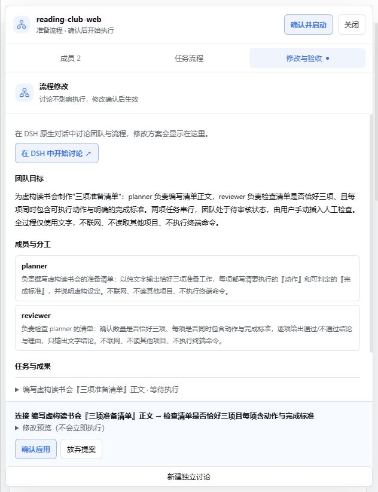
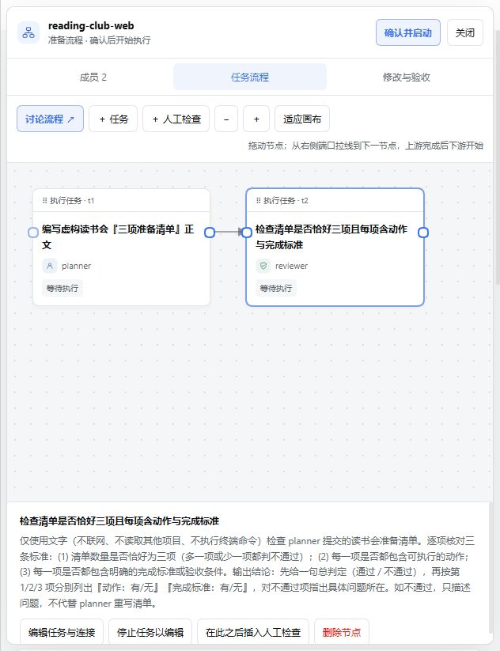

# 本机 DSH Web 截图与操作说明

测试日期：2026-10-27。本次在真实 DSH Web 宿主中调出了本 fork 的界面，使用真实 DeepSeek 模型建立团队，并操作了流程连线。用户确认界面已成功显示后，停止继续测试。

完整的配置讨论、人工验收、退回返工和第二轮通过步骤，见此前已提交的 [桌面实测流程（15 张截图）](../desktop-live-test-2026-10-27/README.md)。这些后续流程没有在本次 Web 测试中重复完成。

## 环境与打开方式

| 项目 | 实测值 |
| --- | --- |
| 宿主 | 官方桌面安装附带的 CLI，`0.2.1-rc.3`，以 Web 方式启动 |
| Profile | `web` |
| 浏览器地址 | `http://127.0.0.1:8372/` |
| 模型 | DeepSeek-V4.1-Flash · 1017 · High |
| 插件来源 | 本 fork 的 `desktop-live-final.tgz`，与桌面实测最终代码一致 |
| 浏览器视口 | 632 × 823，窄窗口布局 |
| UI 中选择的测试工作区 | `G:\dsh_agents\node_modules\dsh-live-test` |
| 新建团队 | `reading-club-web`，与桌面测试团队分开 |

本次使用以下本机命令安装并启动；在其他电脑上应替换安装路径和 tarball 路径。tarball 的生成及其他安装方式见 [中文 README](../../README_ZH.md#卸载旧版并安装本分支)。

```powershell
& 'C:\Apps\DeepSeek Harness\resources\runtime\cli\bin\dsh.cmd' plugin --profile web add --save-exact 'G:\dsh_agents\node_modules\workflow-results\desktop-live-final.tgz'
& 'C:\Apps\DeepSeek Harness\resources\runtime\cli\bin\dsh.cmd' --profile web --host 127.0.0.1 --port 8372 --no-open
```

启动后打开终端打印的本机认证链接。直接输入根地址可能显示需要认证；认证成功后地址恢复为根路径。认证链接不要分享或提交到 Git。

`8372` 是这次真实 Web 服务，`8371` 是此前的开发预览。安装插件所用 profile 必须与启动 Web 所用 profile 一致；本机验证不能证明另一台电脑已经安装了相同来源。

## 1. 在原生对话中创建初步团队

选好测试工作区和模型后发送：

```text
/agent-teams 创建名为 reading-club-web 的待审核团队，为虚构读书会制作三项准备清单。只用两名成员：planner 写清单，reviewer 检查是否恰好三项且每项包含动作和完成标准。创建两个串行任务，先不要执行，我会手动插入人工检查。只使用文字，不联网、不读取其他项目、不执行终端命令。
```



模型实际创建了两名成员、各自的 Summary 和两个串行任务：planner 编写清单，reviewer 检查清单。团队保留在待审核状态，尚未启动执行。

## 2. 打开任务流程画布

从团队面板打开画布，在「成员」「任务流程」「修改与验收」之间切换。窄窗口下工作台占据主视区。



连线表示执行依赖：第二个任务等待第一个任务完成，不是仅建立通信通道。

## 3. 拖拽连线并确认应用

本次先通过「编辑任务与连接」移除第二个任务的上游依赖并确认，再从第一个节点的输出端拖到第二个节点的输入端。界面生成连接修改提案；检查后点击「确认应用」，恢复 `t1 → t2`。



随后尝试反向连接，界面没有生成新提案。下图仅记录操作后图仍保持原连接；没有截取到明确的错误提示，不能把它当作错误提示交互的验证截图。



## 已验证范围与停止位置

- 已完成：真实 Web 启动及认证、真实模型建队、新工作台显示、成员 Summary 生成、窄窗口画布、移除依赖、拖拽生成连接提案、确认后保存依赖。
- 最后读取持久化团队状态：`phase=staged`，两个任务均为 `pending`，`t1` 无依赖、`t2` 依赖 `t1`。
- 停止位置：已打开添加人工检查的编辑入口，未提交检查点，未启动团队。
- 本次未验证：Web 中的配置讨论修改、人工验收及返工、下游执行、刷新恢复、宽窗口布局和其他电脑上的安装。完整桌面流程请看前述桌面报告。

本次只增加截图与说明，没有修改插件代码。
