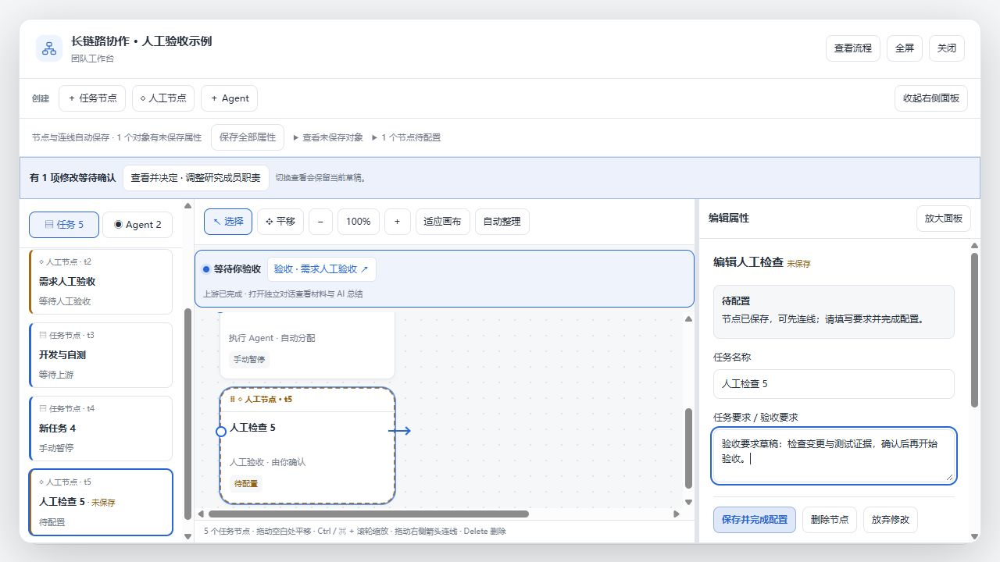
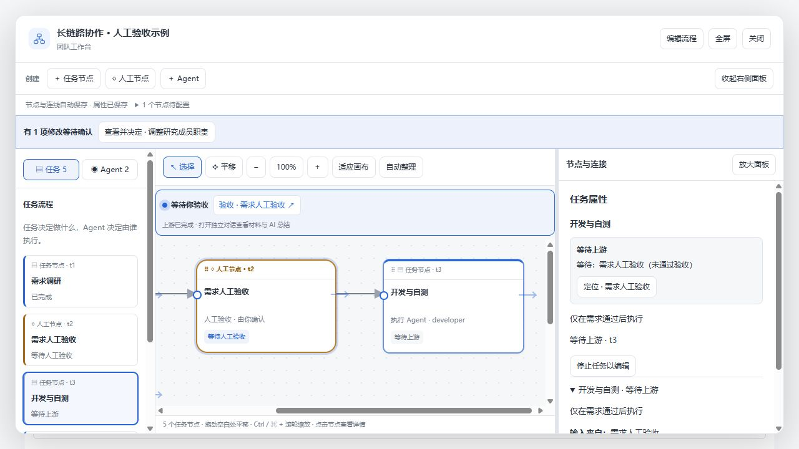

# 工作台草稿、配置与执行条件

本轮补充四项交互改进，未新增执行阶段 DAG 检查。

## 草稿保护与保存反馈

- 属性草稿按会话、团队和对象分别备份到当前标签页的 `sessionStorage`；讨论输入按独立讨论备份。切换、关闭工作台、Esc 退出编辑和刷新可恢复。关闭整个标签页后不保证保留，不跨设备同步。
- Esc 保留属性草稿；「放弃修改」只清除当前属性草稿。存储不可用时显示提示，并在有未备份修改时提示离开风险。
- 顶部展示保存中、保存失败、未保存对象数量与定位入口。「保存全部属性」一次提交全部可保存修改；冲突、已开始任务或待确认重跑设置会阻止整批提交，保留草稿供逐项处理。
- 保存期间的新输入继续保留。新 Agent 创建期间输入的后续修改转移到创建后的 Agent 身份，避免重复创建。讨论发送成功只清理本次发送的文本，不清空发送期间的新输入。

## 节点配置与等待原因

- 画布新建任务／人工节点立即保存并标记「待配置」，空内容也能连线。批量保存属性不会解除该状态。
- 「保存并完成配置」要求名称和任务／验收要求非空。待启动团队随后可以确认启动；运行中的团队保持节点暂停，需再明确确认执行或验收。
- 服务端持久化、调度器、任务领取、团队启动、恢复执行和人工验收入口均识别待配置状态，避免只靠前端按钮限制。
- 属性顶部显示具体等待原因；遇到上游阻塞，可点击「定位」选中并滚动到对应节点。调度说明基于已保存状态，不推断宿主实时会话可用性。

## 验证

- 服务端和客户端 TypeScript 构建、客户端打包及 Git 构建产物一致性检查通过。
- `node --test scripts/workflow.test.mjs scripts/workbench-usability.test.mjs scripts/proposal-review.test.mjs scripts/workspace-summary.test.mjs`：64 项通过。
- `node scripts/verify.mjs`、`node scripts/lifecycle-verify.mjs`、`node scripts/fallback-tdd.mjs` 通过。Windows 沙箱临时目录的归档重命名受到限制，相关检查在正常临时目录重跑通过。
- 浏览器使用实际 React 界面和工作流修改逻辑：验证草稿 Esc 保留、刷新恢复、批量保存不解除配置状态、完成配置后保持暂停、上游定位、人工节点不提前进入验收、延迟发送时保留后续输入。浏览器控制台无错误。
- 截图来自本地开发预览，模型响应和执行结果为模拟数据；未在用户真实 DSH 会话中触发模型执行或发布 npm 版本。
